# AI Usage Tracker

**Your Claude Code, Codex, Antigravity and OpenCode usage, cost, and plan limits, on your own computer.**

A private app for Windows, macOS, and Linux that reads the usage logs your AI tools already write, keeps its own archive, and shows tokens, API-equivalent cost, and live limit percentages. No account, no cloud, no telemetry.

[](../../releases/latest)

   [](LICENSE)

[Features](#features) · [Install](#install) · [Privacy](#privacy) · [How it works](#how-it-works) · [Build from source](#build-from-source) · [Türkçe](README.tr.md)

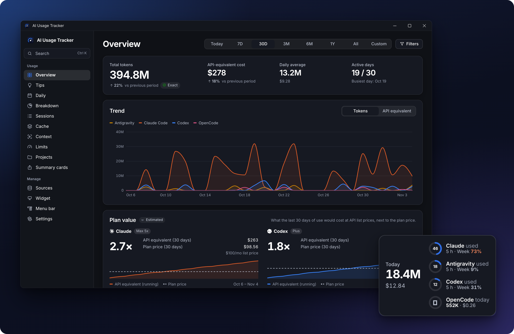

- **Private by design.** Prompts and responses never enter the app's archive. Only counts and metadata are kept, in a local SQLite file, and your usage data never leaves the computer.
- **Know where every number comes from.** Every figure is labeled: **Exact** from the tool's own log, **Estimated** by the app, or **Captured** live. Nothing is guessed silently.
- **Stay ahead of your limits.** Five-hour and weekly percentages for Claude, Codex and Antigravity are read every few minutes, with a forecast of when each window fills and a notification before it does.

## What sets it apart

- **Track your limits without spending quota.** Your five-hour and weekly percentages come from the official interfaces of Claude Code, Codex and the Antigravity CLI, without a single model request.
- **Install what you need in one click.** If a limit read needs Claude Code, the Codex CLI or the Antigravity CLI, the app installs it with its maker's own installer, and shows step by step how to sign in when that is missing.
- **See when your limit may run out.** The forecast uses your average pace since the window started, so a short burst of work is not projected across the whole window.
- **See what a limit window is worth in API terms.** From the windows it has watched to their end, the app estimates how much API-equivalent use a whole five-hour or weekly window holds.
- **Find the plan that fits your use.** A bigger plan is suggested when your limits keep filling, and a smaller one only when the provider publishes the ratio between plans.
- **Compare what the same work would cost on other models.** Your requests are repriced on every model in the price list, with the same token counts and prompt sizes.
- **See what subagents and tools cost you.** You see how much of your cost comes from subagents and how often each tool's calls fail.
- **Measure what the cache saves you.** You see the hit rate, the net savings, what it cost when the cache had to be written again after a long pause, and why Claude Code says it had to.
- **Keep a conversation's cache from running out.** Each Claude Code conversation's cache shows its time left on the **Cache** page, in the widget, the menu bar and the control panel, and Claude Code's own status line can show when it is dropped. Refresh it with one click, or let the app do it shortly before it runs out, for the price of one cache read instead of writing it again.
- **Pick up where a limit stopped you.** When the usage limit stops a Claude Code conversation, the app continues it by itself once the limit resets, so work cut off overnight goes on without you.
- **Keep your history.** Resumed and forked sessions are never counted twice, and your history stays in the archive even after the tools delete their own logs (Claude Code does so after 30 days).
- **Share your use, not your work.** Turn a day, a week, a month or a year into a card in four sizes. A card holds totals, tool names and model names only.


## Features

### Limits that stay current

The app reads the five-hour and weekly limit percentages through the tools' own interfaces (Claude Code, Codex and the Antigravity CLI), so the numbers match what the tools show. Each window gets a forecast at its average pace, and each project gets an estimated share of it.

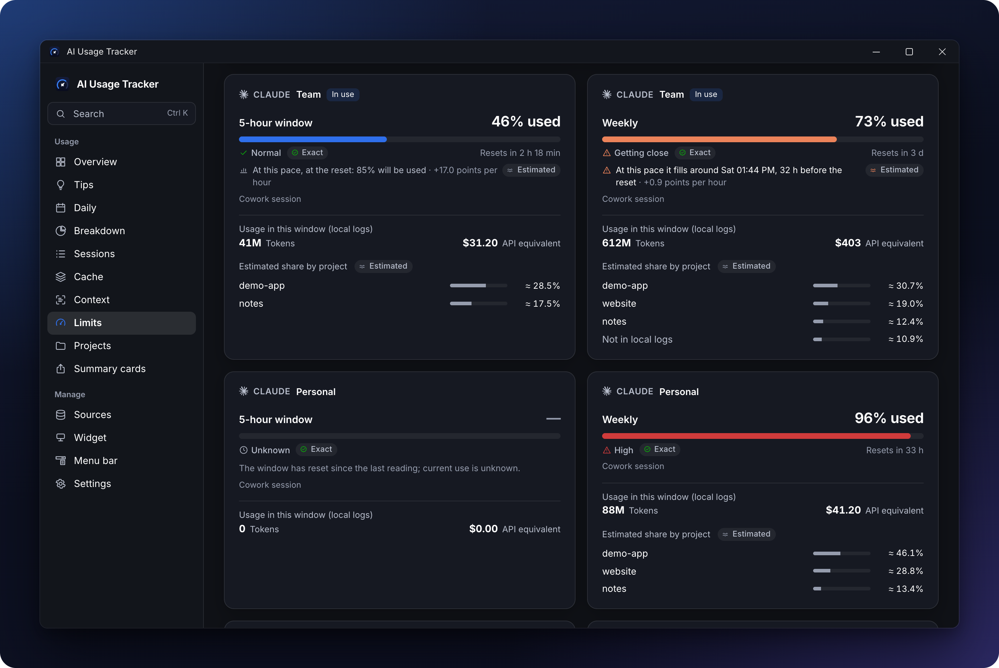

Providers publish how their limits work, not the numbers themselves. The app therefore follows these rules:

- A real percentage appears only when a tool writes one locally or the app reads it live (see [Live capture](#live-capture)).
- If the tool was used after the newest reading, the current value is unknown. It is shown as "?" with the last reading and its age, never as the current value. The panel and the menu bar text mark that last reading with "~": it is usually lower than the current value, but higher if the provider reset your limit in between.
- While a weekly limit is full, its five-hour limit shows a lock and **week full** instead of a percentage, because none of it can be used until the week resets. The menu bar icon then shows that limit as full. Claude's Opus and Sonnet weeks lock nothing, since other models stay free.
- Percentages can read as **used** (as Claude shows them, "15 % used") or **left** (as Codex shows them, "85 % left"). Switch between them in **Settings**, on the **Limits** page, or in the **Widget studio**. Warning colors follow usage either way, at the **Caution** and **Critical** levels set in the **Widget studio** (70% and 90% by default), in the app as in the widget, the panel and the menu bar.
- Without a real reading, you can set your own budget per window. The resulting percentage is labeled **Estimated**.
- Limits are account-wide. Each rise of the percentage is split among the projects that sent requests meanwhile, by API-equivalent cost. Use from elsewhere (the web, a phone, cloud tasks, another computer) is not charged to your projects; it shows separately as **Not in local logs**. With several Claude or Codex accounts, requests no evidence ties to an account get a share of their own, **Unidentified account**, and a reading taken before them is not shown as current. These shares are always **Estimated**.
- Each tool is marked with its own monochrome icon. Under **Settings → General → Tool colors** you can give Claude, Codex, and Antigravity their own color for limit bars and widget rings, and color the icons too if you like. Warning colors still show when a limit gets close. If you prefer plain names, turn the icons off under **Settings → General → Show tool icons**.

**More than one Codex account.** If you switch between Codex accounts, each account gets its own limits, history, and forecast. Codex does not record which account sent each request, so the app ties every request to its account by the limit window the request reports. It learns the account from what Codex does name: the account that started a session (for the requests sent right after) and the signed-in account in the Codex limit read (Codex 0.163 and later). Early resets, including resets the provider grants, are told apart from an account switch. If a reset for everyone makes two accounts' windows start together, that window is given to neither. Requests without such evidence are never guessed; they stay under **Unidentified account**. The widget, panel, and menu bar show the account in use, and you can add your other accounts beside it: in the **Widget studio**, or from the item lists on the **Menu bar** page. The **Limits** page shows every account, and you can name each one and choose its plan there. Usage can also be filtered by account. With a single account, nothing changes.

**More than one Claude account.** Claude's limits belong to your plan's organization, so each Claude account gets its own limits, history, and forecast, and a Team plan you use with the same login counts as its own account. Claude Code does not record which account sent each request, so the app learns it only from what shows it for certain: the request's own telemetry event while the local telemetry receiver is on, and the Claude desktop app's account for the sessions it runs in its Code tab. Without telemetry, a terminal session counts for an account only if its Claude config folder was signed in to that one account all the time the app watched it (the app checks every 30 seconds while it runs), as with one `CLAUDE_CONFIG_DIR` per account. A running Claude Code keeps the sign-in it loaded for a while after you `/login` elsewhere, and its log does not say when a session started, so if you switch accounts in the same folder, turn on the local telemetry receiver. Otherwise those requests are not guessed; they stay under **Unidentified account**, as do requests from before the app watched the sign-in. The app's own limit read counts for the account Claude Code was signed in to, and the desktop app's usage history for the desktop app's account. If your folders are signed in to different accounts at the same time, the account in use is the one the app reads limits with. If the app knows one Claude account and your weekly window starts again days before it was due to end, the **Limits** page says so and shows how to make the other account visible. The **Limits** page, the usage filter, the widget, the panel, and the menu bar work as for Codex. With a single account, nothing changes.

**Account suggestion.** With more than one Claude or Codex account, the **Limits** page names the account to continue with when the one in use is full, or when another has at least 25 points more room. Room is what is left of an account's fuller window (five-hour or weekly), and a week that started again since its last reading counts as empty. Only real readings count: an account without a current reading is never suggested, and nothing is suggested while the account in use has none. When a limit fills up, its notification names that account too. **Settings → General → Account suggestion** turns it on or off, and the choices under it pick the **Limits** page, the notification, or both.

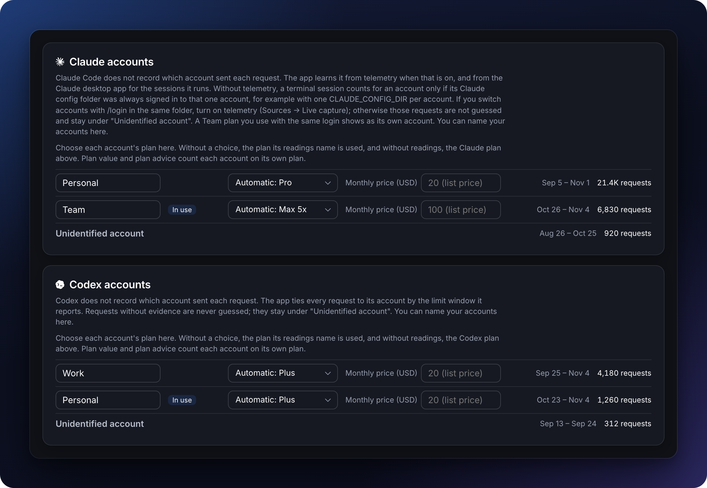

**Forecast.** Every current limit reading carries a forecast based on the window's **average pace since it started** (current % ÷ time since the window began). Every window starts at 0 % when it resets, so this pace is known and already includes idle hours: a burst of work is not extrapolated as if it never stopped. The app then says when the window would fill ("fills around Sun 21:12, 9 h before the reset") or where it would stand at the reset. If the provider resets a window early without moving its end, the pace is measured from that reset. No forecast is made in the first tenth of a window, and every forecast is labeled **Estimated**.

**Notifications.** A system notification tells you when a limit you use passes your warning threshold, when it fills up, and when a full limit starts again. It shows when the limit resets and, at your current pace, roughly when it fills. In **Settings → Notifications**, choose an early warning at the **Caution** or **Critical** threshold or none, whether to hear when a limit fills up and when it resets, and which limits (5-hour, weekly) notify you. macOS asks once whether the app may send notifications. Opening the app never reports what happened while it was closed. Click a notification to open the **Limits** page. To check that notifications show on this computer, use **Settings → Notifications → Test notification**. On Windows, notifications go through the app's Start menu shortcut, so keep it.

**Sign-in notifications.** When Claude Code, the Codex CLI or the Antigravity CLI is signed out and your limits cannot be read, a notification tells you once, even right after the app opens. Click it to see how to sign in. Other reasons a read fails, such as no network or an API key, never count as a sign-out and show under **Sources → Live capture** instead. Turn this off with **Settings → Notifications → When you need to sign in**.

**Continue after a limit resets.** When the usage limit stops a Claude Code conversation in the middle of its work, the app can continue it by itself once the limit resets: turn on **Continue after a limit resets** on the **Limits** page. The app asks before it adds a small hook to your Claude Code settings (`~/.claude/settings.json`); it runs when the usage limit stops a reply, when you send a prompt and when a conversation ends, and turning the switch off removes it. From then on the hook waits in a conversation the limit stopped. The app takes the reset time from what Claude Code itself recorded when the limit turned the request down, and a minute after the reset the conversation gets one automatic message that tells it to continue from where it stopped. The card lists the conversations that wait, with the limit that stopped each and the time each continues, and those continued in the last day; **Don't continue** calls one off.

- The conversation must stay open and the computer awake. If the computer sleeps through the reset, the conversation continues when it wakes.
- A continued conversation runs with its own permission setting, so one that asks before it uses a tool waits at its first question. Its work counts against your plan like any other.
- Writing in the conversation yourself, or closing it, ends the wait.
- A cache refresh that the limit turns down stopped no work, so it is not continued.
- On Windows, updating the app can end the waits; a conversation the limit stopped before the update is then not continued.
- If a limit stops it again (the weekly one after the 5-hour one, for example), it waits for that reset. A conversation is continued at most once in 15 minutes and six times in a day.
- The reset time is never guessed: without Claude Code's own record of it, which needs Claude Code among your sources, the conversation stays as it is and the card says the time is not known.
- A notification tells you when a conversation was continued; turn it off with **Settings → Notifications → When a conversation the limit stopped is continued**.
- It needs a Claude Code version that runs a hook when the limit stops a reply (tested with 2.1.322).

### Limit history

The **History** tab on the **Limits** page lists every five-hour and weekly window your readings cover. From those windows, the app estimates what a whole window is worth in API terms.

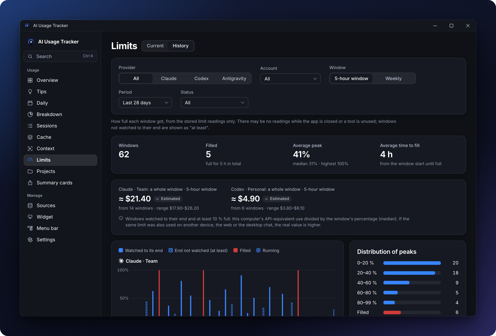

For each window, it shows how full it got, whether it filled, how long it took to fill and how long it stayed full, whether it was watched to its end, and this computer's use inside it (tokens and API-equivalent cost). A window whose end was not watched is shown hatched, as "at least" its highest reading.

- **Filters:** provider, account (with more than one Codex or Claude account), window (five-hour or weekly), period (7 days to all), and status (filled, 80 % and above, or watched to their end).
- **Summary:** the number of windows, how many filled and for how long in total, the average and median peak, the average time to fill, and the distribution of peaks.
- **A whole window in API terms** (an estimate): this computer's API-equivalent use up to the window's highest reading, divided by that percentage. The figure is the median over windows watched to their end and at least 10 % full, shown with its range. If the limit was also used on another device, on the web, or in the desktop chat, the real value is higher.
- **Table:** every window, sortable by start, peak, time to fill, or local use.

### Tips and plan advice

The **Tips** page turns your own records into findings, each with the figures it rests on, what helps, and how it was calculated. Its plan recommendation tells you when your limits keep filling and suggests a smaller plan only when the published ratios back it up.

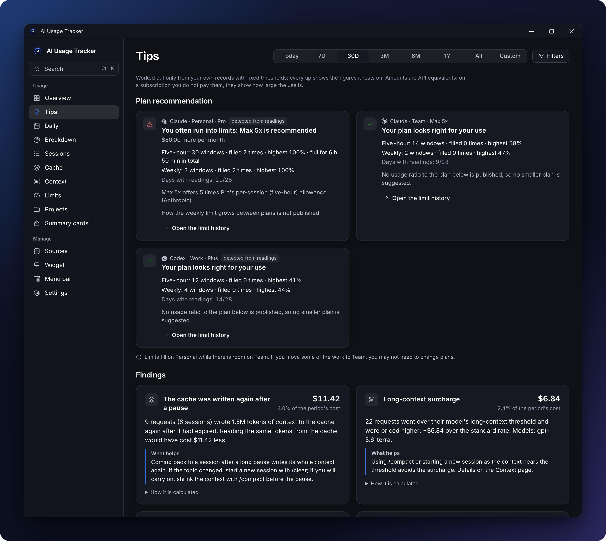

**Plan recommendation.** It covers the last 28 days and rests only on those measurements and on what the providers publish:

- **Limits filled** (a weekly window once, or five-hour windows three times): the next plan up, with its price difference and the published ratio. On Claude, Max 5x and Max 20x give 5 and 20 times Pro's per-session allowance. On ChatGPT, Pro has no five-hour limit. How the weekly limit scales between plans is not published, and the card says so.
- **A smaller plan:** suggested only where the per-session ratio is published (Claude), after 14 days of readings with at least two weekly and five five-hour windows watched to their end, and only if every window would have stayed under 80 % on the plan below. The weekly part is stated as a condition ("if the weekly allowance scales the same way"), never as a fact. OpenAI publishes no ratio between its plans, so no smaller plan is suggested for ChatGPT.
- **Fewer than 7 days of readings:** no recommendation of any kind.

Claude's readings say only "max" for both Max plans, so choose your plan on the **Limits** page. Claude windows read on another plan (Pro against Max) are left out. Codex readings name the plan exactly and are used when none is chosen.

With more than one Codex or Claude account, each account gets its own recommendation, built on its own windows and its own plan. Choose each account's plan on the **Limits** page. An account without one takes the plan its readings name. Claude's readings do not tell Max 5x from Max 20x, so a Max account takes the Max plan you chose for Claude, or asks you to choose; it also asks when the readings name a plan the list does not have. An account without readings takes the plan you chose for the provider. If one account keeps filling its limits while another has room, the **Tips** page says so.

**Tips.** Every rule has a fixed threshold, and an amount must be at least $0.50 and 1 % of the period's cost. The rules look for:

- the cache written again after a long pause. Claude deletes cached content that goes unused for a while (5 minutes or 1 hour), so returning to the same conversation after a break writes it again at a higher price. The app shows that difference against what reading the same content from the cache would have cost. Only content that was already cached counts; what you newly add to the conversation does not
- long-context, fast-mode, and data-residency surcharges, priced against the same requests at the standard rate
- most of the cost coming from requests with more than 100K tokens of context
- tools whose calls return an error 25 % of the time or more (at least 20 calls with a known outcome)

Amounts are API equivalents. On a subscription you do not pay them; they show the size of your use.

**Plan value.** The **Overview** compares each provider's API-equivalent use over the last 30 days with the plan price for those days ("4.7×"), shows a running total against the plan price, and marks the day the plan paid for itself. Tools you have not used in those 30 days are left out.

- **List prices** come from [`config/plans.json`](config/plans.json), verified on 2026-10-02 against the official pages ([Claude](https://claude.com/pricing), [ChatGPT](https://learn.chatgpt.com/docs/pricing)).
- **Your price:** plans without a fixed price (ChatGPT Pro, Enterprise) ask for one, and you can override any plan's price on the **Limits** page (e.g., for annual billing).
- **More than one account:** each Codex or Claude account seen in those 30 days counts with its own plan and price, and their prices are added up. The card lists each account's API-equivalent use next to its plan. Use on a free plan or at API rates is left out of the total, and use that no evidence ties to an account counts only toward the total. A price you enter for an account applies to that account's current plan only.
- **Billing period:** enter the day your subscription renews on the **Limits** page, for the provider or for each account. The card then compares your use since the last renewal with the full monthly price, shows how far into the period you are, and how much use is left to reach the plan price. With several accounts, each needs a renewal day (its own or the provider's) and counts from its own renewal; use that no evidence ties to an account counts from the latest one.
- **Lower bound:** chat use in Claude and ChatGPT is not in local logs, so the real value can be higher.

**Monthly budget.** Set a monthly limit for the API-equivalent cost of every tool in **Settings → Monthly budget**. The **Overview** then shows this month's spend against the budget, the days remaining and, after the first days of the month, where you are heading at this pace. A notification tells you when you reach 80% of the budget and when you go over it; turn it off in **Settings → Notifications**.

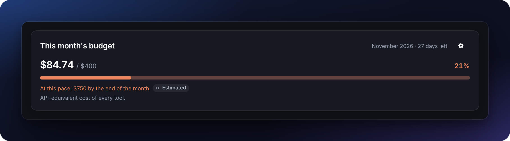

### Day by day

The **Daily** page shows the period day by day, as columns or, for long periods, as a calendar, in tokens, API-equivalent cost, or requests. It highlights the busiest day, the average per active day, the longest and current streaks of active days, and the weekend share.

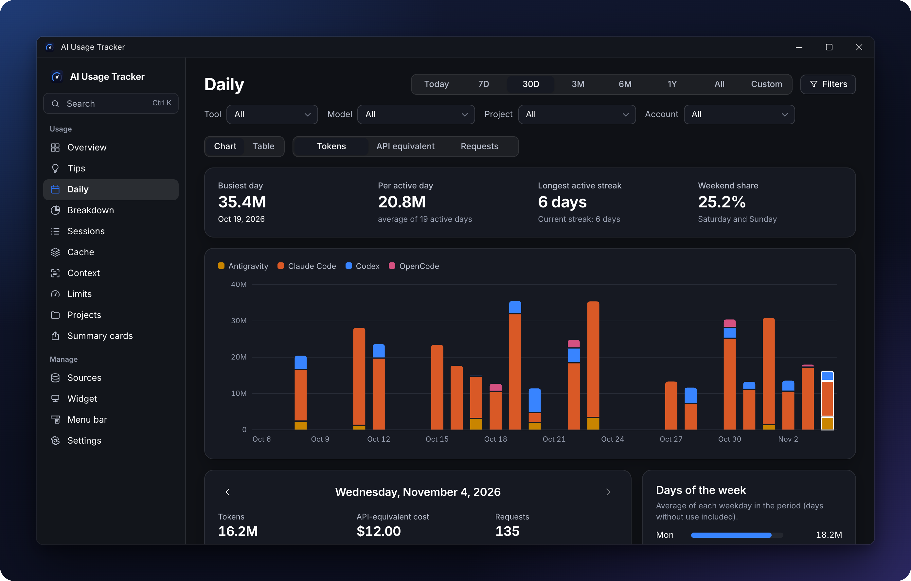

Pick a day, or step through the active days, to see it in detail:

- tokens, cost, requests, and sessions
- first and last activity, and the cache hit rate
- an hour-by-hour chart
- the day's tools, models, and projects
- the day's highest limit readings

Next to it are the average for each weekday and the busiest days.

### What would another model cost?

On the **Breakdown** page, the period's priced requests are repriced on every model in the price list, with the same token counts and prompt sizes, and listed cheapest first against the actual cost.

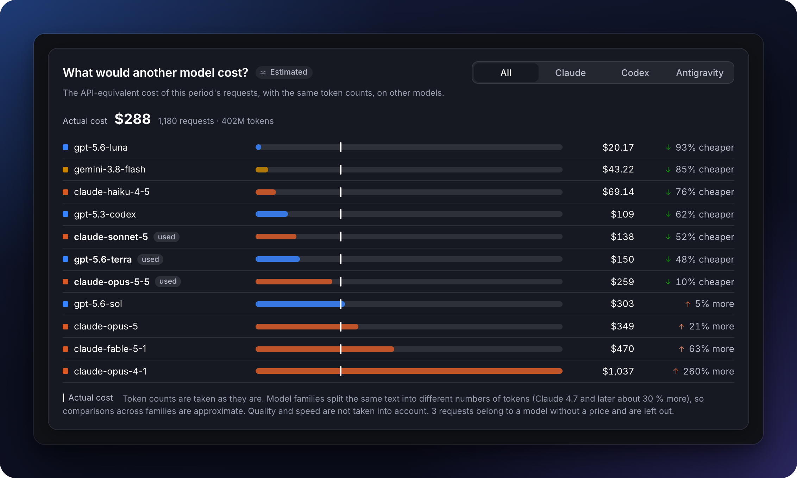

Model families tokenize the same text differently (Claude 4.7 and later use about 30 % more tokens), so comparisons across families are approximate. Quality and speed are not taken into account.

### Subagents and tools

The **Breakdown** page puts subagent costs next to the main conversation and lists the tools the agents call and how often those calls fail.

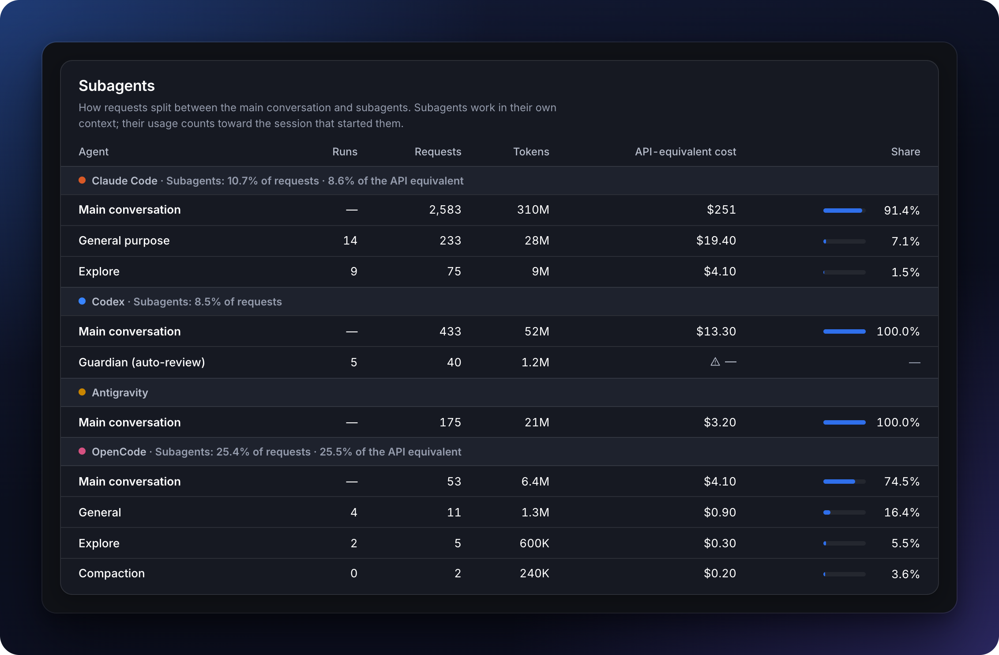

- **Subagents:** the requests, tokens, and API-equivalent cost of subagents (Claude Code agents such as Explore, Codex's guardian auto-review, and others) next to the main conversation. A subagent's usage counts toward the session that started it.
- **Tool use:** how often each tool was called and how many calls returned an error, as the tool itself records the result. MCP tools are grouped by server. Only the tool's name and outcome are stored, never its input or output.

### Explore sessions, cache, context, and projects

Four more pages cover sessions, cache, context, and projects.

| 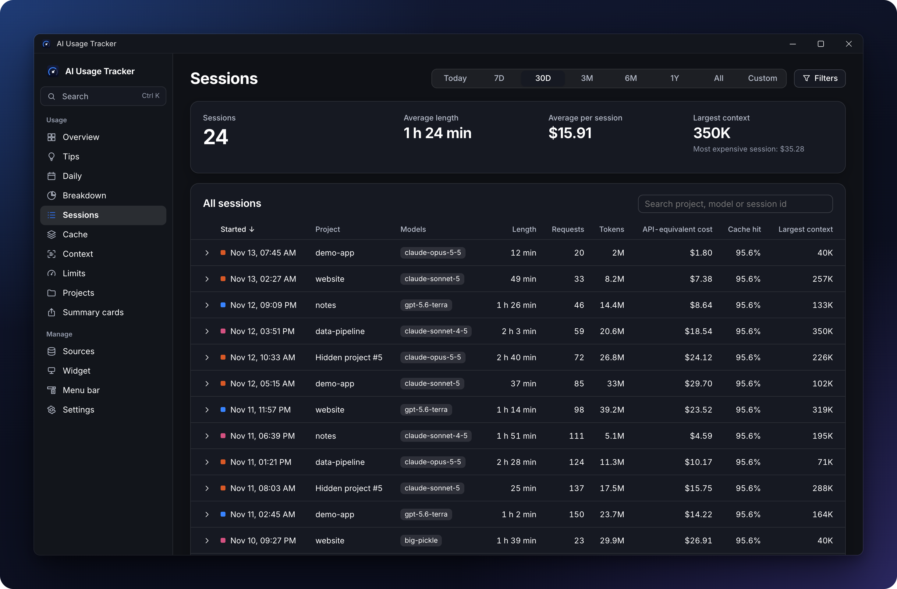 | 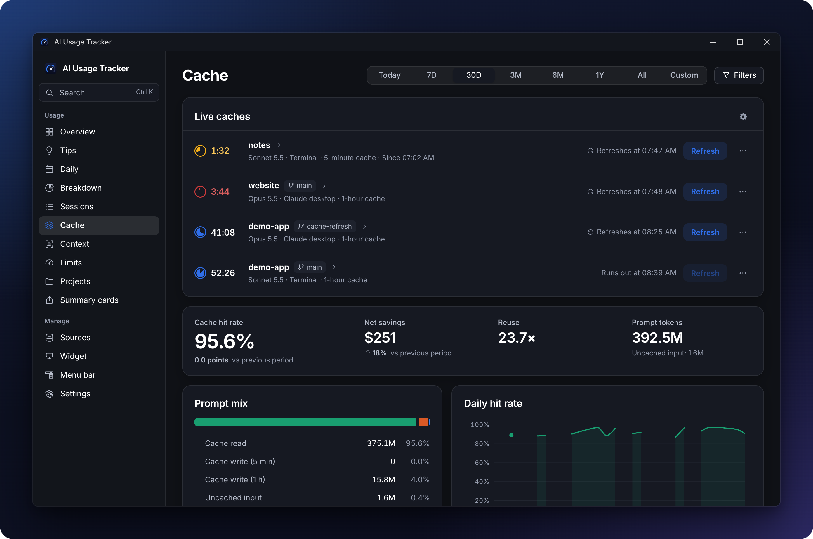 |
|---|---|
| **Sessions**: every session with its length, models, cost, and largest context | **Cache**: each conversation's cache time left, the hit rate, reuse, and what the cache actually saved |

**Sessions.** The **Sessions** page lists every session in the period with its start, project, models, length (first to last request), requests, tokens, API-equivalent cost, cache hit rate, and largest context. The list is sortable and searchable, and each row opens into a panel with the session's tokens, average context, cache hit rate, models, tool and session ID, and a **timeline** of the session. The timeline shows each request as a column with its context size and how much of it came from the cache, and marks where the cache was written again after a pause, where the context shrank, which requests came from subagents and which tools were called. Subagents that work at the same time share one mark that says how many there were, and a long pause shows its length under the gap. Subagent transcripts count toward their parent session.

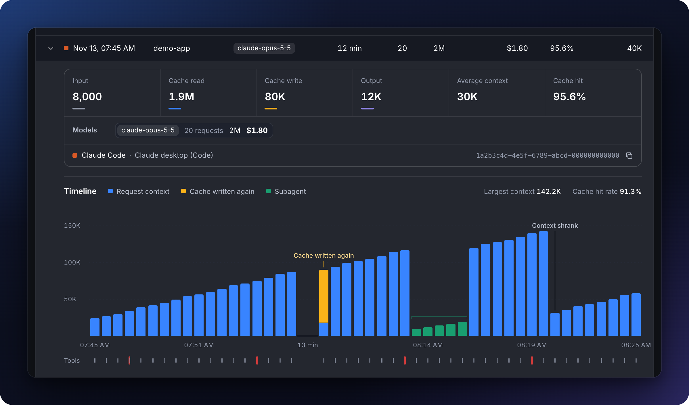

**Cache.** The **Cache** page shows:

- hit rate (cache read ÷ prompt tokens)
- reuse (read ÷ write) for Claude and for Codex models whose logs record cache writes; older Codex logs record reads only and are left out
- the 5-minute vs. 1-hour write split
- the daily hit rate
- breakdowns by model, tool, and project
- **net savings**: what cache reads saved compared with the full input price, minus the write premium, with each request priced at its own model's rates

Negative savings mean that written cache was not read enough to pay off.

**Cache time left.** Claude deletes cached content that goes unused for 5 minutes or an hour, so each Claude Code conversation's cache has its own time left. The top of the **Cache** page lists every conversation whose cache still lasts: the project, its branch, the model, where it runs (terminal or the Claude desktop app), and a countdown with a small pie that empties as the time runs out. Click a row to see how many tokens are in the cache, what reading it once costs against writing it again, and when the conversation began. The widget shows the conversation whose cache runs out first ("notes 1:34 +3"), and the tray icon shows it in minutes: next to the icon on macOS and Linux, and in its tooltip on Windows and macOS. Claude Code's own status line can end with the time the conversation's cache is dropped (`cache until 14:32`); it needs the status-line bridge under [Live capture](#live-capture), and shows a time of day instead of a countdown because Claude Code redraws the line only when the conversation changes. Continue before it runs out and the next request reads the cache at the cheap price instead of writing it again. The time runs from the conversation's last request, with the 5-minute lifetime if the conversation wrote any 5-minute cache, else the 1-hour one. **Settings → General → Cache time left** turns it on or off. The choices under it pick the widget, the menu bar, the Claude Code status line (off at first), and a notification shortly before each conversation's cache runs out (1 minute ahead for a 5-minute cache, 5 minutes for a 1-hour one), and whether to follow every project or only those you pick. To stop following one conversation until the app restarts, choose **Stop following** in its row's menu. The notification is off at first, since a 5-minute cache would notify on every short pause. Click the notification to open the **Cache** page.

**Cache refresh.** On the **Cache** page, **Refresh** next to a conversation wakes it for one short turn while it waits for you: Claude Code reads the cache, which starts its time again, and the conversation shows "Stop hook feedback" followed by "Cache refreshed." The first time, the app asks before it adds a small hook to your Claude Code settings (`~/.claude/settings.json`); it runs when Claude Code finishes a reply, when you send a prompt and when a conversation ends. Nothing else there changes, and **Settings → General → Cache time left → Remove** takes the hook out again and turns automatic refresh off. A conversation can be refreshed once Claude Code has finished a reply in it after the hook was added; one whose reply is still under way, or that is closed, cannot. **Refresh automatically** does it shortly before a cache runs out: 1, 2 or 5 minutes ahead for an hour's cache, in the last minute of a 5-minute one. A conversation's automatic refreshes stop once together they would cost more than writing its cache again, and start again when you write in it. You can also switch them for one conversation in its row's menu, refresh from the control panel's Live caches tile, and refresh from the notification shortly before a cache runs out. Each refresh counts against your plan like one cache read, and the **Cache** page shows today's refreshes with their API-equivalent cost. A refresh after which the cache's time does not move on is not counted and shows as "Not refreshed" on its row. Your own Stop hooks, such as a notification sound, run on each refresh too, and a conversation that runs tools without asking (`bypassPermissions`) is not refreshed. A conversation's first refresh may write part of its cache once more; later ones read it whole.

**Why the cache was written again.** Claude Code tells its status line how many requests in a conversation processed again what the cache already held, and from 2.1.260 on, what most likely caused it: tool definitions changed (an MCP server or plugin came or went), the system prompt changed, the 5-minute lifetime ran out, or likely the server side. With the status-line bridge on (see [Live capture](#live-capture)), the **Cache** page adds these up for the period: the misses and how many conversations they came from, the tokens they wrote again, the rebuilds Claude Code expects after a compaction, each cause with its count and share, and the misses day by day, colored by cause. Below them, the misses are grouped by project, the most first, with each project's main cause, the tokens written again and its latest miss. Open a project to see its misses one by one: when each happened, on which branch and model, why, and how many tokens it wrote again; the arrow opens the conversation on the **Sessions** page. It covers each conversation's main thread, as Claude Code reports it.

| 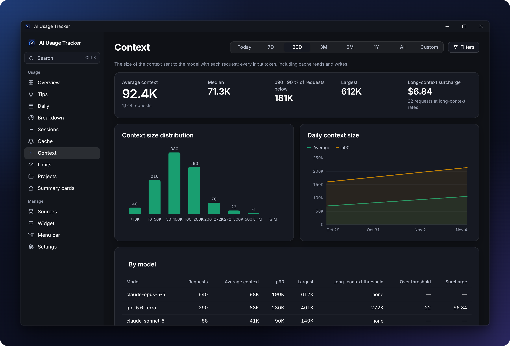 | 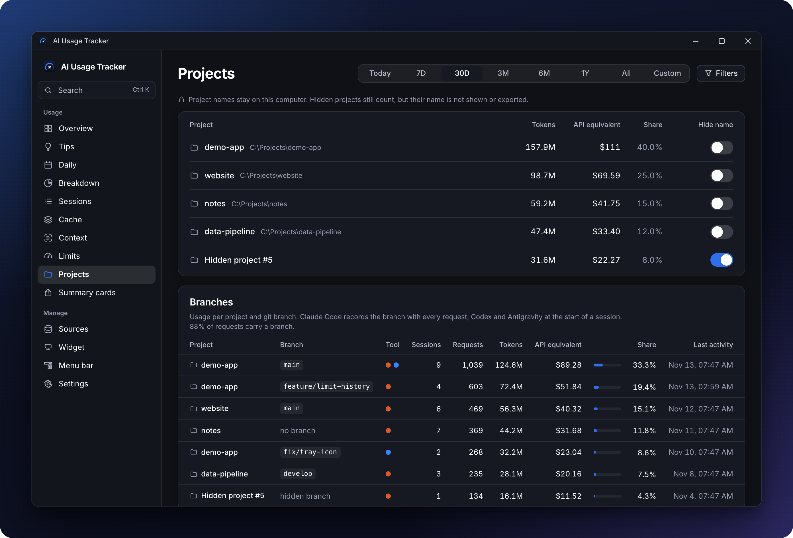 |
|---|---|
| **Context**: how large your prompts get, and the long-context surcharge | **Projects**: usage per project and per git branch |

**Context.** The **Context** page shows how large each request's prompt is (every input token, including cache reads and writes):

- average, median, p90, and largest
- the size distribution (under 10K … over 1M)
- the daily average and p90
- a breakdown per model
- the **long-context surcharge**: what requests above a model's long-context threshold (272K for GPT-5.x) cost beyond the standard rates

**Branches.** The **Projects** page splits each project's usage by git branch. Claude Code records the branch with every request; Codex records it when a session starts in a repository. Requests outside a repository show as "no branch".

### Find anything with one shortcut

Press **Cmd+K** on a Mac or **Ctrl+K** on Windows and Linux, or click **Search** in the sidebar, and type a few letters to jump to any page, settings section, project, model or session. From there you can also switch the theme, show or hide the widget, and check for updates.

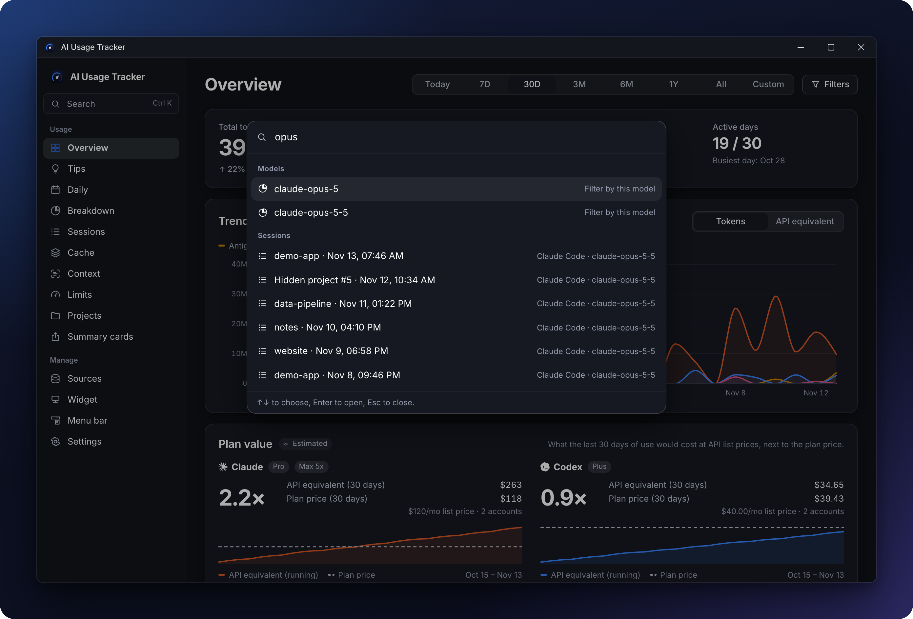

### A widget that stays out of the way

An always-on-top mini window sits by default in the bottom-right corner of the screen. It sizes itself to its content and, when snapped to a corner, stays flush with that corner while it resizes. Dragging it leaves it where you drop it. Right-click it to open the dashboard or change its opacity, size and position.

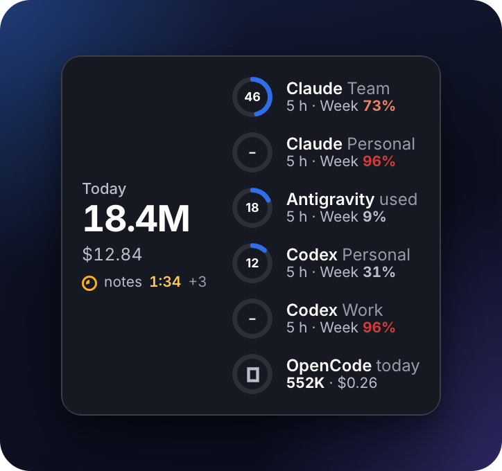

The **Widget studio** page changes what the widget shows and how it looks, with a live preview.

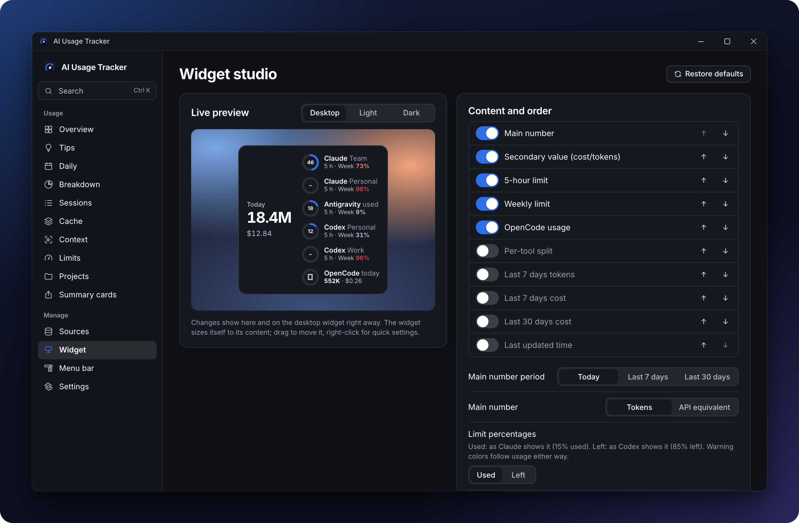

- **Content:** the items shown and their order (main number, secondary value, five-hour and weekly limits, OpenCode usage, per-tool split, 7- and 30-day totals, last update time, and, while **Cache time left** is on, the conversation whose cache runs out first), which tools' limits to show and in what order, and which Antigravity limit to show: Gemini, Claude and GPT, both, or whichever is fuller
- **Layout:** horizontal, vertical, or a single line
- **Limit style:** ring, bar, or text
- **Look:** theme, accent color, scale, background opacity, corner radius, border, shadow, labels, tool icons, and time until reset
- **Text:** any font installed on the computer (searchable and shown in its own face), text size, main-number size, number weight, and fixed-width digits
- **Thresholds:** caution and critical levels, which the app's own limit colors follow too
- **Behavior:** always on top, position lock, click action, hiding during full-screen apps (on macOS while the app is out of the Dock), and snap to a corner

The widget also comes with a shortcut and a tray icon:

- **Shortcut:** a system-wide key combination shows or hides the widget (default **Ctrl+Alt+Shift+W**, on macOS **⌃⌥⇧W**). To change it, open **Settings → Widget** and press the new combination. A combination that another program owns is refused.
- **Tray icon:** next to the clock on Windows, in the menu bar on macOS, in the system tray on Linux. It opens a control panel and can show your limits itself (see [Limits in the menu bar and tray](#limits-in-the-menu-bar-and-tray)).

### Limits in the menu bar and tray

The app's icon sits next to the clock on Windows, in the menu bar on macOS, and in the system tray on Linux. Click it to open the control panel. Right-click it for a short menu: open the app, show or hide the widget, scan now, install a ready update, or quit. On Windows and macOS, hovering over the icon lists every current limit. Linux trays report no clicks, so there the panel opens from the menu.


**Control panel.** The panel shows the tiles you choose:

- **Limits:** one window or both (5-hour and weekly) of Claude, Codex, or Antigravity, as a ring or a bar, with the time until the reset. With several Claude or Codex accounts, each account's limits can have their own tiles.
- **Forecasts:** when a limit will fill at your current pace, or where it will stand at the reset.
- **Usage:** tokens and API-equivalent cost for today, 7 or 30 days, for every tool or OpenCode alone. A large tile adds sessions and the cache hit rate.
- **Live caches:** the conversations whose cache runs out first, with the time left; click the count to open the **Cache** page. The tall tile grows with the conversations, up to three, and is one row high while there is one or none.
- **Last scan:** when the logs were last read; click it to scan again.
- **Buttons:** open the app, show or hide the widget, scan now, or open Settings.

The panel also tells you when an update is ready and when a signed-out tool keeps its limits from being read.

**Menu bar page.** Set up the panel on the **Menu bar** page. Drag tiles from the gallery into a live preview of the panel, drag them to reorder, or drag them back to the gallery to remove them. Click a tile to pick its size (small, wide, large, full width, or full width and tall) and, for limits, a ring or a bar. The panel holds up to 16 tiles and shows used or remaining limits, as in the app or as you set it for the panel.


**Icon.** Choose what the icon shows and which limit it follows (by default, the percentage of your fullest limit):

- **The app icon.** On macOS it takes the menu bar's light or dark look; on Windows it is drawn for a light or a dark taskbar.
- **A limit's percentage or a tool's logo** (Claude, Codex, Antigravity, OpenCode, or the logo of the limit's tool) on a square. The square is slate, or the tool's color if you turn that on, and turns amber, then red, as the limit passes the widget's warning thresholds (70% and 90% by default).
- **The usage dial**, filled to the limit. On macOS it is a plain mark that follows the menu bar's look; past the warning threshold it takes the warning color, still without a square. On Windows and Linux it sits on the app's navy square, with a blue, amber, or red arc.

While the limit was used after its newest reading, so the real value may be higher, the icon is drawn faded, as the text marks such a value with "~".

**Text next to the icon.** On macOS and Linux, text can sit next to the icon, such as `Cl 5h ▰▰▱▱▱ 46% · Cl W ⚠︎▰▰▰▰▱ 73%`. Windows shows no text next to tray icons. Pick the items and their order: any limit (of every Claude or Codex account too), its forecast, tokens, API-equivalent cost, sessions or cache hit rate for today, 7 or 30 days (for every tool or OpenCode alone), and the time of the last scan. While **Cache time left** shows in the menu bar, the conversation whose cache runs out first follows the text (`notes 2m`). Then choose:

- **Labels:** full names (`Claude 5h`), short ones (`Cl 5h`), or none
- **Value:** used or left
- **Display:** percent, a bar, both, or a circle
- **Reset:** hidden, as time left (`↻2h14m`), or as a clock time (`↻18:40`)
- **Separator** and text at the start and end
- **Warning mark:** a ⚠︎ before a value past the warning threshold

On macOS you can also hide the icon so only the text shows; the icon comes back while there is nothing to show.


### Share a summary card

The **Summary cards** page turns a day, a week (Monday to Sunday), a month or a year of your use into an image to share. Step through periods with the arrows, pick a card and a size, and save it as a PNG or copy it to paste straight into a post or a chat.

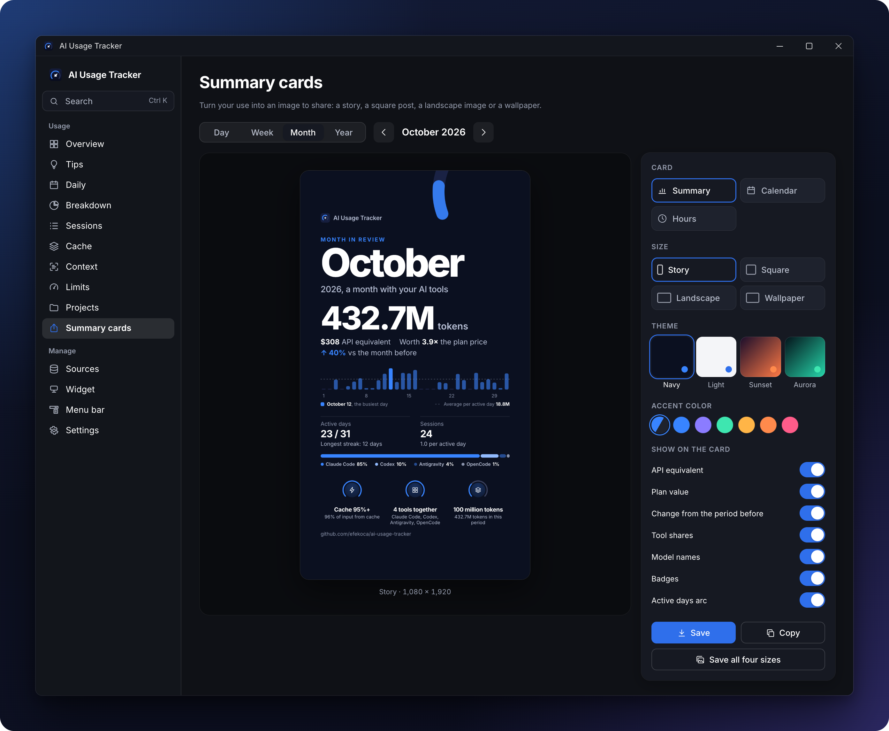

- **Summary:** tokens, the API-equivalent cost, what your plans were worth, a chart of the period, the change from the period before, your busiest day or hour, active days, sessions, the cache hit rate, the model you used most, and each tool's share.
- **Calendar** (month or year): every day colored by how much you used, with your active days and your longest streak.
- **Hours:** when in the day you work, around a 24-hour dial. The six hours that hold most of your use get a name (for example **Night owl** for 23:00–05:00), and longer periods show your week hour by hour.
- **Year story:** your year as a row of story slides: the totals, the calendar, your hours, your models and the badges you earned. **Save all slides** saves them together.

Every card comes in four sizes: a 1080 × 1920 story, a 1080 × 1080 square, a 1200 × 675 landscape image for X or LinkedIn, and a wallpaper the size of your screen. **Save all four sizes** saves them into one folder at once; a file already there is kept, and the new one gets a numbered name. Choose one of four themes (navy, light, sunset and aurora) and an accent color.

**Show on the card** leaves out what you would rather not share: the API-equivalent cost, the plan value, the change from the period before, tool shares, model names, badges or the active days arc.

**Badges** mark fixed thresholds the period reached: 100 million, 1 billion or 10 billion tokens; a 7-, 30- or 100-day streak; use on every day of a finished week or month; 2×, 5× or 10× the plan price; an 80%, 90% or 95% cache hit rate (with at least 1 million input tokens); and 2, 3 or 4 tools used together.

The change from the period before compares with the same part of the calendar period before: a month still running is compared with the same days and time of the month before. It is left out when the archive does not reach back to the start of that period.

A card shows only totals, tool names and model names, never project names or anything you wrote. What your plans were worth counts only plans whose price is known, and is left out when none is.

### Weekly PDF, export, and your own prices

**Usage summary (PDF).** **Settings → Usage summary (PDF)** saves last week, this week, the last 7 days, last month, this month, last year, or this year as an A4 PDF. It contains totals with the change from the previous period, a daily chart (monthly for periods over three months), tools, plan value, current limits with their forecast, context, models, projects (hidden names stay hidden), the most expensive sessions, and notes. No print dialog opens. Optionally, the app saves the last full week (Monday to Sunday) to a folder (by default the **AI Usage Tracker** folder inside your Documents folder) once each week, after the first scan has read the week's logs. A week missed while the computer was off is saved at the next start, and a summary you moved or deleted is not saved again.

**Archive and data.** Source tools may delete old logs; the Claude Code CLI, for example, deletes sessions after 30 days by default. Everything this app has imported stays in its archive, and no record is ever counted twice (see [How it works](#how-it-works)).

**Settings → Data** offers:

- CSV or JSON export (per request or as a daily summary); **CSV (;)** uses semicolons and a decimal comma, so Excel in languages such as Turkish or German opens it in the right columns
- database backup
- merge-import from a backup
- **Delete all my data**, which empties the archive and stops recording until you confirm your sources again. Backups and exports you saved elsewhere are not touched.

**Prices.** Official API list prices ship with the app in [`config/pricing.json`](config/pricing.json), verified between 2026-10-02 and 2026-11-10 against the official [Anthropic](https://platform.claude.com/docs/en/about-claude/pricing), [OpenAI](https://developers.openai.com/api/docs/pricing), [Google Gemini](https://ai.google.dev/gemini-api/docs/pricing) and [Vertex AI](https://cloud.google.com/vertex-ai/generative-ai/pricing) pages and, for models OpenCode can use, the pages of [DeepSeek](https://api-docs.deepseek.com/quick_start/pricing/), [Moonshot AI](https://platform.kimi.ai/docs/pricing/chat), [Z.ai](https://docs.z.ai/guides/overview/pricing), [Alibaba Cloud](https://www.alibabacloud.com/help/en/model-studio/model-pricing), [xAI](https://docs.x.ai/developers/pricing), [Mistral](https://docs.mistral.ai/inference/pricing) and [MiniMax](https://platform.minimax.io/docs/guides/pricing-paygo).

- **New prices without an update:** at startup and every 12 hours the app downloads this same file from GitHub and, when it is newer, uses it in place of the list it shipped with, so a new model is priced without waiting for a new version. A copy is used only when it still holds every model the app knows. Only that file is downloaded and nothing is sent. Turn this off with **Settings → Prices → Keep the price list current**, or check at once with **Check prices**.
- **Pricing rules covered:** 5-minute and 1-hour cache writes, the OpenAI long-context tier (>272K input tokens), fast-mode and US data-residency multipliers, web-search fees, and prices that change on a set date, such as an introductory price that ends: each request is priced at the rate of its own day.
- **Unknown models:** never priced by guesswork. They are listed as "no price" and left out of costs. You can dismiss the overview warning about them; it returns only if another model becomes unpriced, or through **Settings → Prices → Show the warning again**.
- **Edits:** change prices in **Settings → Prices**. The list starts with the models found in your logs; **Show all models** lists every priced model. Your copy, stored as `pricing.json` in the app's data folder (see [Privacy](#privacy)), keeps only the prices you change; every other model, including corrections and models added later, follows the newest list. A changed price is marked **changed** and goes back to the list price with one click. For a model with no price, type one in under **Enter a price for a model without one**; it is marked **yours** and no newer list changes it. You can also map an unpriced model to another model's price or restore the defaults.

## Supported sources

| Source | What is read | Tokens | Limits | Notes |
|---|---|---|---|---|
| **Claude Code** (CLI, VS Code, Claude desktop "Code") | `$CLAUDE_CONFIG_DIR` or `~/.claude/projects/**/*.jsonl` | **Exact** | Only when a limit is hit | Background helper calls (e.g., web-search summarization) are not in these logs |
| **Cowork sessions** (Claude desktop) | *Claude folder*`/local-agent-mode-sessions/**` | **Exact** | **Exact %** (5 h / 7 d) | Only tasks that ran on your computer. New Cowork tasks run in the cloud: their token counts are not stored on your computer, but they count toward your plan limits |
| **Claude desktop: plan usage** | *Claude folder*`/plan-usage-history.json` | — | **Exact %** | Chat tokens are not stored locally, so **none** |
| **Codex** (CLI and desktop) | `$CODEX_HOME` or `~/.codex/{sessions,archived_sessions}` | **Exact** | **Exact %** (every request) | Sessions that newer Codex versions compress (`.jsonl.zst`) are read too |
| **Antigravity** (app, IDE and `agy` CLI) | `~/.gemini/{antigravity,antigravity-ide,antigravity-cli}/conversations/*.db` or `$ANTIGRAVITY_APP_DATA_DIR` | **Exact** | **Captured %** (through `agy`) | A copy of each database is read, so Antigravity's files are never touched. Gemini and Claude/GPT limits are shown separately |
| **OpenCode** | `$XDG_DATA_HOME/opencode` or `~/.local/share/opencode` (also on Windows): `opencode.db`, or `$OPENCODE_DB` | **Exact** | — | Every provider you use in OpenCode (Anthropic, OpenAI, OpenRouter, GitHub Copilot, OpenCode Zen, …), priced at the model maker's own API price. OpenCode does not record whether a request used a subscription or an API key, so this usage is not added to any plan's value. Sessions made with versions before 1.3.16 are not counted |
| ChatGPT desktop | — | **None** | — | Detection only |

`~` is your home folder (`%USERPROFILE%` on Windows). The *Claude folder* is `%APPDATA%\Claude` on Windows and `~/Library/Application Support/Claude` on macOS; the Claude desktop app is not available for Linux.

Every figure carries a label:

- **Exact:** the value the tool wrote into its own log.
- **Estimated:** a value this app computed, e.g., a project's share of a limit or a percentage of a budget you set.
- **Captured:** a value the app read live (see [Live capture](#live-capture)) through the limit reads, the status-line bridge, or the local telemetry receiver.

## Install

Download the file for your system from the [latest release](../../releases/latest). On first launch, the app lists the tools it found on this computer. Choose the sources you want and press **Get started**. Nothing is read until you confirm.

### Windows

Windows 10 and 11.

1. Run `AI-Usage-Tracker_x.y.z_x64-setup.exe`. The installer is **per-user** (it installs to `%LOCALAPPDATA%\AI Usage Tracker`) and needs no administrator rights.
2. Windows 11 already includes WebView2. On Windows 10, the installer adds it if it is missing.

> **SmartScreen.** The installer is not code-signed, so Windows may show "Unknown publisher". Choose **More info → Run anyway**.

**Uninstall.** Use Windows Settings → Apps. The uninstaller reverts the Claude Code settings changed under **Live capture** and removes the cache refresh hook and the limit hook. Ticking "Delete the application data" also removes `%LOCALAPPDATA%\AIUsageTracker`. The start-with-Windows entry is always removed.

### macOS

macOS 11 or newer, on Apple silicon and Intel Macs.

1. Open `AI-Usage-Tracker_x.y.z_universal.dmg` and drag **AI Usage Tracker** to **Applications**.
2. Open the app from **Applications**. It is signed and notarized by Apple, so it opens without a warning.

Run the app from Applications, not from the disk image. A copy opened from the disk image cannot start at login, keep the Claude Code status line, or update itself; the app tells you so when that happens.

To keep the app out of the Dock and the ⌘Tab list, turn off **Settings → Show in the Dock**. You then open it from its menu bar icon or the widget shortcut. The widget can then stay over full-screen apps too: turn off **Hide during full-screen apps** in the **Widget studio**.

**Uninstall.** macOS has no uninstaller, so first turn off the switches you turned on under **Sources → Live capture** and **Settings → Start at login**, and if you added the cache refresh hook, remove it under **Settings → General → Cache time left → Remove**. Turn off **Continue after a limit resets** on the **Limits** page as well. Then drag the app to the Trash. Your data stays in `~/Library/Application Support/AIUsageTracker` until you delete it.

### Linux

Debian 12, Ubuntu 22.04 and newer, Fedora, openSUSE, and other x86_64 distributions with WebKitGTK 4.1.

- **Debian, Ubuntu, Mint:** install `AI-Usage-Tracker_x.y.z_x86_64.deb` with `sudo apt install ./AI-Usage-Tracker_x.y.z_x86_64.deb`.
- **Fedora:** install `AI-Usage-Tracker_x.y.z_x86_64.rpm` with `sudo dnf install ./AI-Usage-Tracker_x.y.z_x86_64.rpm`.
- **openSUSE:** the packages carry no GPG signature, so zypper needs `sudo zypper install --allow-unsigned-rpm ./AI-Usage-Tracker_x.y.z_x86_64.rpm`. You can check the file against `SHA256SUMS` first (see [Verify a download](#verify-a-download)).
- **Any distribution:** make `AI-Usage-Tracker_x.y.z_x86_64.AppImage` executable (`chmod +x`) and run it. Nothing is installed. If it does not start, install FUSE 3 (`sudo apt install fuse3` on Debian and Ubuntu), or start it with `APPIMAGE_EXTRACT_AND_RUN=1 ./AI-Usage-Tracker_x.y.z_x86_64.AppImage`.

The app updates itself in all three forms. For the `.deb` and `.rpm`, your system asks for your password and your package manager installs the update. If that is not possible, the app asks you to install the new package by hand.

**Tray icon on GNOME.** GNOME shows tray icons only with the AppIndicator extension. Ubuntu includes it; on other GNOME systems install "AppIndicator and KStatusNotifierItem Support".

**Widget shortcut.** It works from any app on KDE Plasma and GNOME, also under Wayland. On GNOME 47 and older the app adds a GNOME custom shortcut for it (Settings → Keyboard → Custom Shortcuts). On Sway or Hyprland, bind a key to `ai-usage-tracker --toggle-widget` yourself, for example `bindsym Ctrl+Alt+Shift+w exec ai-usage-tracker --toggle-widget` (Sway) or `bind = CTRL ALT SHIFT, W, exec, ai-usage-tracker --toggle-widget` (Hyprland).

**Uninstall.** `sudo apt remove ai-usage-tracker` or `sudo dnf remove ai-usage-tracker`. Removing the package reverts the Claude Code settings changed under **Live capture**, the cache refresh hook, the limit hook and the start-at-login entry for every user who used the app with the default folders (`~/.local/share` and `~/.config`). For the AppImage, turn those switches off and remove the cache refresh hook under **Settings → General → Cache time left → Remove** and turn off **Continue after a limit resets** on the **Limits** page first, then delete the file. Your data stays in `~/.local/share/AIUsageTracker` until you delete it. On GNOME, also remove the widget shortcut under **Settings → Widget shortcut → Remove**, or in GNOME's keyboard settings.

### Verify a download

Every release includes `SHA256SUMS`, the checksum of each file. Put it next to your download and run:

- **Linux:** `sha256sum -c SHA256SUMS --ignore-missing`
- **macOS:** `shasum -a 256 -c SHA256SUMS --ignore-missing`
- **Windows (PowerShell):** `Get-FileHash .\AI-Usage-Tracker_x.y.z_x64-setup.exe`, then compare the hash with the line for that file in `SHA256SUMS`.

## Privacy

> **Content never enters the archive.** The app takes only details such as token counts, model, and time from the logs; prompt and response text is never saved to the app's archive. Your usage data never leaves your computer, and the app has no telemetry.

- **Read:** timestamps, model, project folder, git branch, session ID, subagent name, token counts, the name and outcome of each tool call (never its input or output), and limit percentages from the tools' own logs.
- **Stored:** only those values, in `tracker.db` (SQLite) in the app's data folder: `%LOCALAPPDATA%\AIUsageTracker` on Windows, `~/Library/Application Support/AIUsageTracker` on macOS, and `~/.local/share/AIUsageTracker` on Linux. Project names stay local. You can hide them one by one or all at once, and hidden names are masked in exports too.
- **Never kept in the app's archive:** prompts, responses, file contents, credentials, or tokens. The app does **not** read the tools' credential files.
- **Codex and Claude accounts:** to tell accounts apart, the app keeps only a one-way digest of the Codex account ID and of the Claude plan's organization ID. For Claude it reads only that ID: from `~/.claude.json`, from telemetry events, and from the folder names and session IDs of the Claude desktop app's Code-tab session list. Account names are the ones you give; e-mail addresses are never read.
- **Antigravity's temporary copy:** Antigravity keeps its conversations, text included, in a database. So as never to touch that file, the app copies it into a temporary folder only you can open, reads the counts and deletes the copy right away. If the app is forced to quit, the next Antigravity read deletes leftover copies older than 10 minutes. Conversation text never reaches the app's archive.
- **OpenCode's database:** OpenCode keeps its sessions, text included, in one database. The app opens it read-only and asks it only for token counts, model, provider, agent, project folder, and the name, result and time of each tool call; text is never read.
- **Cache refresh hook:** if you turn on cache refresh, a small hook is added to `~/.claude/settings.json` (backed up first). The hook and the app share only small files named by each conversation's session ID in the app's data folder: whether the conversation is waiting, when you last sent a prompt, and the refresh request. The hook never reads the conversation, and **Settings → General → Cache time left → Remove** takes it out again.
- **Limit hook:** if you turn on **Continue after a limit resets**, a small hook is added to `~/.claude/settings.json` (backed up first). The hook and the app share only small files named by each conversation's session ID in the app's data folder: whether the conversation waits for a reset, when the limit stopped it, when it was continued, and the request to continue. The message that continues a conversation is fixed in the app, so nothing a file says reaches the conversation. The hook never reads the conversation, and turning the switch off on the **Limits** page takes it out again.
- **Network:** the app itself connects only to check for updates and for a newer price list. Each check downloads one file, the release's version file or `config/pricing.json` from this repository, and sends nothing (**Settings → Updates**, **Settings → Prices**). The limit reads, on by default, run your own Claude Code, Codex and Antigravity CLI, which ask their own services for your plan's limit percentages; the app starts Claude Code with its telemetry and error reporting turned off and Codex with its analytics turned off; the Antigravity CLI has no such setting. You can turn the reads off under **Sources → Live capture**. If you install a tool from the app, its installer is downloaded from the maker's site. Plans ship with the app, and currency conversion uses a rate you enter yourself.

### Live capture

**Sources → Live capture** has five switches. The three **limit reads are on by default**: they change no files, make no model request, and use only your own Claude Code, Codex or Antigravity CLI sign-in. They run within seconds of the app starting, so the widget shows current limits right away. The two methods that edit Claude Code's settings file are **off by default**. Each switch shows exactly what it changes, and turning it off undoes the change. The Windows uninstaller and removing the Linux package revert them too, but updates leave them alone. On macOS and with the AppImage, turn them off before you delete the app.

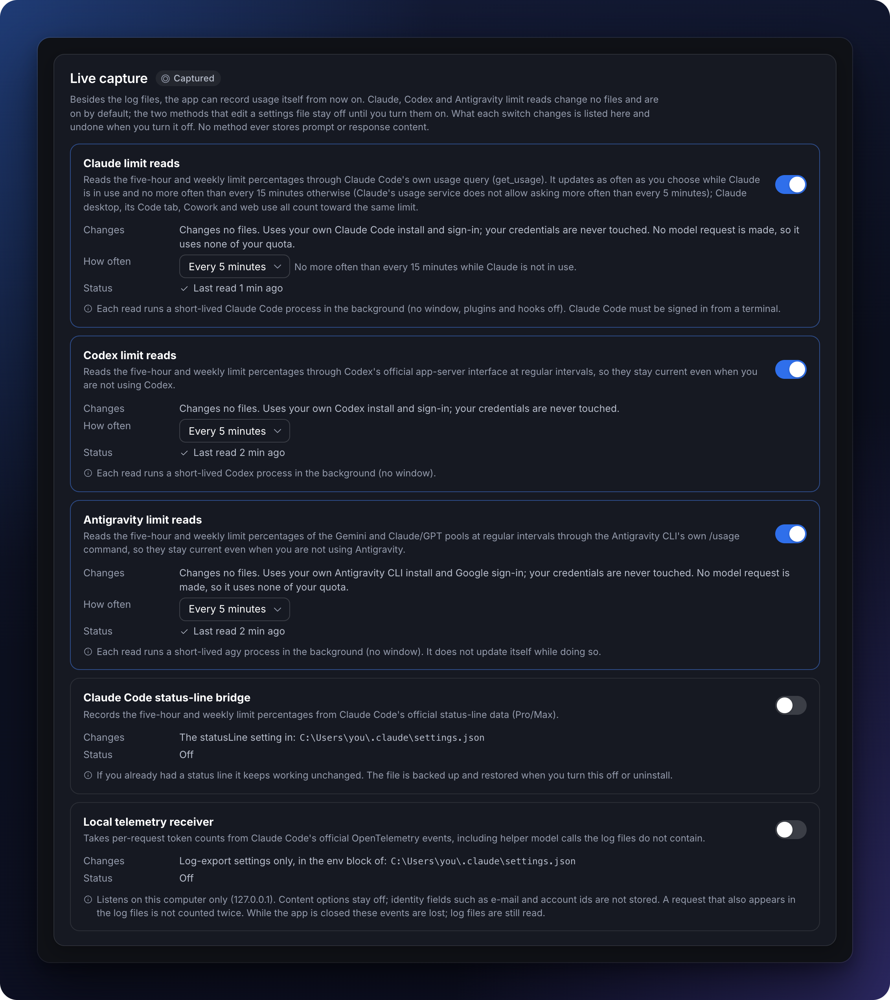

| Method | What it does | What it changes |
|---|---|---|
| **Claude limit reads** | Reads the five-hour and weekly limit percentages through Claude Code's own usage query. No model request is made, so no quota is used. While Claude is in use it updates every 5 minutes, or as often as you choose under **How often** (no more often than every 5 minutes, because Claude's usage service does not allow more frequent requests); otherwise it updates no more often than every 15 minutes. Claude desktop chat, its Code tab, Cowork, and web use are all reflected. Requires Claude Code signed in with a Pro or Max account (`claude` → `/login`). | Nothing. It uses your own Claude Code install and sign-in, turns off MCP servers and hooks as well as telemetry, error reporting, and auto-update for the read, and never touches credentials. |
| **Codex limit reads** | Reads the five-hour and weekly limit percentages every 5 minutes (from every minute to every hour under **How often**) through Codex's official interface, so they stay current even when you are not using Codex. If more than one Codex is installed (for example the one inside the ChatGPT app on macOS), the newest is used. | Nothing. It uses your own Codex install and sign-in with analytics turned off, and never touches credentials. |
| **Antigravity limit reads** | Reads the five-hour and weekly limit percentages of the Gemini and Claude/GPT pools every 5 minutes (from every minute to every hour under **How often**) through the Antigravity CLI's (`agy`) own `/usage` command. The Antigravity app and IDE cannot do this read; it needs `agy`. | Nothing. It uses your own `agy` install and Google sign-in, `agy` does not update itself during the read, and credentials are never touched. |
| **Claude Code status-line bridge** | Records the five-hour and weekly limit percentages from Claude Code's official `statusLine` data (Pro/Max), and each conversation's cache miss counts and their causes. An existing status line keeps running with the same input. It can also end the line with the time the conversation's cache is dropped (**Settings → General → Cache time left**). It works where Claude Code shows a status line (the terminal); the Code tab of the Claude desktop app does not run status lines. | `statusLine` in `~/.claude/settings.json` (backed up first). |
| **Local telemetry receiver** | Takes per-request token counts from Claude Code's official telemetry, including helper-model calls that the transcripts lack, and which Claude account each request used. | Log-export variables only, in the `env` block of `~/.claude/settings.json`. It listens on `127.0.0.1` only and accepts only requests that carry a key generated for this install. |

When the tool a limit read needs is missing, its card offers **Install** and **Install guide**. **Install** uses the maker's own installer: `claude.ai/install` for Claude Code, `chatgpt.com/codex/install` for Codex, and `antigravity.google/cli/install` for the Antigravity CLI. When the tool is installed but signed out, the overview and its card explain step by step how to sign in, and **Try again** reads the limits right away.

Safeguards:

- A request that shows up both in telemetry and in a transcript is counted once.
- Email addresses are never read, account IDs are kept only as one-way digests, and prompt logging is never turned on.
- If you already have your own telemetry setup, the app leaves it alone and tells you.
- Turning a switch off reverts only what the app wrote; changes you made yourself stay.

## How it works

Everything runs on your computer:

1. Claude Code, Cowork, Claude desktop, the Codex CLI and desktop app, the Antigravity app, IDE and CLI, and OpenCode write usage logs to disk, as they already do.
2. The app reads each log from where it left off, so a rescan only touches what is new. It takes only details such as token counts, model, and time; prompt and response text is never saved to the app's archive.
3. When the limit reads are on, your own `claude`, `codex` and `agy` CLIs supply the limit percentages.
4. Only counts and metadata reach the local archive (SQLite). Duplicates from streaming, resumed or forked sessions, and Codex logs moved to the archive are counted once.
5. The dashboard, widget, tray icon, and PDF summary read from that archive.

## Updates

The app checks for a new version at startup and every 6 hours. The check downloads only a small version file from this repository's releases and sends nothing. When a new version is ready, it is shown at the bottom left of the window until you install it. An update is installed only after you confirm it, and only if its signature matches the key built into the app. You can turn the check off under **Settings → Updates**.

## Known limitations

- **Claude Code totals:** helper calls outside the main model are missing from its logs, so totals can be slightly low.
- **Desktop chats:** Claude and ChatGPT desktop chat tokens are not available locally.
- **Codex fast tier:** not recorded per request, so the standard price is used.
- **Telemetry-only requests:** for requests known only from the local telemetry receiver, cache writes are priced at the 5-minute rate, so their cost can be slightly low.
- **`codex-auto-review`:** has no published price.
- **Older Antigravity conversations:** conversations that older Antigravity versions kept encrypted as `.pb` files, and conversations whose database is gone, are not read; they hold no real token counts.
- **Google AI plan prices:** they differ by country and offer, so you enter what you pay for your Antigravity plan.
- **OpenCode:** it does not record the requests that name a session, so those are missing, and a request stopped before the model reported its usage is recorded with no tokens. The cost shown is the model maker's API price, not what OpenRouter, GitHub Copilot or OpenCode Zen charged. Models from Anthropic, OpenAI, Google, DeepSeek, Moonshot AI (Kimi), Z.ai (GLM), Alibaba Cloud (Qwen), xAI (Grok), Mistral and MiniMax are priced from each maker's own price page; DeepSeek at half price for requests made outside its busy hours, as it charges. Other models take the price from OpenCode's own model catalog on your computer when the maker itself lists one there; the app marks those prices as unverified. A model with no maker price stays out of the cost.
- **Log formats:** these are not documented interfaces and may change. The app skips unknown fields and lists unrecognized files under **Sources**.

## Build from source

Requirements: Rust 1.99+ (the version CI and the release builds use) and Node 22.12+, plus:

- **Windows:** Visual Studio Build Tools (C++)
- **macOS:** Xcode Command Line Tools, and for the universal release build `rustup target add aarch64-apple-darwin x86_64-apple-darwin`
- **Linux:** WebKitGTK 4.1 and its build files, for example on Debian and Ubuntu: `sudo apt install libwebkit2gtk-4.1-dev libayatana-appindicator3-dev librsvg2-dev libxdo-dev libssl-dev`

```bash
npm --prefix ui install
cargo test -p tracker-core
npx --prefix ui tauri dev
npm --prefix ui run release        # packages → target/release/bundle/release/
```

Running `npm --prefix ui run dev` on its own opens the dashboard in a browser with sample data.

| Path | Contents |
|---|---|
| `crates/tracker-core` | discovery, parsers, SQLite archive, pricing, analytics, and export (plus synthetic fixtures) |
| `src-tauri` | desktop shell: worker, file watching, tray, widget, and IPC |
| `ui` | Svelte 5 dashboard and widget |
| `config` | `pricing.json`, `plans.json`, and `updates.json` (release location) |

Bug reports and pull requests are welcome.

## Code signing policy

See [CODE_SIGNING.md](CODE_SIGNING.md).

## License

[MIT](LICENSE)
