# AI Usage Tracker

**Your Claude Code, Codex, Antigravity and OpenCode usage, cost, and plan limits, on your own computer.**

A private app for Windows, macOS, and Linux that reads the usage logs your AI tools already write, keeps its own archive, and shows tokens, API-equivalent cost, and live limit percentages. No account, no cloud, no telemetry.

[](../../releases/latest)

   [](LICENSE)

[Features](#features) · [Install](#install) · [Privacy](#privacy) · [How it works](#how-it-works) · [Build from source](#build-from-source) · [Türkçe](README.tr.md)

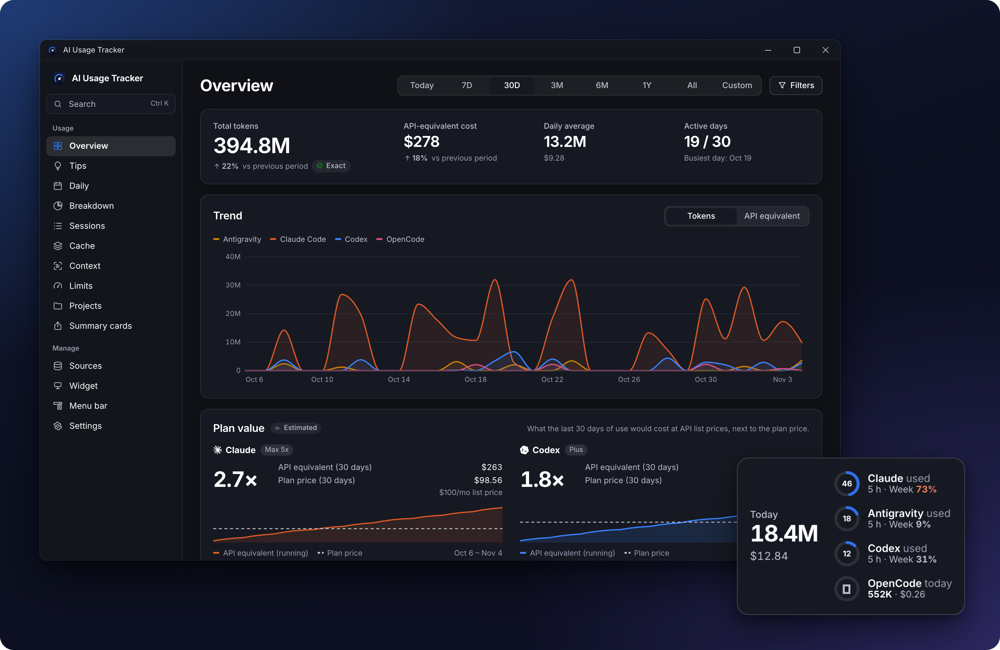

- **Private by design.** Prompts and responses never enter the app's archive. Only counts and metadata are kept, in a local SQLite file, and your usage data never leaves the computer.
- **Know where every number comes from.** Every figure is labeled **Exact** (from the tool's own log), **Estimated** (computed by the app) or **Captured** (read live). Nothing is guessed silently.
- **Stay ahead of your limits.** Five-hour and weekly percentages for Claude, Codex and Antigravity are read every few minutes, with a forecast of when each window fills and a notification before it does.


## Features

### Limits that stay current

The app reads your five-hour and weekly limits through the official interfaces of Claude Code, Codex and the Antigravity CLI, so the numbers match what the tools show. Each window gets a forecast based on your average pace since it started, so a short burst of work is not projected across the whole window.

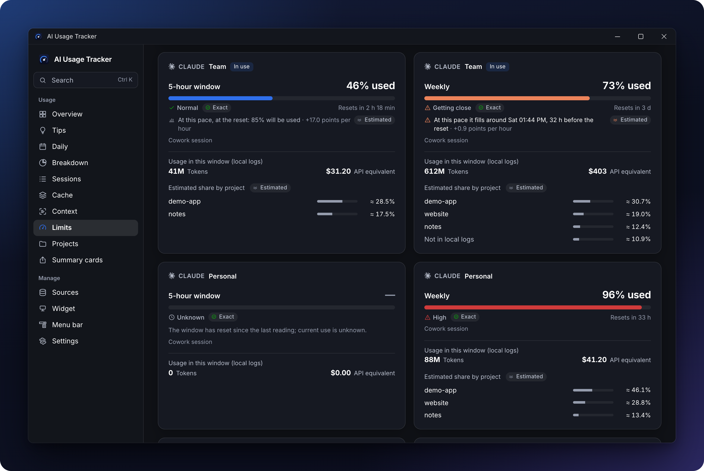

- If you used a tool after its newest reading, the current value is unknown. The app then shows "?" with the last reading, which the panel and menu bar mark with "~".
- Percentages can read as **used** or **left**. Warning colors follow the **Caution** and **Critical** levels in the **Widget studio** (70% and 90% by default).
- Without a real reading, you can set your own budget per window. The percentage is then labeled **Estimated**.
- Each project gets an estimated share of the limit. Use from elsewhere, such as the web or a phone, shows separately as **Not in local logs**.

**More than one account.** Each Claude and Codex account gets its own limits, history and forecast, and you can name it and choose its plan on the **Limits** page. A request counts for an account only when the logs show it for certain. Otherwise it stays under **Unidentified account**. If you switch Claude accounts in the same config folder, turn on the local telemetry receiver under [Live capture](#live-capture). When the account in use is full, the **Limits** page names the account to continue with (**Settings → General → Account suggestion**).

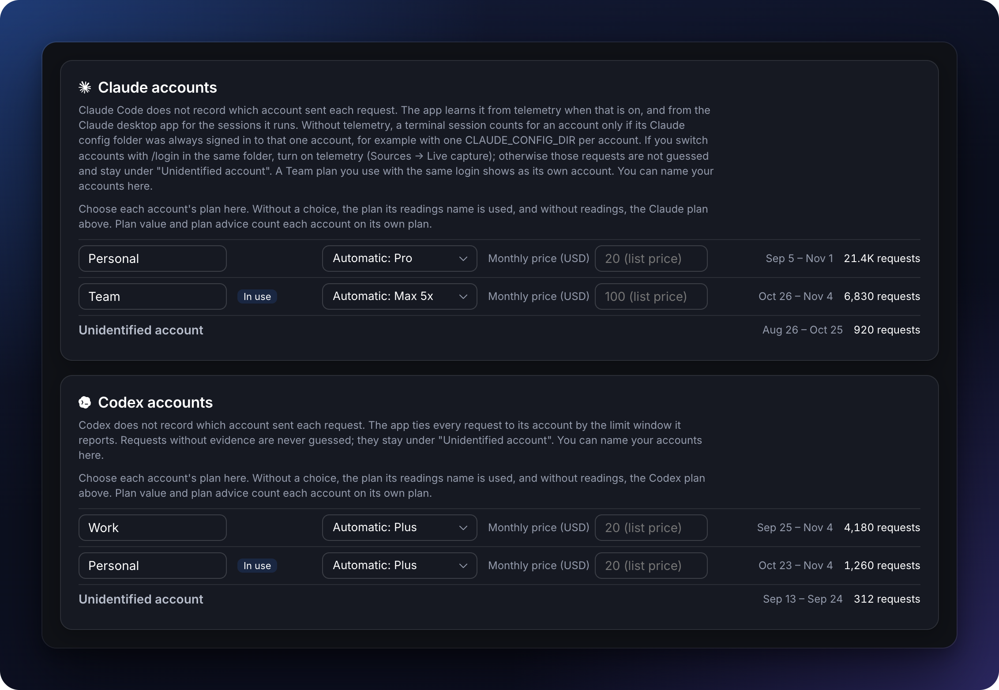

**Notifications.** You get a notification when a limit passes your warning level, when it fills, and when it starts again. Others tell you when a weekly limit is about to reset with 30% or more unused, and when a tool is signed out so its limits cannot be read. Choose them in **Settings → Notifications**. On Windows, notifications go through the app's Start menu shortcut, so keep it.

**Continue after a limit resets.** When the usage limit stops a Claude Code conversation in the middle of its work, the app can continue it once the limit resets. Turn on **Continue after a limit resets** on the **Limits** page. The app asks before it adds a hook to Claude Code's settings (see [What the app changes on your computer](#what-the-app-changes-on-your-computer)). After the reset, the conversation gets one message that tells it to carry on. The conversation must stay open and the computer awake, and the continued work counts against your plan.

**Handoff note before the limit.** When a Claude Code or Codex conversation reaches 95% of its 5-hour or weekly limit, the app asks it once to write what it did and what comes next. Turn on **Handoff note before the limit** on the **Limits** page, and switch each tool on or off on the card. The app asks before it adds the hooks this needs. When the limit then stops the conversation, a notification offers **Continue in Codex** (or **Continue in Claude**), which starts the other tool on the note in the project's folder. If you continue there, the stopped conversation no longer continues by itself after the reset, so two agents never work on the same files. Notes are deleted after 14 days.

**Window scheduler.** Claude's 5-hour window starts with your first request. Turn on **Window scheduler** on the **Limits** page and pick a time, and the app opens the window for you then. With 06:00, the window resets at 11:00 and a second one carries you through the afternoon. The card can also suggest a time from your own working hours. Each run sends one very small request through your own Claude Code (Haiku, 1,000 to 1,500 tokens), which counts against your plan. The app must be running and the computer awake at that time. No request is sent while Claude Code uses an API key, Amazon Bedrock, Google Vertex AI or Microsoft Foundry instead of your plan.

### Limit history

The **History** tab on the **Limits** page lists every five-hour and weekly window your readings cover: how full it got, whether it filled and how fast, and this computer's use inside it. From the windows it watched to their end, the app estimates what a whole window is worth in API-equivalent cost.

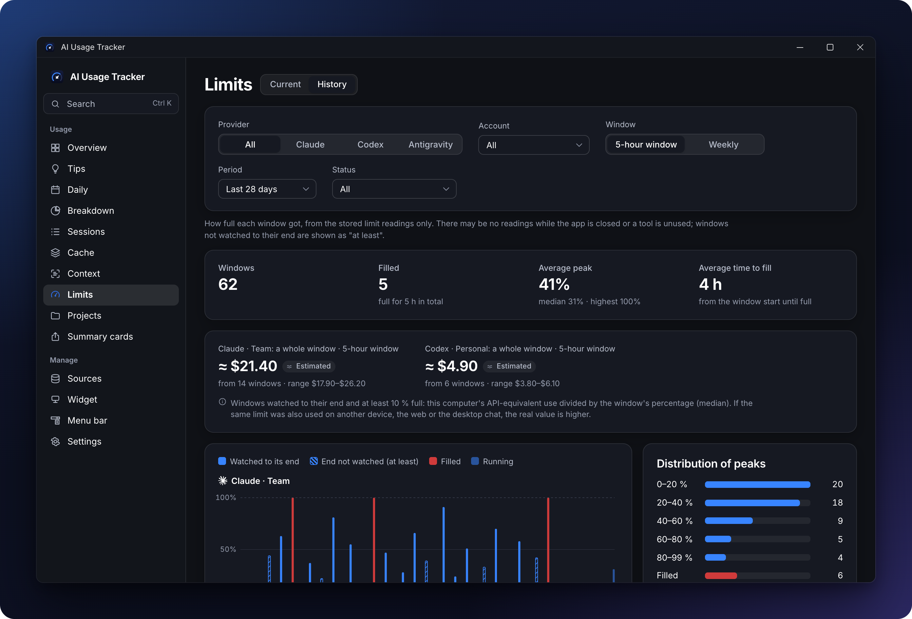

### Tips and plan advice

The **Tips** page turns your own records into findings, such as the cache written again after a long pause, long-context surcharges, and tools that often fail. Each finding shows the figures it rests on and what helps. Amounts are API equivalents. On a subscription you do not pay them, but they show the size of your use.

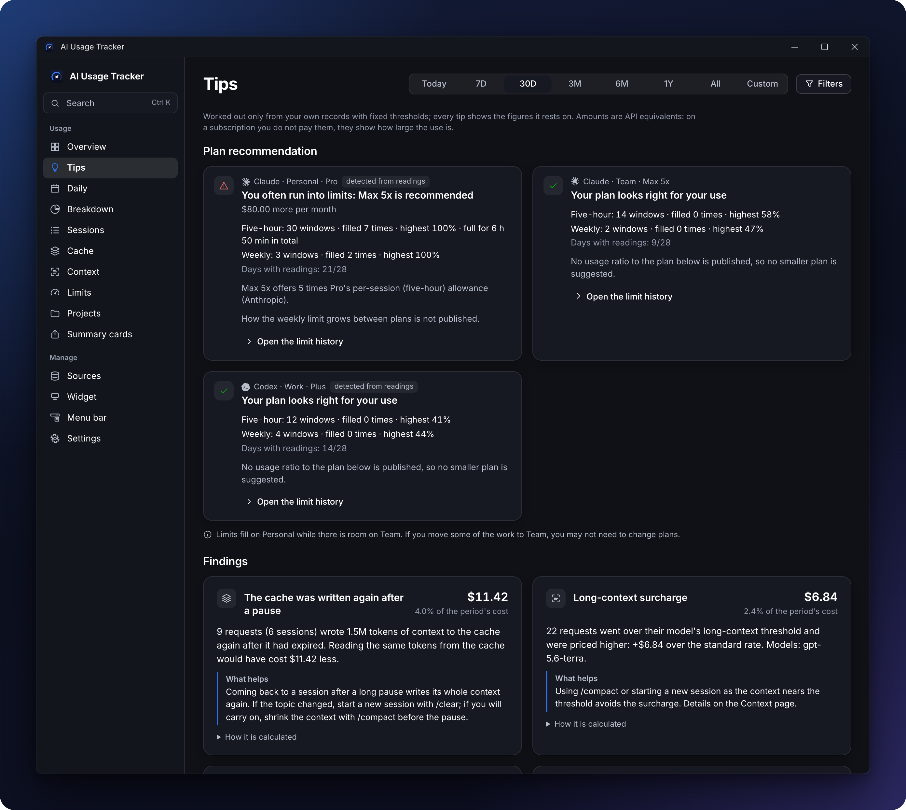

**Plan recommendation.** Based on the last 28 days, the app suggests a bigger plan when your limits keep filling. It suggests a smaller one only where the provider publishes the ratio between plans (Claude) and your use would have fit. Claude's readings do not tell Max 5x from Max 20x, so choose your plan on the **Limits** page.

**Before and after.** Mark the day you changed something, such as adding an MCP server or shortening `CLAUDE.md`. The app compares the days before and after it: cost per session, starting load, tool error rate and cache hit rate. It shows what changed around that day, not that your change caused it.

**Plan value.** The **Overview** compares each provider's API-equivalent use over the last 30 days with your plan price ("4.7×") and marks the day the plan paid for itself. List prices come from [`config/plans.json`](config/plans.json), checked against the official [Claude](https://claude.com/pricing) and [ChatGPT](https://learn.chatgpt.com/docs/pricing) pages. Enter your own price or renewal day on the **Limits** page. Chat use is not in local logs, so the real value can be higher.

**Monthly budget.** Set a monthly limit for API-equivalent cost in **Settings → Monthly budget**. The **Overview** then shows this month's spend, the days left and where the month is heading. A notification tells you when you reach 80% and when you go over.

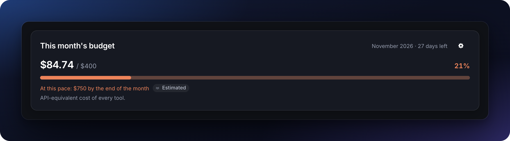

### Day by day

The **Daily** page shows the period day by day, as columns or as a calendar, with your busiest day, your streaks and your weekend share. Pick a day to see its hours, tools, models, projects and highest limit readings.

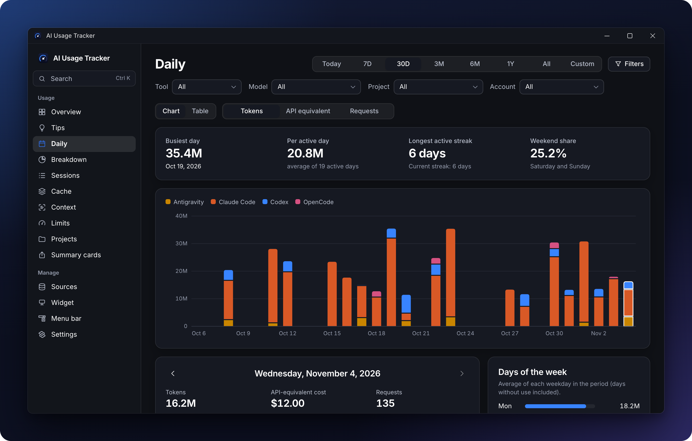

### What would another model cost?

The **Breakdown** page reprices the period's requests on every model in the price list, with the same token counts, and lists them cheapest first. Model families count tokens differently, so comparisons across families are approximate.

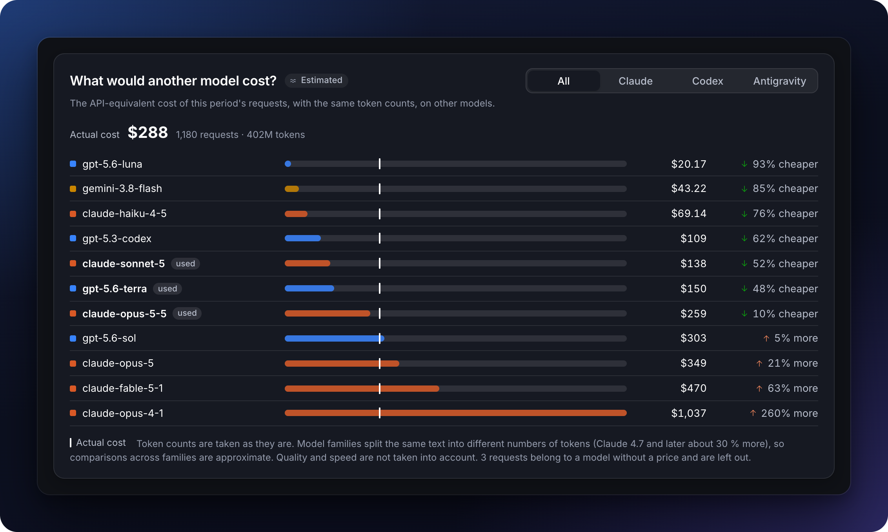

### Subagents and tools

The **Breakdown** page also shows what subagents cost next to the main conversation, how often each tool is called and how often its calls fail. Only a tool's name and outcome are stored, never its input or output.

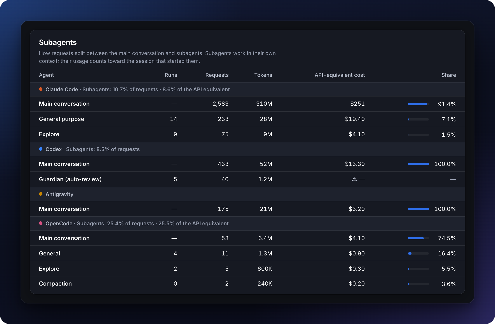

### Explore sessions, cache, context, and projects

| 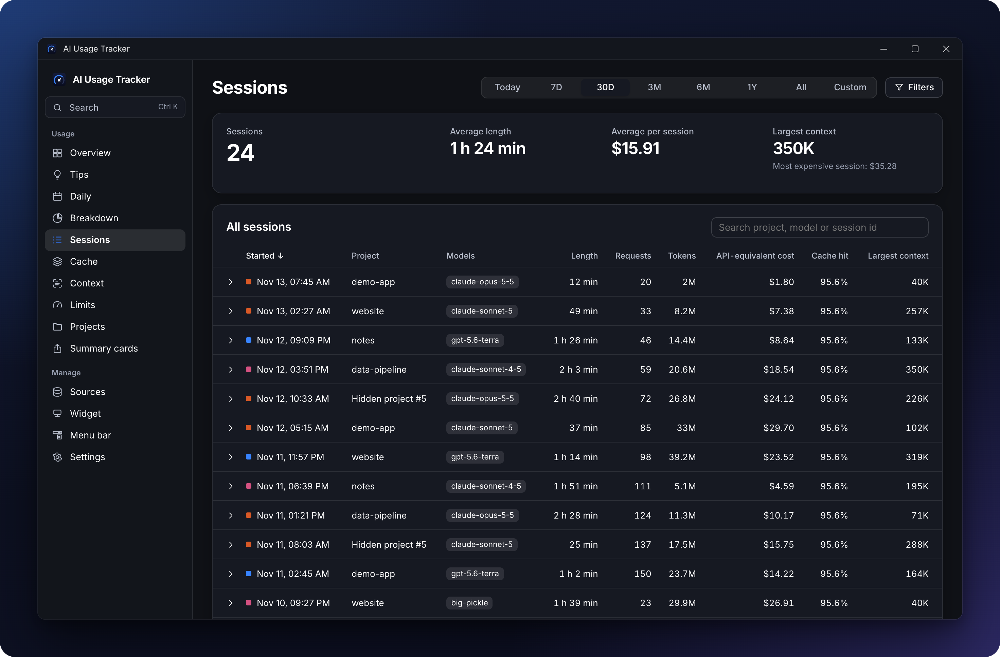 | 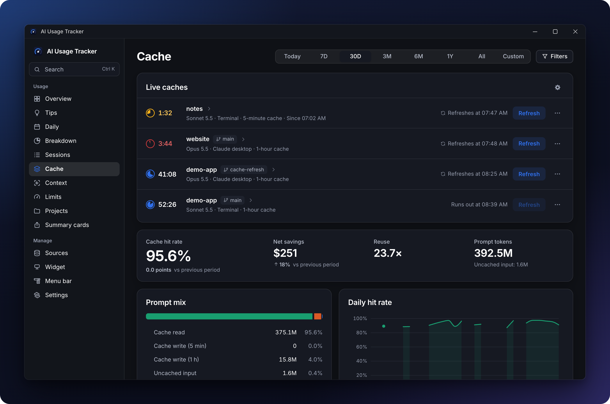 |
|---|---|
| **Sessions**: every session with its length, models, cost, and largest context | **Cache**: each conversation's cache time left, the hit rate, reuse, and what the cache actually saved |

**Sessions.** Open a session on the **Sessions** page to see a timeline of its requests, with cache rewrites, subagents and tool calls marked.

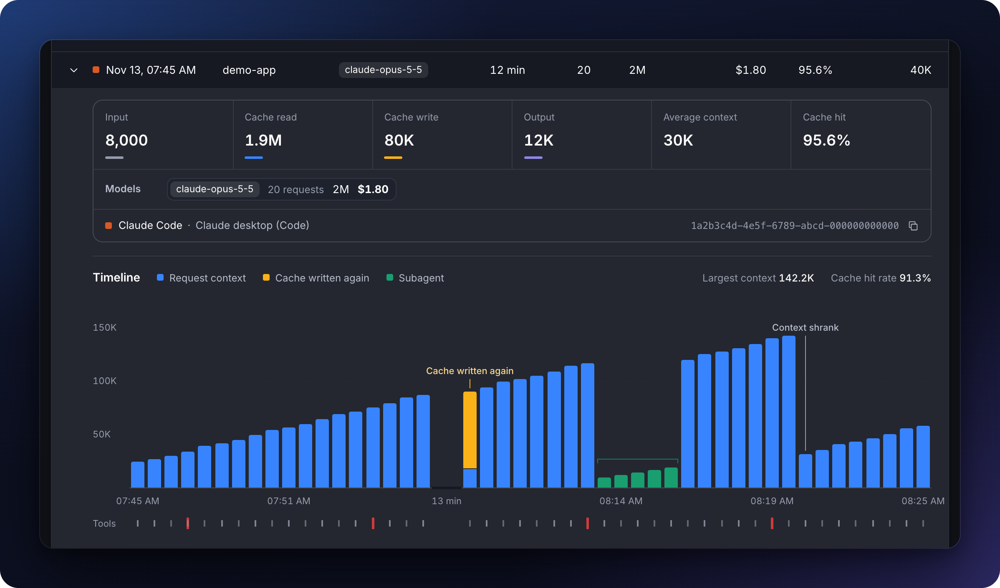

**Turn cost.** A turn is one prompt and everything it set off: the requests, the subagents and their tool calls. The **Sessions** page lists the period's turns, the costliest first, so you see what one prompt cost ("the turn at 14:32: 84 requests, 3 subagents, $11.40"). Turns come from the logs of Claude Code and Codex, and the prompt's text is never read.

**Cache time left.** Claude drops a conversation's cache after 5 minutes or an hour without use. The **Cache** page counts down each Claude Code conversation's cache, and the widget and the menu bar show the one that runs out first. With the status-line bridge on, Claude Code's own status line can show when its conversation's cache is dropped. Continue before it runs out and the next request reads the cache cheaply instead of writing it again. Choose where it shows, and turn on a warning shortly before, in **Settings → General → Cache time left**.

**Cache refresh.** **Refresh** next to a conversation makes Claude Code read its cache in one short turn, which starts its time again. **Refresh automatically** does this shortly before a cache runs out, and stops once the refreshes would cost more than writing the cache again. Each refresh counts against your plan like one cache read, and your own Stop hooks, such as a notification sound, run on each one too. The first time, the app asks before it adds a hook to Claude Code's settings (see [What the app changes on your computer](#what-the-app-changes-on-your-computer)).

**Why the cache was written again.** With the status-line bridge on, the **Cache** page adds up why Claude Code had to write a cache again, such as a changed MCP server, system prompt or model, and groups these misses by project.

| 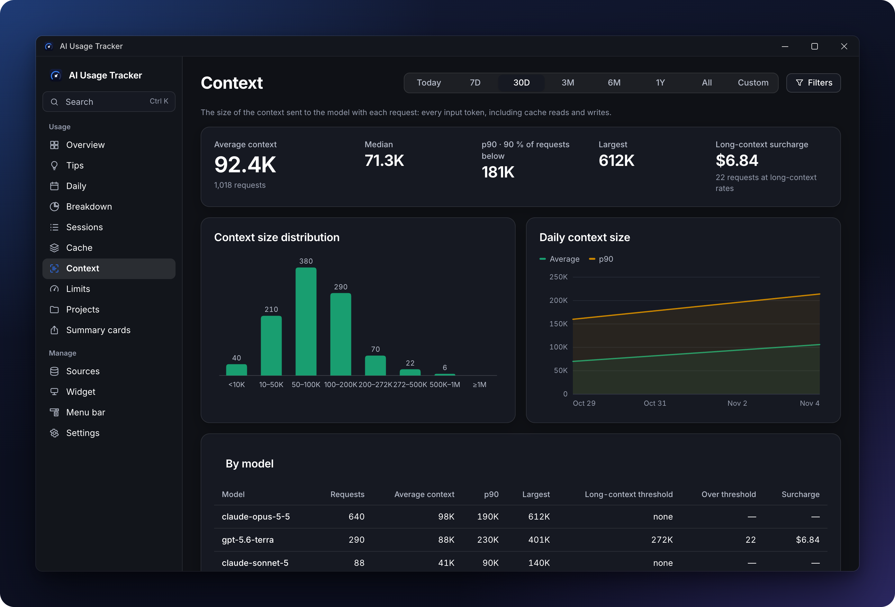 | 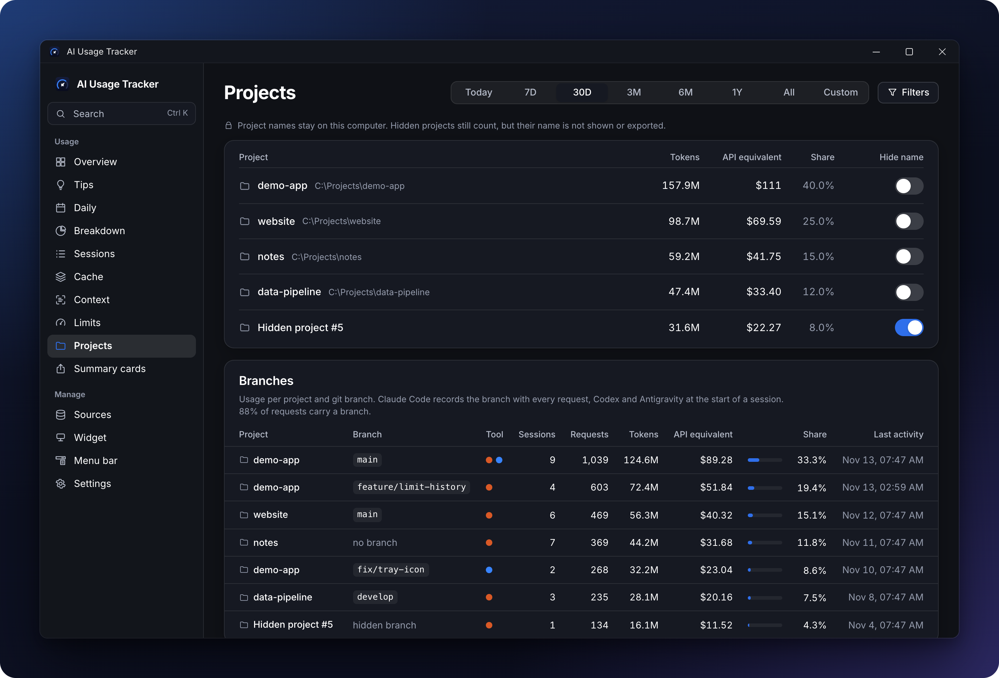 |
|---|---|
| **Context**: how large your prompts get, and the long-context surcharge | **Projects**: usage per project and per git branch |

**Starting load.** Every conversation starts with text you did not write: the system prompt, the tool definitions, memory files such as `CLAUDE.md`, and what your MCP servers add. The **Context** page shows that load for each project and the day it grew or shrank.

### Find anything with one shortcut

Press **Cmd+K** on a Mac or **Ctrl+K** on Windows and Linux to jump to any page, setting, project, model or session. You can also switch the theme, show or hide the widget, and check for updates from there.

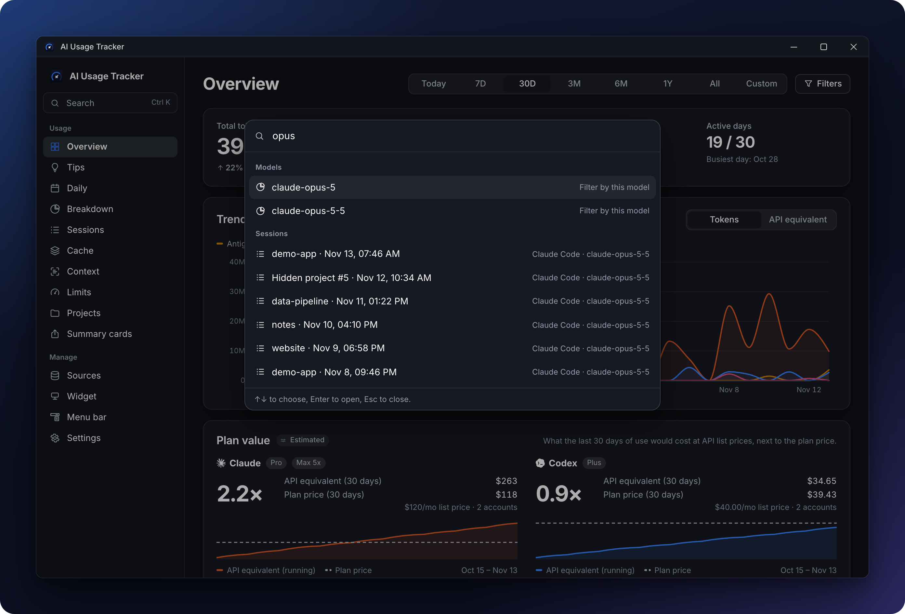

### A widget that stays out of the way

An always-on-top mini window sits in the bottom-right corner of the screen by default. Drag it anywhere, or right-click it to open the dashboard or change its opacity, size and position.

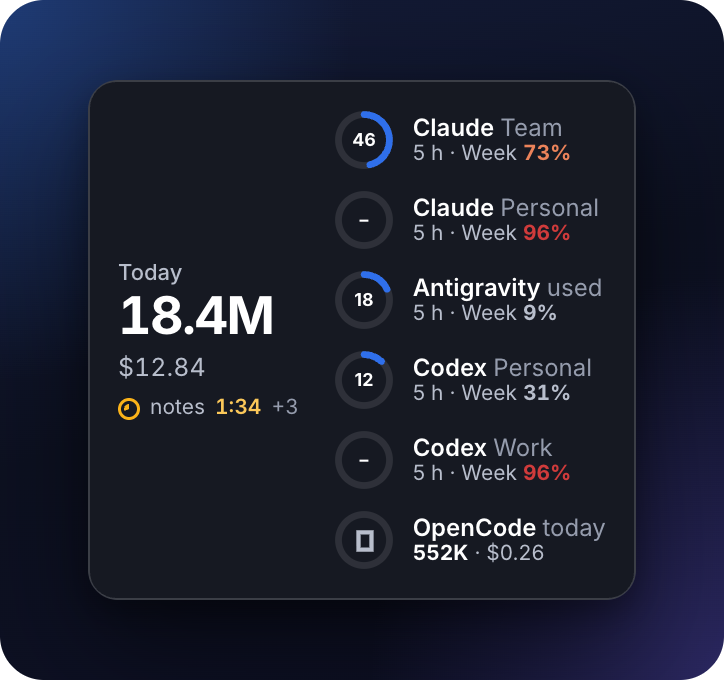

The **Widget studio** page changes what the widget shows, its layout, limit style, look, font and warning levels, with a live preview.

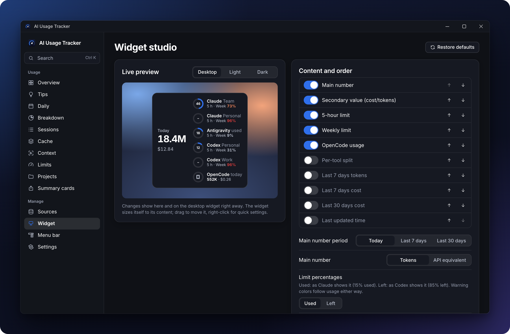

A system-wide shortcut shows or hides the widget (**Ctrl+Alt+Shift+W**, on macOS **⌃⌥⇧W**). Change it in **Settings → Widget**.

### Limits in the menu bar and tray

The app's icon sits next to the clock on Windows, in the menu bar on macOS, and in the system tray on Linux. Click it to open the control panel, or right-click it for a short menu. Linux trays report no clicks, so there the panel opens from that menu.


The panel shows the tiles you pick: limits, forecasts, usage, live caches, the last scan and buttons. Arrange them on the **Menu bar** page by dragging tiles from the gallery into a live preview.


The icon can show the app icon, a limit's percentage, a tool's logo, or a dial filled to the limit. Percentages, logos and the dial take a warning color as the limit gets close. On macOS and Linux, text such as `Cl 5h ▰▰▱▱▱ 46%` can sit next to the icon, with the limits, forecasts and usage you choose. Windows shows no text next to tray icons.


### Share a summary card

The **Summary cards** page turns a day, a week, a month or a year of your use into an image to share: a summary, a calendar, your hours, or a year story. Save it as a PNG in four sizes, or copy it and paste it straight into a post or a chat.

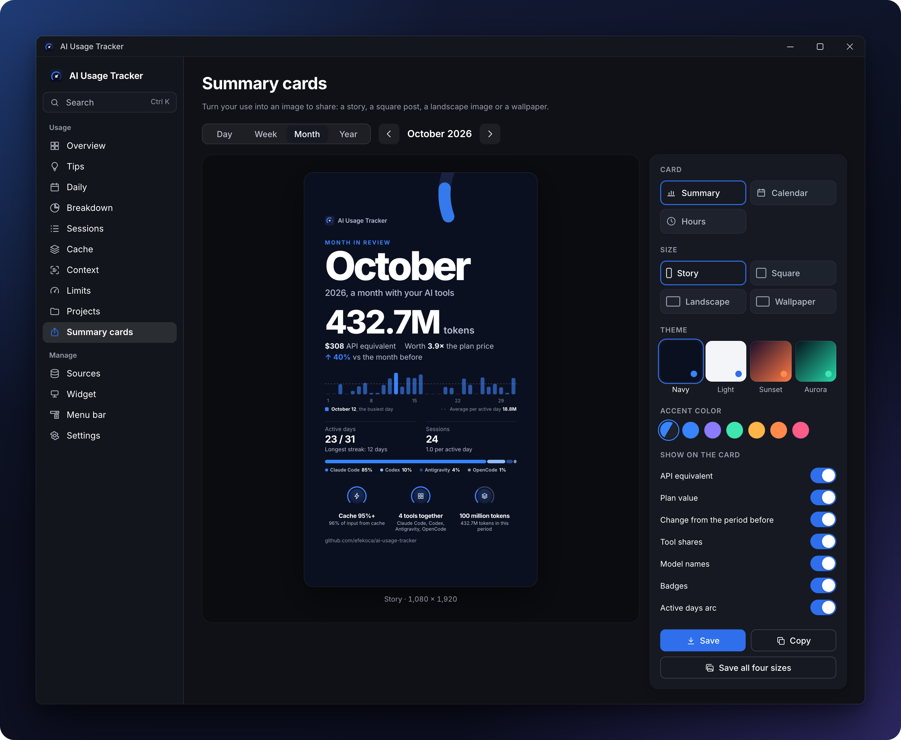

A card shows only totals, tool names and model names, never project names or anything you wrote. **Show on the card** lets you also leave out the cost, the plan value, model names and more.

### Weekly PDF, export, and your own prices

**Usage summary (PDF).** **Settings → Usage summary (PDF)** saves a week, a month or a year as an A4 PDF with totals, a daily chart, limits, models, projects and the most expensive sessions. The app can also save last week's summary by itself once a week, by default to the **AI Usage Tracker** folder in your Documents folder.

**Archive and data.** Source tools delete old logs (Claude Code after 30 days by default), but everything the app has imported stays in its archive. **Settings → Data** exports CSV or JSON, backs up the database, merges a backup back in, and offers **Delete all my data**.

**Prices.** API list prices ship with the app in [`config/pricing.json`](config/pricing.json), checked against the official pages of [Anthropic](https://platform.claude.com/docs/en/about-claude/pricing), [OpenAI](https://developers.openai.com/api/docs/pricing), [Google Gemini](https://ai.google.dev/gemini-api/docs/pricing) and [Vertex AI](https://cloud.google.com/vertex-ai/generative-ai/pricing), and for models OpenCode can use, of [DeepSeek](https://api-docs.deepseek.com/quick_start/pricing/), [Moonshot AI](https://platform.kimi.ai/docs/pricing/chat), [Z.ai](https://docs.z.ai/guides/overview/pricing), [Alibaba Cloud](https://www.alibabacloud.com/help/en/model-studio/model-pricing), [xAI](https://docs.x.ai/developers/pricing), [Mistral](https://docs.mistral.ai/inference/pricing) and [MiniMax](https://platform.minimax.io/docs/guides/pricing-paygo). Once you finish the first setup, the app downloads a newer copy of this file from GitHub at startup and every 12 hours, so new models are priced without an update. Turn this off with **Settings → Prices → Keep the price list current**. A model without a known price is never priced by guesswork. It stays out of costs until you enter a price in **Settings → Prices**.

### Your usage from the command line

`ai-usage-tracker --json` prints the usage and limits the app shows as JSON, for your scripts or tools such as Raycast, tmux or SketchyBar. The period is today unless you add `--period` with `7d`, `30d`, `3m`, `6m`, `1y` or `all`. The command only reads the app's data. The app does not have to be open, but the figures are only as recent as its last scan.

```sh
ai-usage-tracker --json | jq '.limits[] | select(.window == "five_hour") | .used_pct'
```

**Settings → Data → Command line** shows the command for your installation, with ready-made scripts for tmux, SketchyBar, Raycast and PowerShell.

## Supported sources

| Source | What is read | Tokens | Limits | Notes |
|---|---|---|---|---|
| **Claude Code** (CLI, VS Code, Claude desktop "Code") | `$CLAUDE_CONFIG_DIR` or `~/.claude/projects/**/*.jsonl` | **Exact** | Only when a limit is hit | Background helper calls are not in these logs |
| **Cowork sessions** (Claude desktop) | *Claude folder*`/local-agent-mode-sessions/**` | **Exact** | **Exact %** (5 h / 7 d) | Only tasks that ran on your computer. Cloud tasks count toward your limits but leave no local token counts |
| **Claude desktop: plan usage** | *Claude folder*`/plan-usage-history.json` | None | **Exact %** | Chat tokens are not stored locally |
| **Codex** (CLI and desktop) | `$CODEX_HOME` or `~/.codex/{sessions,archived_sessions}` | **Exact** | **Exact %** (every request) | Compressed sessions (`.jsonl.zst`) are read too |
| **Antigravity** (app, IDE and `agy` CLI) | `~/.gemini/{antigravity,antigravity-ide,antigravity-cli}/conversations/*.db` or `$ANTIGRAVITY_APP_DATA_DIR` | **Exact** | **Captured %** (through `agy`) | A copy is read, so Antigravity's files are never touched |
| **OpenCode** | `$XDG_DATA_HOME/opencode` or `~/.local/share/opencode` (also on Windows): `opencode.db`, or `$OPENCODE_DB` | **Exact** | None | Priced at the model maker's API price and not added to any plan's value. Sessions from versions before 1.3.16 are not counted |
| ChatGPT desktop | Nothing | None | None | Detection only |

`~` is your home folder (`%USERPROFILE%` on Windows). The *Claude folder* is `%APPDATA%\Claude` on Windows and `~/Library/Application Support/Claude` on macOS. The Claude desktop app is not available for Linux.

## Install

Download the file for your system from the [latest release](../../releases/latest). On first launch, the app lists the tools it found on this computer. Choose the sources you want and press **Get started**. Nothing is read until you confirm.

### Windows

Windows 10 and 11. Run `AI-Usage-Tracker_x.y.z_x64-setup.exe`. It installs for your user only (to `%LOCALAPPDATA%\AI Usage Tracker`), needs no administrator rights, and adds WebView2 on Windows 10 if it is missing.

> **SmartScreen.** The installer is not code-signed, so Windows may show "Unknown publisher". Choose **More info → Run anyway**.

**Uninstall.** Use **Settings → Apps** in Windows. The uninstaller undoes every change listed under [What the app changes on your computer](#what-the-app-changes-on-your-computer), including the start-with-Windows entry. Tick "Delete the application data" to also remove `%LOCALAPPDATA%\AIUsageTracker`.

### macOS

macOS 11 or newer, on Apple silicon and Intel Macs. Open `AI-Usage-Tracker_x.y.z_universal.dmg` and drag **AI Usage Tracker** to **Applications**. The app is signed and notarized by Apple, so it opens without a warning.

Run the app from Applications, not from the disk image. A copy opened from the disk image cannot start at login, keep the Claude Code status line, or update itself. To keep the app out of the Dock and the ⌘Tab list, turn off **Settings → Show in the Dock**.

**Uninstall.** macOS has no uninstaller, so undo the app's changes first:

1. Turn off what you turned on under **Sources → Live capture** and **Settings → Start at login**.
2. Turn off **Continue after a limit resets** and **Handoff note before the limit** on the **Limits** page.
3. If you added the cache refresh hook, remove it with **Settings → General → Cache time left → Remove**.
4. Drag the app to the Trash. Your data stays in `~/Library/Application Support/AIUsageTracker` until you delete it.

### Linux

Debian 12, Ubuntu 22.04 and newer, Fedora, openSUSE, and other x86_64 distributions with WebKitGTK 4.1.

- **Debian, Ubuntu, Mint:** `sudo apt install ./AI-Usage-Tracker_x.y.z_x86_64.deb`
- **Fedora:** `sudo dnf install ./AI-Usage-Tracker_x.y.z_x86_64.rpm`
- **openSUSE:** the packages carry no GPG signature, so run `sudo zypper install --allow-unsigned-rpm ./AI-Usage-Tracker_x.y.z_x86_64.rpm`. You can check the file against `SHA256SUMS` first (see [Verify a download](#verify-a-download)).
- **Any distribution:** make `AI-Usage-Tracker_x.y.z_x86_64.AppImage` executable (`chmod +x`) and run it. If it does not start, install FUSE 3 (`sudo apt install fuse3` on Debian and Ubuntu), or start it with `APPIMAGE_EXTRACT_AND_RUN=1 ./AI-Usage-Tracker_x.y.z_x86_64.AppImage`.

The app updates itself in all three forms. For the `.deb` and `.rpm`, your system asks for your password.

**Tray icon on GNOME.** GNOME shows tray icons only with the AppIndicator extension. Ubuntu includes it. On other GNOME systems, install "AppIndicator and KStatusNotifierItem Support".

**Widget shortcut.** It works in any app on KDE Plasma and GNOME, also under Wayland. On GNOME 47 and older, the app adds a GNOME custom shortcut for it. On Sway or Hyprland, bind a key to `ai-usage-tracker --toggle-widget` yourself, for example `bindsym Ctrl+Alt+Shift+w exec ai-usage-tracker --toggle-widget` (Sway) or `bind = CTRL ALT SHIFT, W, exec, ai-usage-tracker --toggle-widget` (Hyprland).

**Uninstall.** Run `sudo apt remove ai-usage-tracker` or `sudo dnf remove ai-usage-tracker`. Removing the package undoes the changes to the Claude Code and Codex settings and the start-at-login entry, for every user who used the app with the default folders (`~/.local/share` and `~/.config`). For the AppImage, follow steps 1 to 3 of the macOS uninstall, then delete the file. Your data stays in `~/.local/share/AIUsageTracker` until you delete it. On GNOME, also remove the widget shortcut with **Settings → Widget shortcut → Remove**, or later in GNOME's keyboard settings.

### Verify a download

Every release includes `SHA256SUMS`, the checksum of each file. Put it next to your download and run:

- **Linux:** `sha256sum -c SHA256SUMS --ignore-missing`
- **macOS:** `shasum -a 256 -c SHA256SUMS --ignore-missing`
- **Windows (PowerShell):** `Get-FileHash .\AI-Usage-Tracker_x.y.z_x64-setup.exe`, then compare the hash with the line for that file in `SHA256SUMS`.

## Privacy

> **Content never enters the archive.** The app takes only details such as token counts, model, and time from the logs. Prompt and response text is never saved to the archive, your usage data never leaves your computer, and the app has no telemetry.

- **Read:** timestamps, model, project folder, git branch, session ID, subagent name, when each prompt was sent and what kind it was (never its text), token counts, the name and outcome of each tool call (never its input or output), and limit percentages.
- **Stored:** only those values, in `tracker.db` (SQLite) in the app's data folder: `%LOCALAPPDATA%\AIUsageTracker` on Windows, `~/Library/Application Support/AIUsageTracker` on macOS, and `~/.local/share/AIUsageTracker` on Linux. You can hide project names, and hidden names are masked in exports too.
- **Never kept:** prompts, responses, file contents, credentials or access tokens. The app does not read the tools' credential files.
- **Accounts:** to tell accounts apart, the app keeps only a one-way digest of the Codex account ID and of the Claude plan's organization ID. For Claude it reads only that ID, from `~/.claude.json`, from telemetry events and from the Claude desktop app's Code-tab session list. Account names are the ones you give, and e-mail addresses are never read.
- **Antigravity and OpenCode:** both keep conversation text in a database. The app reads Antigravity's from a temporary copy that only you can open and deletes the copy right away. It opens OpenCode's read-only. From both it takes only counts and metadata.
- **Network:** the app itself connects only to check for updates and for a newer price list. Each check downloads one file and sends nothing. The limit reads run your own Claude Code, Codex and Antigravity CLI, which ask their own services for your limits, with Claude Code's telemetry and Codex's analytics off. A tool you install from the app comes from its maker's site.
- **Window scheduler:** when it is on, it runs your own Claude Code once on each chosen day to send one small request, with telemetry, error reporting, MCP servers and hooks off for that run.

### What the app changes on your computer

The app changes the Claude Code and Codex files only after you turn a feature on, and it asks before it adds a hook. It backs up `~/.claude/settings.json` before every change. Turning a feature off removes only what the app wrote, and your own changes stay.

| Feature | What it adds | How to remove it |
|---|---|---|
| **Cache refresh** | A hook in `~/.claude/settings.json` | **Settings → General → Cache time left → Remove** |
| **Continue after a limit resets** | A hook in `~/.claude/settings.json` | Turn the switch off on the **Limits** page |
| **Handoff note before the limit** (Claude Code) | A hook and a write permission for the app's notes folder in `~/.claude/settings.json`. The hook adds a short sentence to the start of each conversation | Turn the switch off on the **Limits** page |
| **Handoff note before the limit** (Codex) | A hook in `~/.codex/hooks.json`. Codex asks you once to trust it, and Codex's `config.toml` is never touched | Turn Codex off on the card, or turn the switch off |
| **Claude Code status-line bridge** | `statusLine` in `~/.claude/settings.json`. An existing status line keeps running | Turn it off under **Sources → Live capture** |
| **Local telemetry receiver** | Log-export variables in the `env` block of `~/.claude/settings.json` | Turn it off under **Sources → Live capture** |
| **Start at login** | A start-at-login entry for the app | Turn off **Settings → Start at login** |
| **Widget shortcut** (GNOME 47 and older, under Wayland) | A GNOME custom shortcut for the widget's key, added by itself | **Settings → Widget shortcut → Remove** |

A hook can appear under several events in the file, each time with the app's own command. The cache refresh and limit hooks never read the conversation, and the messages the limit and handoff hooks add to a conversation are fixed in the app. The Codex hook reads the end of the conversation's own Codex log and keeps only its limit lines. Codex writes its note to a private folder in the temp folder, and the app moves it to its data folder. The app never reads a handoff note. It only opens it or passes its path to the other tool.

The Windows uninstaller and removing the Linux package undo these changes, except the GNOME shortcut. Updates leave them alone. On macOS and with the AppImage, turn them off before you delete the app.

### Live capture

**Sources → Live capture** has five switches. The three limit reads are on by default. They change no files, make no model request, and use only your own sign-in. The two methods that edit Claude Code's settings are off by default.

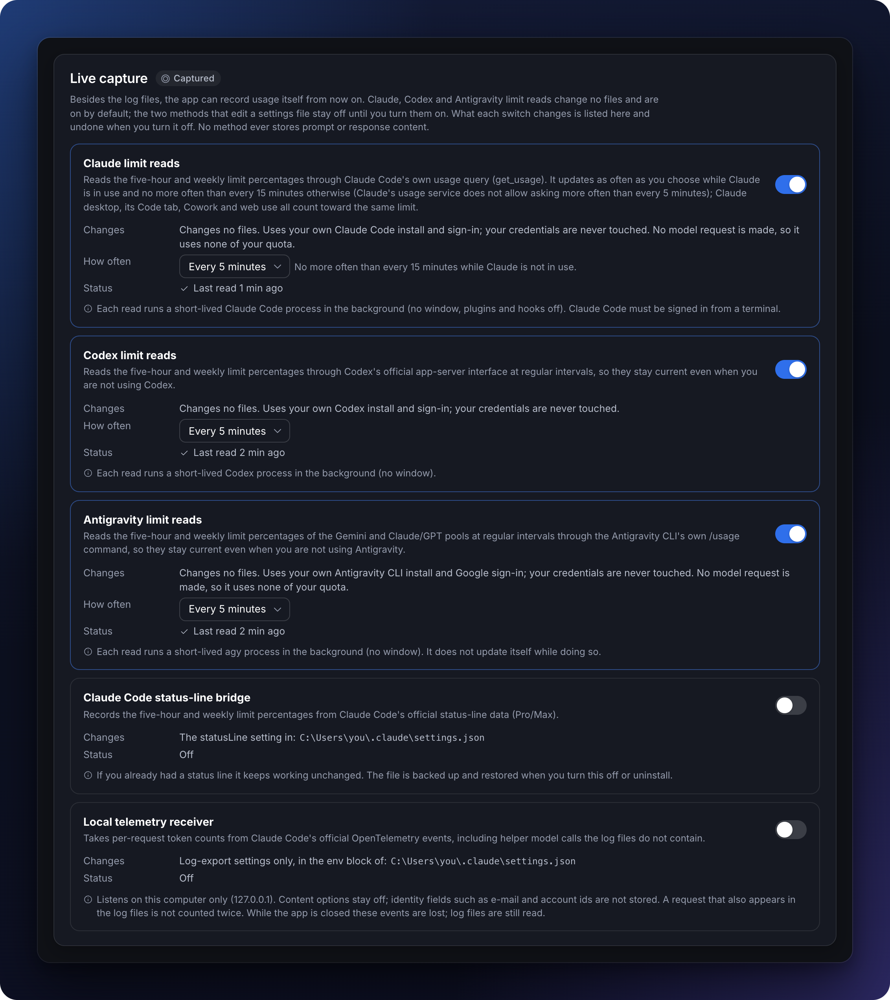

| Method | What it does | What it needs |
|---|---|---|
| **Claude limit reads** | Reads your limits through Claude Code's own usage query, every 5 minutes while you use Claude. Use in Claude desktop, Cowork and on the web shows up too | Claude Code signed in with Pro or Max (`claude` → `/login`) |
| **Codex limit reads** | Reads your limits through Codex's official interface, every 5 minutes or as often as you set under **How often** | Codex, signed in |
| **Antigravity limit reads** | Reads the Gemini and Claude/GPT limits through the `/usage` command of `agy`, every 5 minutes or as often as you set | The Antigravity CLI (`agy`). The app and IDE cannot do this read |
| **Claude Code status-line bridge** | Records limits and cache misses from Claude Code's official `statusLine` data, and can add the cache time and the conversation's cost to your status line | Claude Code with Pro or Max, in the terminal. The Claude desktop Code tab runs no status lines |
| **Local telemetry receiver** | Takes per-request token counts and the Claude account from Claude Code's official telemetry, including helper calls the logs lack. It listens on `127.0.0.1` only, with a key made for this install, and never turns prompt logging on | Claude Code |

When a tool a limit read needs is missing, its card offers **Install**, which uses the maker's own installer (`claude.ai/install`, `chatgpt.com/codex/install` or `antigravity.google/cli/install`). When the tool is signed out, the card shows how to sign in. If you already have your own telemetry setup, the app leaves it alone and tells you.

## How it works

Everything runs on your computer:

1. Your AI tools write usage logs to disk, as they already do.
2. The app reads each log from where it left off and keeps only counts and metadata in a local SQLite archive. Records repeated by streaming, resumed or forked sessions are counted once.
3. When the limit reads are on, your own `claude`, `codex` and `agy` CLIs supply the limit percentages.
4. The dashboard, widget, tray icon and PDF summary read from that archive.

## Updates

Once you finish the first setup, the app checks for a new version at startup and every 6 hours. The check downloads only a small version file and sends nothing. An update is installed only after you confirm it, and only if its signature matches the key built into the app. Turn the check off under **Settings → Updates**.

## Known limitations

- **Claude Code totals** can be slightly low, because helper calls outside the main model are missing from its logs.
- **Desktop chats** in Claude and ChatGPT have no local token counts.
- **Codex's fast tier** is not recorded per request, so the standard price is used.
- **Older Antigravity conversations** that were kept as encrypted `.pb` files are not read.
- **Google AI plan prices** differ by country and offer, so you enter what you pay for Antigravity.
- **OpenCode** costs are the model maker's API price, not what OpenRouter, GitHub Copilot or OpenCode Zen charged. A model with no maker price stays out of the cost.
- **Log formats** are not documented interfaces and may change. The app skips unknown fields and lists unrecognized files under **Sources**.

## Build from source

You need Rust 1.99+ and Node 22.12+, plus the Visual Studio Build Tools (C++) on Windows, the Xcode Command Line Tools on macOS, or WebKitGTK 4.1 and its build files on Linux (on Debian and Ubuntu: `sudo apt install libwebkit2gtk-4.1-dev libayatana-appindicator3-dev librsvg2-dev libxdo-dev libssl-dev`).

```bash
npm --prefix ui install
cargo test -p tracker-core
npx --prefix ui tauri dev
npm --prefix ui run release
```

`npm --prefix ui run dev` on its own opens the dashboard in a browser with sample data. Bug reports and pull requests are welcome.

## Code signing policy

See [CODE_SIGNING.md](CODE_SIGNING.md).

## License

[MIT](LICENSE)
