# AI Usage Tracker

**Claude Code, Codex, Antigravity ve OpenCode kullanımınızı, API eşdeğeri maliyetinizi ve plan limitlerinizi tek yerden izleyin.**

AI Usage Tracker, Windows, macOS ve Linux'ta çalışan bir uygulamadır. Yapay zekâ araçlarınızın bilgisayarınıza zaten yazdığı kullanım kayıtlarını okur ve size anlaşılır bir panelde sunar. Ne kadar token harcadığınızı, bu kullanımın API fiyatlarıyla ne tutacağını ve limitlerinizin ne zaman dolacağını görürsünüz. Hesap açmanız gerekmez; verileriniz bulutta değil, kendi bilgisayarınızda kalır.

[](../../releases/latest)

   [](LICENSE)

[Özellikler](#özellikler) · [Kurulum](#kurulum) · [Gizlilik](#gizlilik) · [Nasıl çalışır](#nasıl-çalışır) · [Kaynaktan derleme](#kaynaktan-derleme) · [English](README.md)

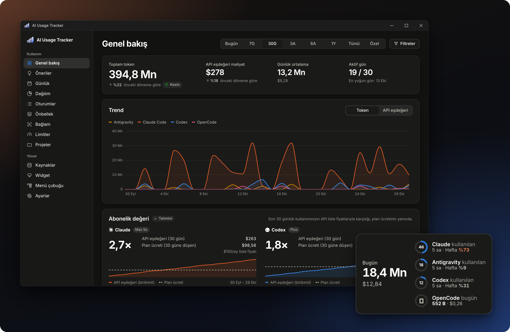

- **Verileriniz sizde kalır.** Prompt ve yanıtlarınız uygulamanın arşivine hiçbir zaman kaydedilmez. Uygulama yalnızca sayıları ve meta verileri bilgisayarınızdaki bir dosyada tutar ve hiçbir yere göndermez.
- **Her sayının nereden geldiğini bilirsiniz.** Araçtan doğrudan okunan değerler **Kesin**, uygulamanın hesapladıkları **Tahmini**, canlı okunanlar **Yakalanan** etiketiyle gösterilir. Hiçbir değer sessizce tahmin edilmez.
- **Limitinize takılmadan çalışın.** Claude, Codex ve Antigravity'nin 5 saatlik ve haftalık limitlerini birkaç dakikada bir güncel olarak görür, ne zaman dolacaklarını önceden öğrenirsiniz.

## Öne çıkan özellikler

- **Limitlerinizi kotanızdan harcamadan izleyin.** Limit yüzdeleri Claude Code'un, Codex'in ve Antigravity CLI'ın kendi resmi arayüzlerinden okunur. Bunun için modele tek bir istek bile gönderilmez.
- **Gereken aracı tek tıkla kurun.** Limit okumak için Claude Code, Codex CLI ya da Antigravity CLI gerekiyorsa uygulama onu üreticinin resmi kurulumuyla kurar. Giriş yapmanız gerekiyorsa ne yapacağınızı adım adım gösterir.
- **Limitinizin ne zaman dolabileceğini görün.** Tahmin, pencerenin başından bu yana ortalama hızınıza dayanır. Kısa süreli bir yoğunluk, bütün hafta öyle geçecekmiş gibi hesaplanmaz.
- **Limit pencerenizin tahmini API eşdeğerini görün.** Uygulama, sonuna kadar izlediği pencerelerden yola çıkarak 5 saatlik ya da haftalık bir pencerenin API fiyatlarıyla ne kadar kullanıma denk geldiğini hesaplar.
- **Size uygun planı öğrenin.** Limitleriniz sık doluyorsa bir üst plan önerilir. Daha küçük bir plan ise yalnızca sağlayıcının yayımladığı oranlar bunu destekliyorsa önerilir.
- **Aynı işin başka bir modelle ne tutacağını karşılaştırın.** İstekleriniz aynı token sayıları ve bağlam boyutlarıyla fiyat listesindeki her modele göre yeniden fiyatlanır.
- **Alt ajanların ve araçların payını görün.** Maliyetin ne kadarının alt ajanlardan geldiğini ve hangi araçların ne sıklıkla hata verdiğini görürsünüz.
- **Önbelleğin size ne kazandırdığını ölçün.** İsabet oranını, net tasarrufu ve uzun bir aradan sonra önbelleğin yeniden yazılmasının maliyetini görürsünüz.
- **Geçmişinizi kaybetmeyin.** Devam ettirdiğiniz ya da kopyasından yeni oturum açtığınız sohbetler iki kez sayılmaz. Claude Code kayıtlarını 30 gün sonra silse bile geçmişiniz uygulamanın veri tabanında kalır.

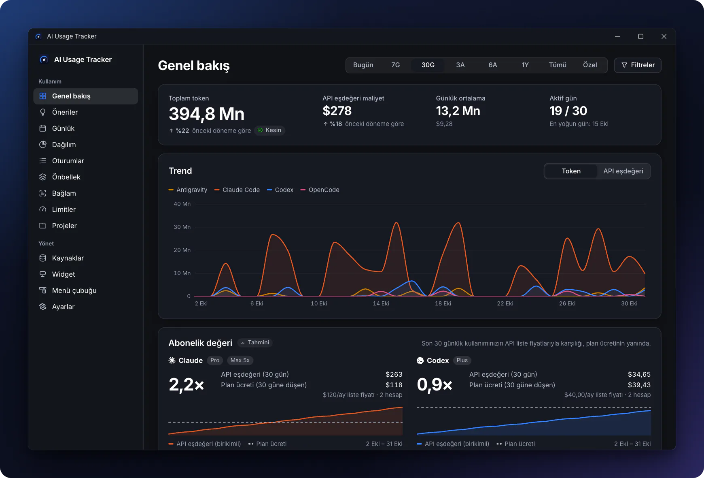

## Özellikler

### Limitlerinizi anlık izleyin

5 saatlik ve haftalık limit yüzdeleriniz Claude Code'un, Codex'in ve Antigravity CLI'ın kendi arayüzlerinden okunur; gördüğünüz sayılar araçların gösterdiğiyle aynıdır. Her pencerenin ne zaman dolacağını ve her projenin limitin ne kadarını kullandığını görürsünüz.

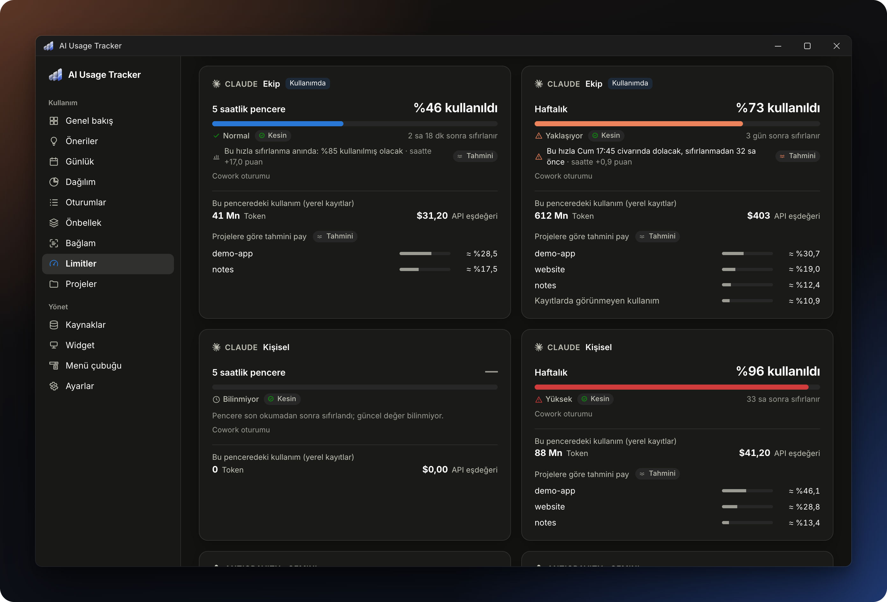

Sağlayıcılar limitlerin sayısal karşılığını yayımlamıyor, yalnızca nasıl işlediklerini açıklıyor. Bu yüzden uygulama şu kurallara uyar:

- Gerçek yüzde yalnızca araç bunu kendi kaydına yazdığında ya da uygulama canlı okuduğunda gösterilir (bkz. [Canlı yakalama](#canlı-yakalama)).
- Son okumadan sonra aracı kullandıysanız güncel değer bilinemez. Bu durumda "?" görürsünüz; yanında son okuma ve ne kadar önce yapıldığı yazar. Eski bir değer hiçbir zaman güncelmiş gibi gösterilmez. Panelde ve menü çubuğu metninde bu son okuma "~" ile işaretlenir: güncel değer genellikle daha yüksektir, ama sağlayıcı arada limitinizi sıfırladıysa daha düşük olabilir.
- Yüzdeleri **kullanılan** ("%15 kullanıldı", Claude'daki gibi) ya da **kalan** ("%85 kaldı", Codex'teki gibi) olarak görebilirsiniz. Bu tercihi **Ayarlar**'dan, **Limitler** sayfasından ya da **Widget stüdyosu**'ndan değiştirirsiniz. Uyarı renkleri her iki durumda da kullanıma göre değişir.
- Okuma yoksa her pencere için kendi bütçenizi belirleyebilirsiniz, örneğin "5 saatte 50 $ API eşdeğeri". Bu bütçeye göre hesaplanan yüzde **Tahmini** olarak gösterilir.
- Limitler hesabınızın tamamı için geçerlidir. Yüzde her arttığında artış, o arada istek gönderen projelere API eşdeğeri maliyetleri oranında bölünür. Başka yerde yaptığınız kullanım (web, telefon, bulut görevleri, başka bir bilgisayar) projelerinize yazılmaz, **Kayıtlarda görünmeyen kullanım** satırında ayrı görünür. Bu paylar **Tahmini** olarak gösterilir.
- Her araç kendi tek renkli ikonuyla gösterilir. **Ayarlar → Genel → Araç renkleri** bölümünden Claude, Codex ve Antigravity'ye limit çubuklarında ve widget halkalarında kullanılacak kendi rengini verebilir, isterseniz ikonları da renklendirebilirsiniz. Limit dolmaya yaklaştığında uyarı renkleri yine gösterilir. Yalnızca adları görmek isterseniz ikonları **Ayarlar → Genel → Araç ikonlarını göster** ile kapatın.

**Birden fazla Codex hesabı.** Codex hesapları arasında geçiş yapıyorsanız her hesabın limiti, geçmişi ve dolma tahmini ayrı görünür. Codex her isteğin hangi hesaptan gittiğini kaydetmez. Bu yüzden uygulama her isteği, bildirdiği limit penceresine bakarak hesabına bağlar. Hesabın kim olduğunu Codex'in verdiği bilgilerden öğrenir: oturumu açan hesap (oturumun ilk istekleri için) ve Codex limit okumasındaki giriş yapılmış hesap (Codex 0.163 ve sonrası). Erken sıfırlamalar, şirketin verdiği sıfırlama hakları dahil, hesap değişimiyle karıştırılmaz. Herkese verilen bir sıfırlama iki hesabın penceresini aynı anda başlatırsa o pencere hiçbir hesaba yazılmaz. Kanıtı olmayan istekler tahmin edilmez; **Tanımlanmamış hesap** altında kalır. Widget, panel ve menü çubuğu kullanımdaki hesabı gösterir. Diğer hesaplarınızı da yanına ekleyebilirsiniz: **Widget stüdyosu**'ndan ya da **Menü çubuğu** sayfasındaki listelerden. **Limitler** sayfasında tüm hesapları görür, her birine ad verip planını seçebilirsiniz. Kullanımı hesaba göre de filtreleyebilirsiniz. Tek hesap kullanıyorsanız hiçbir şey değişmez.

**Birden fazla Claude hesabı.** Claude'un limitleri planınızın bağlı olduğu kuruluşa aittir. Bu yüzden her Claude hesabının limiti, geçmişi ve dolma tahmini ayrı görünür; aynı girişle kullandığınız bir ekip planı da ayrı hesap sayılır. Claude Code her isteğin hangi hesaptan gittiğini kaydetmez. Uygulama hesabı yalnızca bunu kesin gösteren bilgilerden öğrenir: yerel telemetri alıcısı açıksa isteğin kendi telemetri kaydından, Claude masaüstünün Code sekmesindeki oturumlarda ise masaüstünün hesabından. Telemetri kapalıyken terminaldeki bir oturum, ancak çalıştığı Claude ayar klasörü uygulamanın izlediği süre boyunca hep aynı hesapta kaldıysa o hesaba yazılır; örneğin her hesap için ayrı bir `CLAUDE_CONFIG_DIR` kullanıyorsanız. Uygulama açık hesabı, çalıştığı sürece 30 saniyede bir kontrol eder. Çalışan bir Claude Code, başka yerde `/login` yaptıktan sonra da bir süre eski girişle devam eder ve kayıtlar oturumun ne zaman açıldığını yazmaz. Bu yüzden aynı klasörde hesap değiştiriyorsanız yerel telemetri alıcısını açın. Açmazsanız bu istekler tahmin edilmez; **Tanımlanmamış hesap** altında kalır. Uygulamanın açık hesabı izlemeye başlamasından önceki istekler de öyle. Uygulamanın kendi limit okuması, Claude Code'da açık olan hesaba; masaüstü uygulamasının kullanım geçmişi masaüstünün hesabına yazılır. Klasörleriniz aynı anda farklı hesaplarda açıksa kullanımdaki hesap, uygulamanın limitleri okuduğu hesaptır. **Limitler** sayfası, kullanım filtresi, widget, panel ve menü çubuğu Codex'teki gibi çalışır. Tek hesap kullanıyorsanız hiçbir şey değişmez.

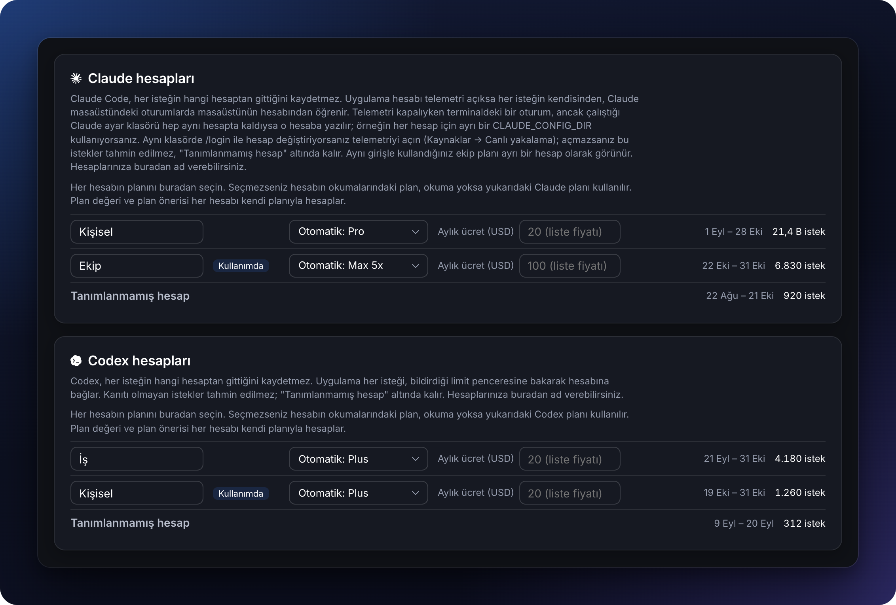

**Dolma tahmini.** Uygulama her güncel okumada, pencerenin **başından bu yana ortalama hızınıza** göre bir tahmin yapar (şu anki yüzde ÷ pencere başladığından bu yana geçen süre). Her pencere %0'dan başladığı için bu hız kesin olarak bilinir ve boşta geçen saatleri de içerir; kısa bir yoğunluk hiç bitmeyecekmiş gibi ileriye taşınmaz. Sonuçta pencerenin ne zaman dolacağını ("Paz 21:12 civarında dolacak, sıfırlanmadan 9 sa önce") ya da sıfırlandığında hangi seviyede olacağını görürsünüz. Sağlayıcı bir pencereyi bitiş zamanını değiştirmeden erkenden sıfırlarsa hız o sıfırlamadan itibaren ölçülür. Pencerenin ilk onda birinde tahmin yapılmaz. Tahminler **Tahmini** etiketi taşır.

### Geçmiş limit pencerelerinizi inceleyin

**Limitler** sayfasındaki **Geçmiş** sekmesinde her 5 saatlik ve haftalık pencerenizi görürsünüz: ne kadar dolduğunu, dolup dolmadığını, ne kadar sürede dolduğunu ve o sırada bu bilgisayarda ne kadar kullandığınızı. Uygulama bu pencerelerden yola çıkarak bir pencerenin tamamının API eşdeğeri olarak kaça denk geldiğini de tahmin eder.

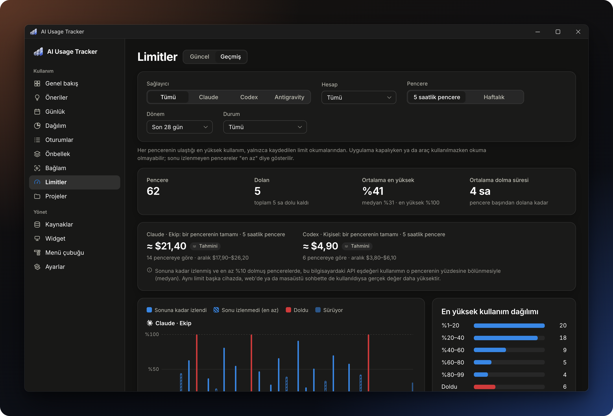

Her pencere için ne kadar süre dolu kaldığı ve sonuna kadar izlenip izlenmediği de yazar. Kullanım token ve API eşdeğeri olarak gösterilir. Sonu izlenmemiş pencereler taralı çizilir; bunların en yüksek okuması "en az" olarak okunmalıdır.

- **Filtreler:** sağlayıcı, hesap (birden fazla Codex ya da Claude hesabı varsa), pencere (5 saatlik ya da haftalık), dönem (7 günden tümüne kadar), durum (dolanlar, %80 ve üzeri, sonuna kadar izlenenler).
- **Özet:** kaç pencere olduğu, kaçının dolduğu ve toplamda ne kadar süre dolu kaldığı, en yüksek kullanımın ortalaması ve medyanı, ortalama dolma süresi ve en yüksek kullanımların dağılımı.
- **Bir pencerenin tamamı API cinsinden** (tahmini): Sonuna kadar izlenmiş ve en az %10 dolmuş her pencerede, bu bilgisayardaki API eşdeğeri kullanım en yüksek okumaya kadar toplanır ve o yüzdeye bölünür. Gösterilen değer bu sonuçların medyanı ve aralığıdır. Aynı limiti başka bir cihazda, web'de ya da masaüstü sohbette de kullandıysanız gerçek değer daha yüksektir.
- **Tablo:** tüm pencereler; başlangıca, en yüksek kullanıma, dolma süresine ya da yerel kullanıma göre sıralanabilir.

### Size uygun planı ve tasarruf fırsatlarını bulun

**Öneriler** sayfası kendi kayıtlarınızdan bulgular çıkarır. Her bulgu dayandığı sayıları, ne yapabileceğinizi ve nasıl hesaplandığını gösterir. **Plan önerisi** de limitleriniz sık doluyorsa bunu söyler; daha küçük bir planı ise yalnızca yayımlanmış oranlar destekliyorsa önerir.

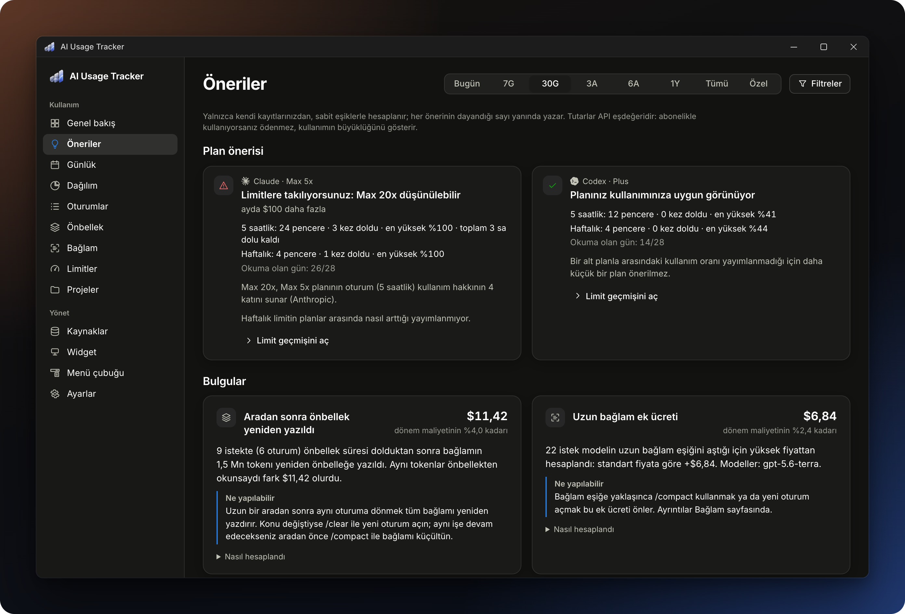

**Plan önerisi.** Son 28 güne bakar; yalnızca bu ölçümlere ve sağlayıcıların yayımladığı bilgilere dayanır:

- **Limitleriniz dolduysa** (bir haftalık pencere bir kez ya da 5 saatlik pencereler üç kez): Bir üst plan, fiyat farkı ve yayımlanmış oranıyla birlikte önerilir. Claude'da Max 5x ve Max 20x, Pro'nun oturum başına kullanım hakkının 5 ve 20 katını verir. ChatGPT'de Pro planının 5 saatlik limiti yoktur. Haftalık limitin planlar arasında nasıl arttığı yayımlanmadığı için kart bunu ayrıca belirtir.
- **Daha küçük plan:** Yalnızca oturum oranının yayımlandığı durumlarda (Claude) önerilir. Bunun için en az 14 günlük okuma ve sonuna kadar izlenmiş en az iki haftalık ve beş adet 5 saatlik pencere gerekir. Ayrıca her pencerenin alt planda %80'in altında kalması gerekir. Haftalık kısım kesin bir bilgi olarak değil, bir koşul olarak yazılır ("haftalık hak da aynı oranda olsaydı"). OpenAI planları arasındaki oranı yayımlamadığı için ChatGPT'de daha küçük plan önerilmez.
- **7 günden az okuma varsa** hiçbir öneri yapılmaz.

Claude okumaları iki Max planı için de yalnızca "max" der; bu yüzden planınızı **Limitler** sayfasından seçin. Seçtiğiniz plandan farklı bir planda okunmuş Claude pencereleri (Pro ile Max arasında) hesaba katılmaz. Codex okumaları planın adını tam olarak içerir ve siz plan seçmediyseniz bu bilgi kullanılır.

Birden fazla Codex ya da Claude hesabınız varsa her hesap, kendi pencerelerine ve kendi planına göre ayrı bir öneri alır. Her hesabın planını **Limitler** sayfasından seçin. Plan seçmediğiniz hesap, okumalarının söylediği planı alır. Claude okumaları Max 5x ile Max 20x'i ayırmaz; bu yüzden Max hesabı, Claude için seçtiğiniz Max planını alır ya da sizden seçmenizi ister. Okumalar listede olmayan bir plan söylüyorsa da seçmenizi ister. Okuması olmayan hesap, sağlayıcı için seçtiğiniz planı alır. Bir hesap limitlere takılırken diğerinde yer varsa **Öneriler** sayfası bunu söyler.

**Bulgular.** Her kuralın sabit bir eşiği vardır. Bir bulgunun gösterilmesi için tutarın en az 0,50 $ olması ve dönem maliyetinin en az %1'ine ulaşması gerekir. Uygulama şunlara bakar:

- Uzun bir aradan sonra önbelleğin baştan yazılması. Claude, önbelleğe aldığı içeriği bir süre kullanılmazsa (5 dakika ya da 1 saat) siler. Ara verip aynı sohbete döndüğünüzde bu içerik yeniden yazılır ve daha pahalıya gelir. Uygulama bu farkı, aynı içerik önbellekten okunsaydı ne tutacağıyla karşılaştırarak gösterir. Yalnızca daha önce önbellekte olan içerik hesaba katılır; sohbete yeni eklediğiniz kısım sayılmaz.
- Uzun bağlam, hızlı mod ve veri yerleşimi ek ücretleri. Aynı isteklerin standart fiyatıyla karşılaştırılır.
- Maliyetin büyük kısmının bağlamı 100K token'ı aşan isteklerden gelmesi.
- Çağrılarının %25'i ya da daha fazlası hata veren araçlar (sonucu bilinen en az 20 çağrı).

Tutarlar API eşdeğeridir. Abonelikle kullanıyorsanız bu tutarları ödemezsiniz; tutarlar kullanımınızın büyüklüğünü gösterir.

**Abonelik değeri.** **Genel bakış** sayfası, son 30 günde her sağlayıcıdaki API eşdeğeri kullanımınızı planınızın bu günlere düşen ücretiyle karşılaştırır ("4,7×"). Birikimli kullanımınız plan ücretiyle aynı grafikte çizilir ve planın kendini kaçıncı gün amorti ettiği gösterilir. Bu 30 günde hiç kullanmadığınız araçlar gösterilmez.

- **Liste fiyatları** [`config/plans.json`](config/plans.json) dosyasındadır ve 2026-10-02'de resmi sayfalardan doğrulanmıştır ([Claude](https://claude.com/pricing), [ChatGPT](https://learn.chatgpt.com/docs/pricing)).
- **Kendi fiyatınız:** Sabit fiyatı olmayan planlarda (ChatGPT Pro, Enterprise) fiyatı siz girersiniz. Her planın fiyatını **Limitler** sayfasından değiştirebilirsiniz (örneğin yıllık ödüyorsanız).
- **Birden fazla hesap:** Bu 30 günde görülen her Codex ve Claude hesabı kendi planı ve fiyatıyla hesaba katılır; fiyatlar toplanır. Kart her hesabın API eşdeğeri kullanımını planıyla birlikte listeler. Ücretsiz plandaki ya da API fiyatıyla ödenen kullanım toplama girmez; hiçbir hesaba bağlanamayan kullanım ise yalnızca toplama girer. Bir hesaba girdiğiniz fiyat, yalnızca o hesabın o anki planı için geçerlidir.
- **Alt sınır:** Claude ve ChatGPT'deki sohbet kullanımı yerel kayıtlarda olmadığı için gerçek değer daha yüksek olabilir.

### Kullanımınızı gün gün görün

**Günlük** sayfası seçtiğiniz dönemi gün gün gösterir. Kısa dönemlerde sütunlar, uzun dönemlerde takvim görürsünüz; değerleri token, API eşdeğeri ya da istek sayısı olarak seçebilirsiniz.

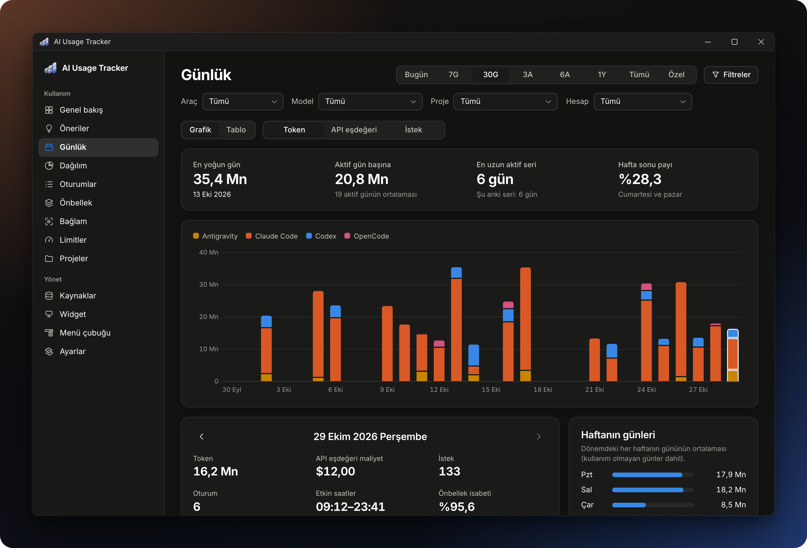

Sayfanın üstünde en yoğun gününüz, aktif gün başına ortalamanız, en uzun ve şu anki aktif gün seriniz ve hafta sonu payınız yer alır. Bir gün seçtiğinizde ya da aktif günler arasında gezindiğinizde o günün ayrıntıları açılır: token, maliyet, istek, oturum, ilk ve son etkinlik, önbellek isabeti, saat saat grafik, kullandığınız araçlar, modeller ve projeler, o gün ulaşılan en yüksek limit okumaları. Yanında haftanın her gününün ortalamasını ve en yoğun günlerinizi görürsünüz.

### Aynı işin başka bir modelle ne tutacağını görün

**Dağılım** sayfası, ilgili dönemdeki isteklerinizi aynı token sayıları ve bağlam boyutlarıyla fiyat listesindeki her modele göre yeniden hesaplar. Sonuçları gerçek maliyetinizle birlikte, en ucuzdan en pahalıya doğru görürsünüz.

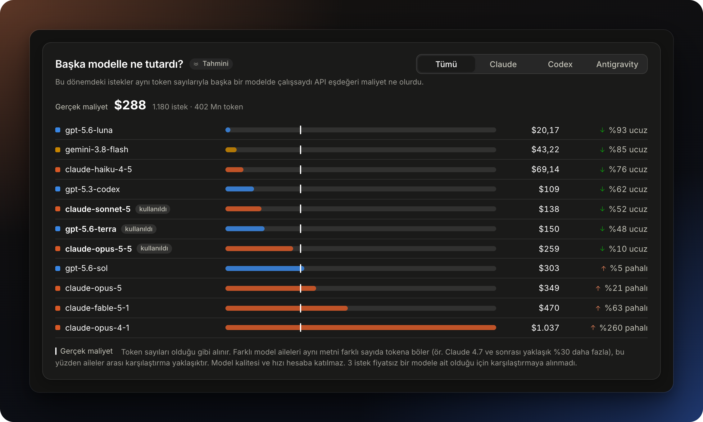

Model aileleri aynı metni farklı sayıda token'a böler (Claude 4.7 ve sonrası yaklaşık %30 daha fazla token üretir). Bu yüzden farklı aileler arasındaki karşılaştırma yaklaşıktır; kalite ve hız hesaba katılmaz.

### Alt ajanların ve araçların payını görün

**Dağılım** sayfası, alt ajanlarınızın ana konuşmanın yanında ne kadar tuttuğunu, ajanların hangi araçları çağırdığını ve bu çağrıların ne sıklıkla hata verdiğini gösterir.

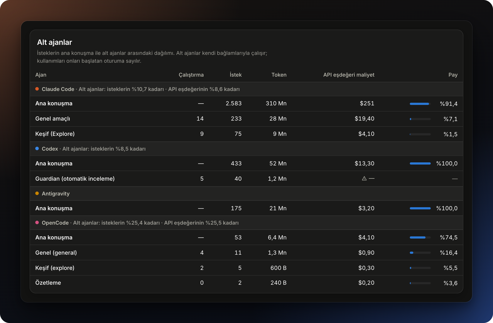

- **Alt ajanlar:** Alt ajanların (Explore gibi Claude Code ajanları, Codex'in guardian otomatik incelemesi vb.) istek, token ve API eşdeğeri maliyeti, ana konuşmayla yan yana gösterilir. Bir alt ajanın kullanımı onu başlatan oturuma sayılır.
- **Araç kullanımı:** Her aracın kaç kez çağrıldığını ve çağrıların ne kadarının hata verdiğini görürsünüz. Hata bilgisi, aracın kendi kaydettiği sonuçtan alınır. MCP araçları sunucuya göre gruplanır. Yalnızca aracın adı ve sonucu saklanır; girdileri ve çıktıları hiçbir zaman saklanmaz.

### Oturumlarınızı, önbelleği, bağlamı ve projelerinizi inceleyin

| 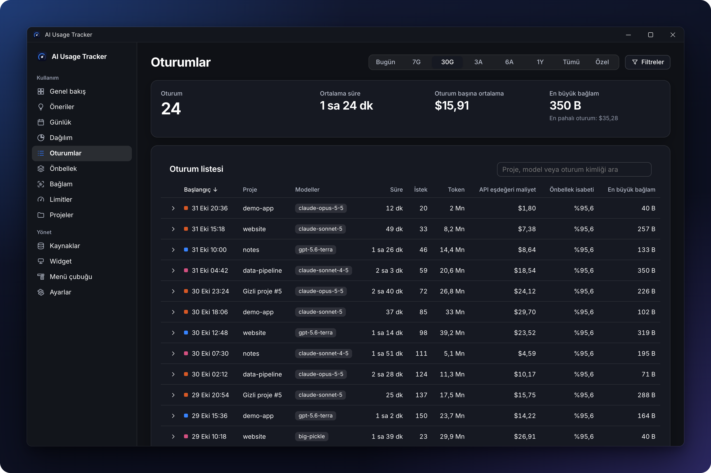                              | 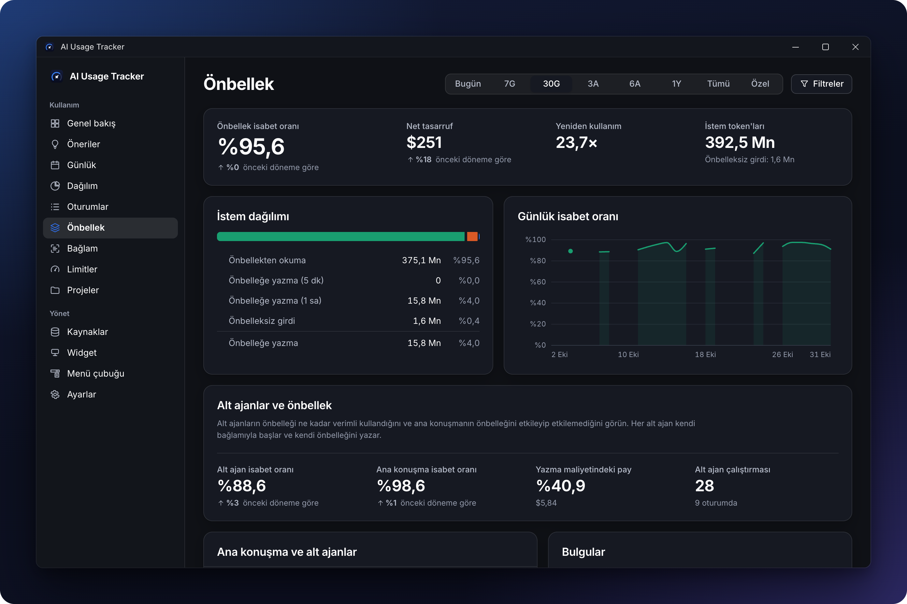                                         |
| --------------------------------------------------------------------------------- | ---------------------------------------------------------------------------------------- |
| **Oturumlar**: her oturumunuz; süresi, modelleri, maliyeti ve en büyük bağlamıyla | **Önbellek**: isabet oranı, yeniden kullanım ve önbelleğin size gerçekte ne kazandırdığı |

| 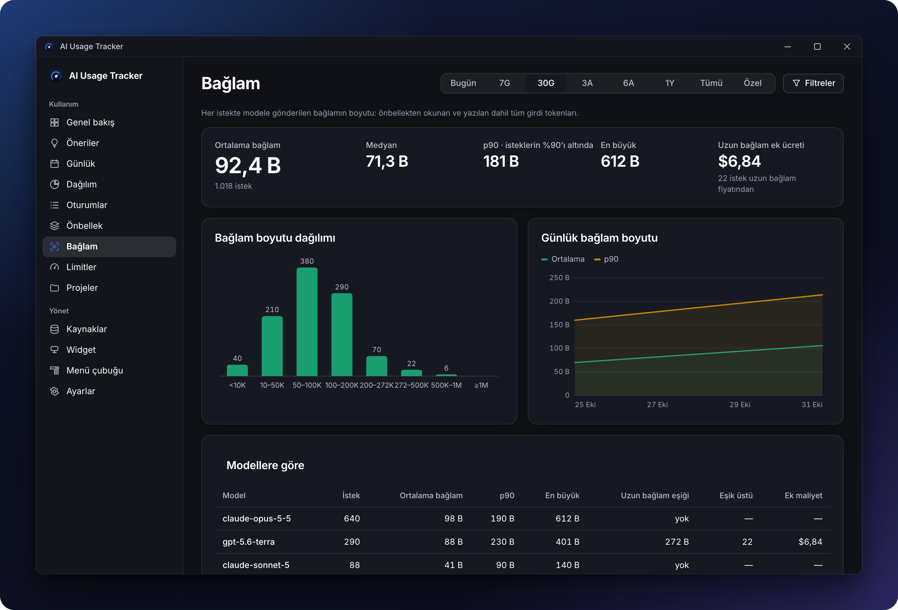                      | 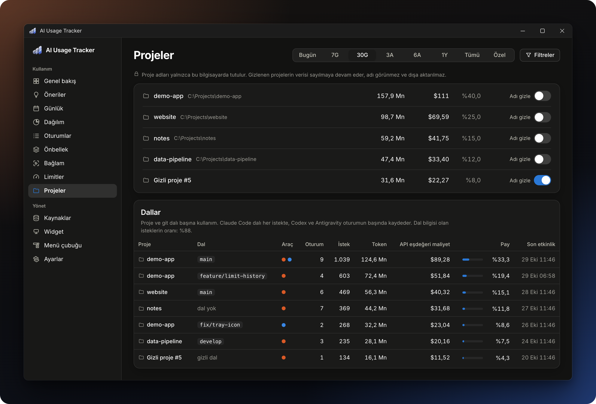 |
| --------------------------------------------------------------------- | --------------------------------------------------- |
| **Bağlam**: istemlerinizin ne kadar büyüdüğü ve uzun bağlam ek ücreti | **Projeler**: proje ve git dalı bazında kullanım   |

**Oturumlar** sayfası dönemdeki her oturumunuzu listeler: başlangıç, proje, modeller, süre (ilk ve son istek arası), istek, token, API eşdeğeri, önbellek isabeti ve en büyük bağlam. Listeyi sıralayabilir ve içinde arama yapabilirsiniz; bir satırı açınca model bazında ayrıntısını görürsünüz. Alt ajan kayıtları ait oldukları oturuma sayılır.

**Bağlam** sayfası her istekte gönderilen bağlamın büyüklüğünü gösterir (önbellekten okunan ve önbelleğe yazılanlar dahil tüm girdi token'ları):

- ortalama, medyan, p90 ve en büyük değer,
- boyut dağılımı (10K altından 1M üstüne kadar),
- günlük ortalama ve p90,
- model bazında dağılım ve **uzun bağlam ek ücreti**: bir modelin uzun bağlam eşiğini (GPT-5.x için 272K) aşan isteklerin standart fiyata göre fazladan tuttuğu tutar.

**Önbellek** sayfasında şunları görürsünüz:

- isabet oranı (önbellekten okunan ÷ istem token'ları),
- yeniden kullanım katsayısı (okuma ÷ yazma). Claude için ve önbellek yazmalarını kaydeden Codex modelleri için hesaplanır; eski Codex kayıtları yalnızca okumaları tuttuğu için hesaba katılmaz,
- 5 dakikalık ve 1 saatlik yazmaların ayrımı,
- günlük isabet oranı,
- model, araç ve projeye göre dağılım,
- **net tasarruf**: önbellekten okunan token'ları tam fiyat yerine indirimli ödediğiniz için kazandığınız tutar; önbelleğe yazma ücreti bundan düşülür. Değer, API eşdeğeridir ve her istek kendi modelinin fiyatıyla hesaplanır.

Net tasarruf eksi çıkıyorsa, yazılan önbellek maliyetini karşılayacak kadar okunmamış demektir.

**Projeler** sayfası her projenin kullanımını git dalına göre ayırır. Claude Code dalı her istekte, Codex ise oturum bir depoda başladığında kaydeder. Depo dışındaki istekler "dal yok" olarak görünür.

### Limitlerinizi masaüstünde görün

Widget her zaman üstte duran küçük bir penceredir. Varsayılan olarak ekranın sağ alt köşesinde durur. Neleri gösterdiğini ve nasıl göründüğünü **Widget stüdyosu**'nda canlı önizlemeyle değiştirirsiniz.

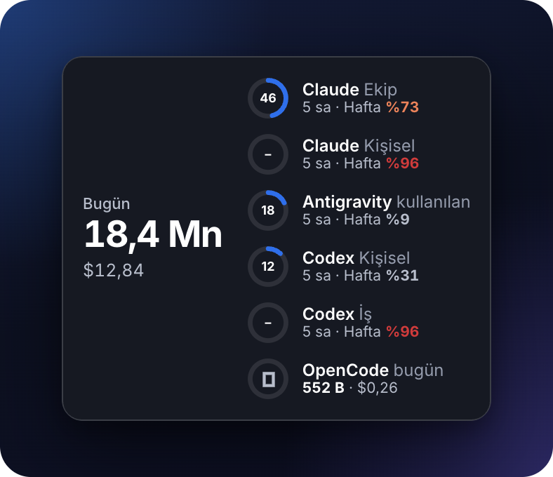

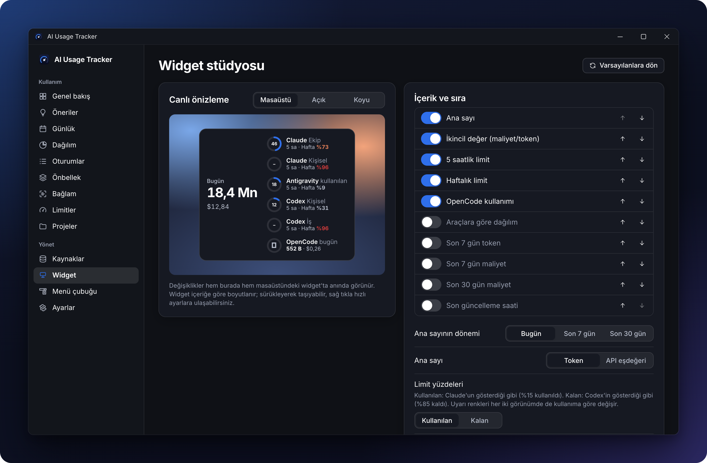

**Widget stüdyosu**'nda şunları ayarlayabilirsiniz:

- **Gösterilenler:** ana sayı, ikincil değer, 5 saatlik ve haftalık limitler, OpenCode kullanımı, araçlara göre dağılım, 7 ve 30 günlük toplamlar, son güncelleme saati. Her öğeyi açıp kapatabilir ve sırasını değiştirebilirsiniz. Limitleri gösterilecek araçları ve sıralarını da seçebilirsiniz. Antigravity için hangi limitin gösterileceğini belirleyin: Gemini, Claude ve GPT, ikisi birden ya da hangisi daha doluysa o.
- **Yerleşim:** yatay, dikey ya da tek satır.
- **Limit gösterimi:** halka, çubuk ya da metin.
- **Görünüm:** tema, vurgu rengi, ölçek, arka plan opaklığı, köşe yuvarlaklığı, kenarlık, gölge, etiketler, araç ikonları, sıfırlanmaya kalan süre.
- **Yazı:** bilgisayarınızda yüklü herhangi bir yazı tipi (aranabilir; her biri kendi görünümüyle listelenir), yazı boyutu, ana sayı boyutu, sayı kalınlığı, sabit genişlikli rakamlar.
- **Uyarı eşikleri:** dikkat ve kritik seviyeleri.
- **Davranış:** her zaman üstte, konum kilidi, tıklayınca ne olacağı, tam ekran uygulamalarda gizlenme (Windows), köşeye yerleştirme.

Widget boyutunu içeriğe göre kendisi ayarlar. Bir köşeye sabitlediyseniz büyüyüp küçülürken o köşede kalır; sürüklerseniz bıraktığınız yerde durur. Sağ tıklayarak hızlı ayarlara ulaşabilirsiniz. Sistem tepsisindeki simge her zaman görünür.

- **Tepsi simgesi, kontrol paneli ve menü çubuğu** (Windows'ta saatin yanında, macOS'te menü çubuğunda, Linux'ta sistem tepsisinde): Simgeye tıklayınca bir kontrol paneli açılır. Panelde limitleriniz (halka ya da çubuk, tek pencere ya da ikisi birden), bu hızla bir limitin ne zaman dolacağı, bugün, son 7 ya da 30 günün kullanımı (tüm araçlar ya da yalnızca OpenCode), son tarama ve uygulamayı açma, widget'ı gösterme ve şimdi tarama düğmeleri yer alır. Sağ tık küçük bir menü açar; Linux'ta panel bu menüden açılır. Simge ayrıca bir limitin yüzdesini widget'ın uyarı renkleriyle gösterebilir; macOS ve Linux'ta yanına `Cl 5s %42 · Cl H ▰▰▰▱▱` gibi bir metin de koyabilirsiniz.
  - Hepsini **Menü çubuğu** sayfasından ayarlayın: kutucukları galeriden panelin canlı önizlemesine sürükleyin, sürükleyerek sıralayın, galeriye geri sürükleyerek kaldırın. Bir kutucuğa tıklayıp boyutunu (küçük, geniş, büyük, tam genişlik) ve halka ya da çubuk görünümünü seçin.
  - Simgenin yanındaki metne istediğiniz limitleri, tahminleri, kullanım değerlerini (tüm araçlar ya da yalnızca OpenCode) ya da son taramayı istediğiniz sırayla ekleyin. Ayrıca şunları belirleyebilirsiniz: tam ad, kısa ad ya da etiketsiz; kullanılan ya da kalan; yüzde, çubuk, ikisi birden ya da daire; sıfırlanmaya kalan süre ya da saati; ayraç, metnin iki ucuna eklenecek işaretler ve uyarı eşiğini geçen değerde ⚠︎. macOS'te simgeyi gizleyip yalnızca metni bırakabilirsiniz.
- **Kısayol:** Sistem genelinde bir tuş kısayoluyla widget'ı gösterip gizleyebilirsiniz (varsayılan **Ctrl+Alt+Shift+W**, macOS'te **⌃⌥⇧W**). Değiştirmek için **Ayarlar → Widget** bölümünü kullanabilirsiniz. Başka bir programın kullandığı kısayol kabul edilmez.

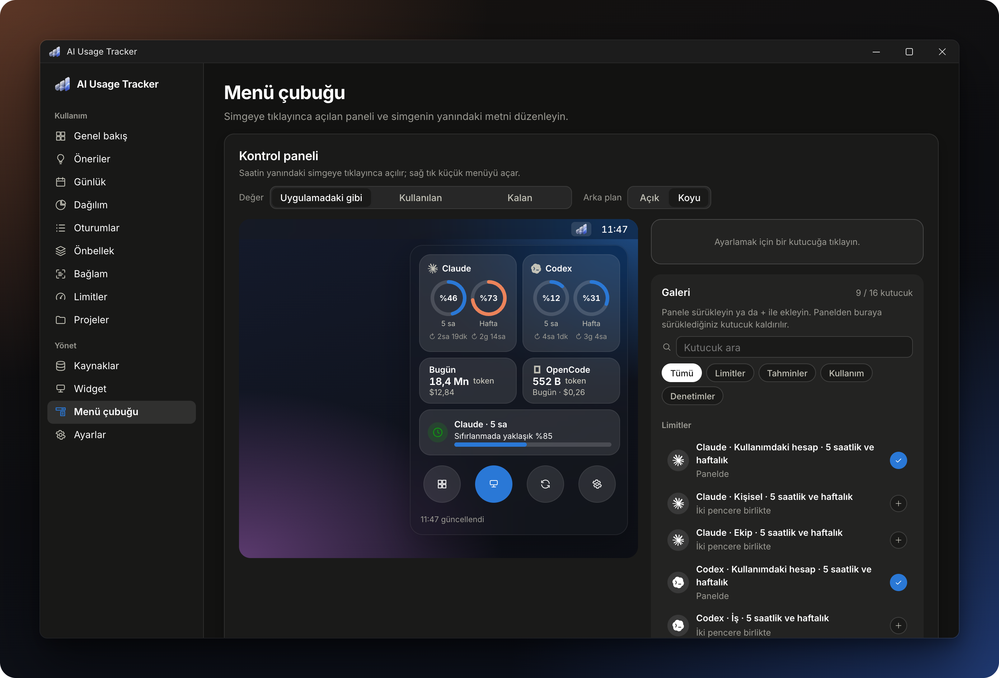

### Haftalık rapor alın, verilerinizi yönetin

Haftalık kullanımınızı PDF olarak kaydedebilir, verilerinizi dışa aktarıp yedekleyebilir ve fiyatları kendinize göre düzenleyebilirsiniz.

**Kullanım özeti (PDF).** **Ayarlar → Kullanım özeti (PDF)** bölümünden geçen haftayı, bu haftayı, son 7 günü, geçen ayı, bu ayı, geçen yılı ya da bu yılı A4 PDF olarak kaydedebilirsiniz. Özette şunlar yer alır: önceki döneme göre değişimiyle toplamlar, günlük grafik (üç aydan uzun dönemlerde aylık), araçlar, abonelik değeri, tahminleriyle güncel limitler, bağlam, modeller, projeler (gizlediğiniz adlar gizli kalır), en maliyetli oturumlar ve notlar. Yazdırma penceresi açılmaz. İsterseniz son tam haftanın (pazartesi–pazar) özeti, ilk tarama haftanın kayıtlarını okuduktan sonra her hafta bir kez kendiliğinden kaydedilir. Bilgisayar kapalıyken kaçırılan hafta bir sonraki açılışta kaydedilir; taşıdığınız ya da sildiğiniz özet yeniden kaydedilmez (varsayılan olarak Belgeler klasörünün içindeki **AI Usage Tracker** klasörüne kaydedilir).

**Kalıcı arşiv.** Araçlar kendi kayıtlarını zamanla silebilir. Örneğin Claude Code CLI eski oturumları varsayılan olarak **30 gün** sonra siler; Claude Desktop/Cowork oturumları bunun dışındadır. Uygulama içe aldığı her kaydı kendi veri tabanında tuttuğu için geçmişiniz kaybolmaz. Hiçbir kayıt iki kez sayılmaz (bkz. [Nasıl çalışır](#nasıl-çalışır)).

**Dışa aktarma ve yedek.** **Ayarlar → Veriler** bölümünde şunları yapabilirsiniz:

- CSV ya da JSON olarak dışa aktarma (istek bazında ya da günlük özet),
- veri tabanını yedekleme,
- bir yedeği mevcut verilerle birleştirerek içe aktarma,
- **Tüm verilerimi sil:** Veri tabanını boşaltır ve yeniden onaylayana kadar kayıt almayı durdurur. Başka bir yere kaydettiğiniz yedeklere ve dışa aktarımlara dokunmaz.

**Fiyatlar.**

- Fiyatlar [`config/pricing.json`](config/pricing.json) dosyasındadır ve 2026-10-02 ile 2026-10-10 arasında resmi sayfalardan doğrulanmıştır: [Anthropic](https://platform.claude.com/docs/en/about-claude/pricing), [OpenAI](https://developers.openai.com/api/docs/pricing), [Google Gemini](https://ai.google.dev/gemini-api/docs/pricing), [Vertex AI](https://cloud.google.com/vertex-ai/generative-ai/pricing).
- Hesaba katılan fiyat kalemleri: önbelleğe yazma (5 dk / 1 sa), önbellekten okuma, OpenAI uzun bağlam katmanı (>272K), hızlı mod (fast mode) ve ABD veri yerleşimi çarpanları, web araması ücreti.
- Fiyatı bilinmeyen modeller **maliyete eklenmez** ve "fiyat tanımsız" uyarısıyla listelenir. Ad benzerliğine bakılarak tahmini fiyat atanmaz. **Genel bakış**'taki bu uyarıyı kapatabilirsiniz; yalnızca başka bir model fiyatsız kalırsa yeniden çıkar. Uyarıyı **Ayarlar → Fiyatlar → Uyarıyı tekrar göster** ile de geri getirebilirsiniz.
- Fiyatları **Ayarlar → Fiyatlar** ekranında düzenleyebilirsiniz. Listede önce kayıtlarınızda geçen modeller görünür; fiyatı tanımlı bütün modelleri görmek için **Tüm modelleri göster**'e basın. Düzenlemeleriniz uygulamanın veri klasöründeki `pricing.json` dosyasına kaydedilir (bkz. [Gizlilik](#gizlilik)). Sonraki sürümlerde eklenen modeller bu dosyaya kendiliğinden eklenir, düzenlemeleriniz korunur. Aynı ekranda fiyatsız bir modeli başka bir modelin fiyatıyla hesaplatabilir ya da varsayılan fiyatlara dönebilirsiniz.

## Desteklenen kaynaklar

| Kaynak                                                 | Okunan konum                                                             | Token     | Limit                      | Not                                                                                 |
| ------------------------------------------------------ | ------------------------------------------------------------------------ | --------- | -------------------------- | ----------------------------------------------------------------------------------- |
| **Claude Code** (CLI, VS Code, Claude masaüstü "Code") | `$CLAUDE_CONFIG_DIR` ya da `~/.claude/projects/**/*.jsonl` | **Kesin** | Yalnızca limit dolduğunda  | Yardımcı arka plan çağrıları (örneğin web araması özetleme) bu kayıtlarda yer almaz |
| **Cowork oturumları** (Claude masaüstü)                | *Claude klasörü*`/local-agent-mode-sessions/**` | **Kesin** | **Kesin %** (5 sa / 7 gün) | Yalnızca bilgisayarınızda çalışan işler. Yeni Cowork işleri bulutta çalışır: token sayıları bilgisayarınızda tutulmaz ancak plan limitlerinize dahil edilir |
| **Claude masaüstü: plan kullanımı**                    | *Claude klasörü*`/plan-usage-history.json` | —         | **Kesin %**                | Sohbet token'ları yerelde tutulmadığı için token verisi **yok**                     |
| **Codex** (CLI ve masaüstü)                            | `$CODEX_HOME` ya da `~/.codex/{sessions,archived_sessions}` | **Kesin** | **Kesin %** (her istekte)  | Yeni Codex sürümlerinin sıkıştırdığı oturumlar (`.jsonl.zst`) da okunur             |
| **Antigravity** (uygulama, IDE ve `agy` CLI)           | `~/.gemini/{antigravity,antigravity-ide,antigravity-cli}/conversations/*.db` ya da `$ANTIGRAVITY_APP_DATA_DIR` | **Kesin** | **Yakalanan %** (`agy` ile) | Veritabanının bir kopyası okunur; Antigravity'nin dosyalarına dokunulmaz. Gemini ile Claude/GPT modellerinin limitleri ayrı gösterilir |
| **OpenCode**                                           | `$XDG_DATA_HOME/opencode` ya da `~/.local/share/opencode` (Windows'ta da): `opencode.db`, ya da `$OPENCODE_DB` | **Kesin** | —                          | OpenCode'da kullandığınız her sağlayıcı (Anthropic, OpenAI, OpenRouter, GitHub Copilot, OpenCode Zen…) modelin kendi API fiyatıyla hesaplanır. OpenCode bir isteğin abonelikle mi API anahtarıyla mı yapıldığını kaydetmediği için bu kullanım hiçbir planın değerine eklenmez. 1.3.16'dan eski sürümlerle yapılan oturumlar sayılmaz |
| ChatGPT masaüstü                                       | —                                                                        | **Yok**   | —                          | Yalnızca algılanır                                                                  |

`~` kullanıcı klasörünüzü gösterir (Windows'ta `%USERPROFILE%`, örneğin `C:\Users\adınız`). *Claude klasörü* Windows'ta `%APPDATA%\Claude`, macOS'te `~/Library/Application Support/Claude` klasörüdür; Claude masaüstü uygulamasının Linux sürümü yoktur.

Her sayının yanında bir doğruluk etiketi bulunur:

- **Kesin:** Aracın kendi kaydındaki değer.
- **Tahmini:** Uygulamanın hesapladığı değer; örneğin bir projenin limit payı ya da belirlediğiniz bütçeye göre hesaplanan yüzde.
- **Yakalanan:** Uygulamanın canlı okuduğu değer (bkz. [Canlı yakalama](#canlı-yakalama)): limit okuma, durum satırı köprüsü ya da yerel telemetri alıcısı üzerinden gelir.

## Kurulum

[Son sürümden](../../releases/latest) sisteminize uygun dosyayı indirin. İlk açılışta bilgisayarınızda bulunan araçlar listelenir. İstediğiniz kaynakları seçip **Başla**'ya basın. Siz onay vermeden hiçbir kayıt okunmaz.

### Windows

Windows 10 ve 11.

1. `AI-Usage-Tracker_x.y.z_x64-setup.exe` dosyasını çalıştırın. Kurulum yalnızca sizin kullanıcı hesabınıza yapılır ve yönetici yetkisi istemez; uygulama `%LOCALAPPDATA%\AI Usage Tracker` klasörüne kurulur.
2. WebView2 Windows 11'de zaten yüklüdür. Windows 10'da eksikse kurulum dosyası onu da yükler.

> **SmartScreen uyarısı.** Kurulum dosyası kod imzası taşımadığı için Windows "Bilinmeyen yayımcı" uyarısı gösterebilir. Bu durumda **Ek bilgi → Yine de çalıştır**'ı seçin.

**Kaldırma.** **Ayarlar → Uygulamalar → AI Usage Tracker → Kaldır** yolunu izleyin. Uygulama kaldırılırken **Canlı yakalama** ile Claude Code ayarlarında yapılan değişiklikler geri alınır. "Uygulama verilerini sil" kutusunu işaretlerseniz `%LOCALAPPDATA%\AIUsageTracker` klasörü de silinir. "Windows ile başlat" kaydı her durumda temizlenir.

### macOS

macOS 11 ve sonrası; Apple Silicon ve Intel Mac'lerde çalışır.

1. `AI-Usage-Tracker_x.y.z_universal.dmg` dosyasını açın ve **AI Usage Tracker**'ı **Uygulamalar** klasörüne sürükleyin.
2. Uygulamayı **Uygulamalar** klasöründen açın. Apple tarafından imzalanıp onaylandığı (notarize) için uyarı göstermeden açılır.

Uygulamayı disk görüntüsünden değil, Uygulamalar klasöründen çalıştırın. Disk görüntüsünden açılan kopya oturum açılışında başlayamaz, Claude Code durum satırını koruyamaz ve kendini güncelleyemez; böyle açtığınızda uygulama sizi uyarır.

**Kaldırma.** macOS'te uygulama silinirken bu değişiklikler geri alınamadığı için önce **Kaynaklar → Canlı yakalama** bölümünde açtığınız anahtarları ve **Ayarlar → Oturum açınca başlat** seçeneğini kapatın. Ardından uygulamayı Çöp Sepeti'ne sürükleyin. Verileriniz siz silene kadar `~/Library/Application Support/AIUsageTracker` klasöründe kalır.

### Linux

Debian 12, Ubuntu 22.04 ve sonrası, Fedora, openSUSE ve WebKitGTK 4.1 bulunan diğer x86_64 dağıtımlarda çalışır.

- **Debian, Ubuntu, Mint:** `AI-Usage-Tracker_x.y.z_x86_64.deb` dosyasını `sudo apt install ./AI-Usage-Tracker_x.y.z_x86_64.deb` ile kurun.
- **Fedora:** `AI-Usage-Tracker_x.y.z_x86_64.rpm` dosyasını `sudo dnf install ./AI-Usage-Tracker_x.y.z_x86_64.rpm` ile kurun.
- **openSUSE:** Paketler GPG imzası taşımadığı için zypper'a `sudo zypper install --allow-unsigned-rpm ./AI-Usage-Tracker_x.y.z_x86_64.rpm` komutunu verin. Önce dosyayı `SHA256SUMS` ile doğrulayabilirsiniz (bkz. [Dosyanın doğruluğunu kontrol edin](#dosyanın-doğruluğunu-kontrol-edin)).
- **Her dağıtım:** `AI-Usage-Tracker_x.y.z_x86_64.AppImage` dosyasını çalıştırılabilir yapın (`chmod +x`) ve açın. Hiçbir şey kurulmaz. Açılmazsa FUSE 3'ü kurun (Debian ve Ubuntu'da `sudo apt install fuse3`) ya da dosyayı `APPIMAGE_EXTRACT_AND_RUN=1 ./AI-Usage-Tracker_x.y.z_x86_64.AppImage` ile başlatın.

Uygulama üç biçimde de kendini günceller. `.deb` ve `.rpm` için sisteminiz parolanızı sorar ve güncellemeyi paket yöneticiniz kurar. Bu mümkün olmazsa uygulama yeni paketi elle kurmanızı ister.

**GNOME'da tepsi simgesi.** GNOME tepsi simgelerini yalnızca AppIndicator eklentisiyle gösterir. Ubuntu'da hazır gelir; diğer GNOME sistemlerinde "AppIndicator and KStatusNotifierItem Support" eklentisini kurun.

**Widget kısayolu.** KDE Plasma ve GNOME'da, Wayland'de de, hangi programda olursanız olun çalışır. GNOME 47 ve öncesinde uygulama bunun için bir GNOME özel kısayolu ekler (Ayarlar → Klavye → Özel Kısayollar). Sway ya da Hyprland kullanıyorsanız `ai-usage-tracker --toggle-widget` komutuna kendiniz bir tuş atayın; örneğin Sway'de `bindsym Ctrl+Alt+Shift+w exec ai-usage-tracker --toggle-widget`, Hyprland'de `bind = CTRL ALT SHIFT, W, exec, ai-usage-tracker --toggle-widget`.

**Kaldırma.** `sudo apt remove ai-usage-tracker` ya da `sudo dnf remove ai-usage-tracker`. Paketi kaldırdığınızda, uygulamayı varsayılan klasörlerle (`~/.local/share` ve `~/.config`) kullanan her kullanıcı için **Canlı yakalama** ile Claude Code ayarlarında yapılan değişiklikler ve oturum açılışında başlatma kaydı geri alınır. AppImage kullanıyorsanız önce bu anahtarları kapatın, sonra dosyayı silin. Verileriniz siz silene kadar `~/.local/share/AIUsageTracker` klasöründe kalır. GNOME'da widget kısayolunu da **Ayarlar → Widget kısayolu → Kaldır** bölümünden ya da GNOME'un klavye ayarlarından kaldırın.

### Dosyanın doğruluğunu kontrol edin

Her sürümde, her dosyanın sağlama değerini içeren bir `SHA256SUMS` dosyası bulunur. Bu dosyayı indirdiğiniz dosyanın yanına koyup şu komutu çalıştırın:

- **Linux:** `sha256sum -c SHA256SUMS --ignore-missing`
- **macOS:** `shasum -a 256 -c SHA256SUMS --ignore-missing`
- **Windows (PowerShell):** `Get-FileHash .\AI-Usage-Tracker_x.y.z_x64-setup.exe` komutunun verdiği değeri `SHA256SUMS` içindeki ilgili satırla karşılaştırın.

## Gizlilik

> **Prompt ve yanıtlarınız arşive alınmaz.** Uygulama kayıtlardan yalnızca token sayısı, model ve zaman gibi bilgileri alır; prompt ve yanıt metinleri uygulamanın arşivine kaydedilmez. Kullanım verileriniz bilgisayarınızdan hiçbir yere gönderilmez ve uygulamada telemetri yoktur.

- **Okunanlar:** Araçların kendi kayıtlarındaki zaman damgası, model adı, proje klasörü, oturum kimliği, token sayıları ve limit yüzdeleri.
- **Saklananlar:** Yalnızca bu sayılar ve meta veriler. Hepsi uygulamanın veri klasöründeki `tracker.db` (SQLite) dosyasında durur: Windows'ta `%LOCALAPPDATA%\AIUsageTracker`, macOS'te `~/Library/Application Support/AIUsageTracker`, Linux'ta `~/.local/share/AIUsageTracker`. Proje adları bu bilgisayardan çıkmaz. İsterseniz adları tek tek ya da toplu olarak gizleyebilirsiniz; gizlenen adlar dışa aktarımlarda da maskelenir.
- **Uygulamanın arşivinde hiçbir zaman tutulmayanlar:** Prompt ve yanıtlar, dosya içerikleri, kimlik bilgileri ve erişim token'ları. Uygulama, araçların oturum anahtarlarını tutan dosyaları (`.credentials.json`, `auth.json`) **okumaz**.
- **Codex ve Claude hesapları:** Uygulama hesapları ayırt etmek için Codex hesap kimliğinin ve Claude planının bağlı olduğu kuruluş kimliğinin yalnızca geri çözülemeyen bir özetini saklar. Claude'da yalnızca bu kimliği okur: `~/.claude.json` dosyasından, telemetri kayıtlarından ve Claude masaüstünün Code sekmesi oturum listesindeki klasör adları ile oturum kimliklerinden. Hesap adları sizin verdiğiniz adlardır; e-posta adresi hiç okunmaz.
- **Antigravity'nin geçici kopyası:** Antigravity, sohbetlerini metinleriyle birlikte bir veri tabanında tutar. Uygulama bu dosyaya dokunmamak için onu, yalnızca sizin erişebildiğiniz geçici bir klasöre kopyalar, sayıları okur ve kopyayı hemen siler. Uygulama zorla kapatılırsa kalan kopyalar, Antigravity bir sonraki okunduğunda 10 dakikadan eskiyse silinir. Sohbet metni uygulamanın arşivine hiçbir zaman alınmaz.
- **OpenCode'un veritabanı:** OpenCode, oturumlarını metinleriyle birlikte tek bir veritabanında tutar. Uygulama bu dosyayı salt okunur açar ve yalnızca token sayılarını, modeli, sağlayıcıyı, ajanı, proje klasörünü ve araç çağrılarının adını, sonucunu ve zamanını sorar; metin hiç okunmaz.
- **İnternet bağlantısı:** Uygulamanın kendisi internete yalnızca güncelleme denetimi için bağlanır. Bu denetimde yalnızca sürüm dosyası indirilir, hiçbir veri gönderilmez (**Ayarlar → Güncellemeler**). Varsayılan olarak açık gelen limit okumaları bilgisayarınızdaki Claude Code, Codex ve Antigravity CLI'ı çalıştırır; bu araçlar limit yüzdenizi kendi servislerinden sorar. Uygulama onları telemetri ve hata raporlaması kapalı olarak başlatır. Limit okumalarını **Kaynaklar → Canlı yakalama** bölümünden kapatabilirsiniz. Bir aracı uygulamadan kurarsanız kurulum dosyası üreticinin sitesinden indirilir. Fiyat ve plan dosyaları uygulamayla birlikte gelir. Döviz kuru için de internetten veri çekilmez; kuru kendiniz girersiniz.

### Canlı yakalama

**Kaynaklar → Canlı yakalama** bölümünde beş yöntem bulunur. **Claude, Codex ve Antigravity limit okuma varsayılan olarak açıktır.** Bu üçü için uygulama hiçbir dosyayı değiştirmez, modele istek göndermez ve yalnızca kendi Claude Code, Codex ya da Antigravity CLI oturumunuzu kullanır. Okumalar uygulama açıldıktan birkaç saniye sonra yapılır; widget güncel limitlerinizi hemen gösterir. Claude Code'un ayar dosyasını değiştiren diğer iki yöntem **varsayılan olarak kapalıdır**. Her yöntemin neyi değiştirdiği ekranda yazar; yöntemi kapattığınızda değişiklik geri alınır. Windows'ta uygulama, Linux'ta paket kaldırılırken bu değişiklikler kendiliğinden geri alınır; güncellemelerde ise dokunulmaz. macOS'te ve AppImage'da uygulamayı silmeden önce bu anahtarları kapatın.

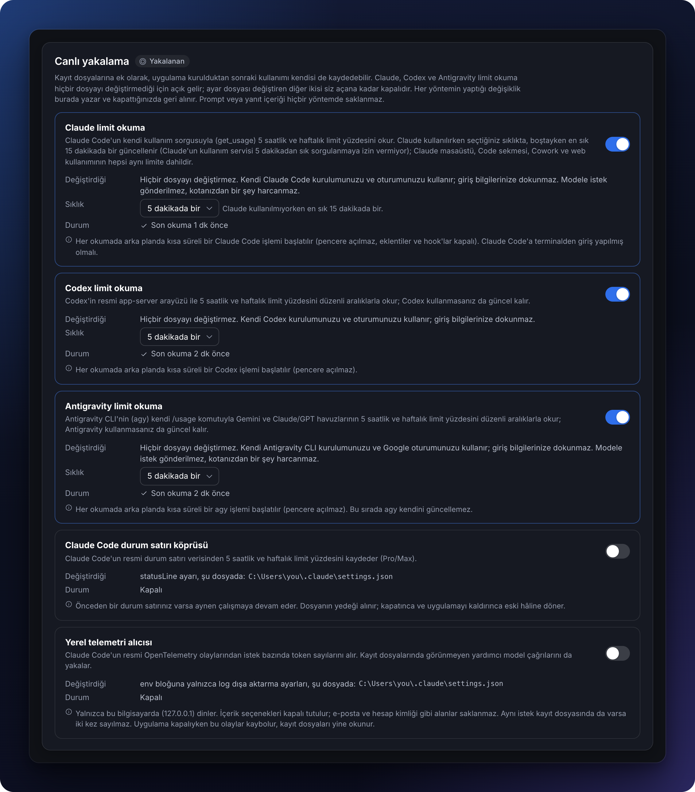

| Yöntem                               | Ne yapar                                                                                                                                                                                                                                                                                                                                                                                                                                                                        | Neyi değiştirir                                                                                                                                                                                                        |
| ------------------------------------ | ------------------------------------------------------------------------------------------------------------------------------------------------------------------------------------------------------------------------------------------------------------------------------------------------------------------------------------------------------------------------------------------------------------------------------------------------------------------------------- | ---------------------------------------------------------------------------------------------------------------------------------------------------------------------------------------------------------------------- |
| **Claude limit okuma**               | Claude Code'un kendi kullanım sorgusuyla 5 saatlik ve haftalık limit yüzdenizi okur. Modele istek gönderilmediği için kotanızdan bir şey harcanmaz. Claude'u kullanırken 5 dakikada bir ya da **Sıklık** alanında seçtiğiniz aralıkla güncellenir (Claude'un kullanım servisi 5 dakikadan sık sorulmasına izin vermez); kullanmadığınızda en sık 15 dakikada bir güncellenir. Böylece Claude masaüstü sohbetleri, Code sekmesi, Cowork ve web kullanımı da yansır. Claude Code'da Pro/Max hesabıyla oturum açmış olmanız gerekir (`claude` → `/login`). | Hiçbir şeyi değiştirmez. Kendi Claude Code kurulumunuzu ve oturumunuzu kullanır. Okuma sırasında MCP sunucuları, hook'lar, telemetri, hata raporlaması ve otomatik güncelleme kapalıdır. Giriş bilgilerinize dokunmaz. |
| **Codex limit okuma**                | Codex'in resmi arayüzüyle 5 saatlik ve haftalık limit yüzdenizi 5 dakikada bir okur (**Sıklık** alanından dakikada birden saatte bire kadar değiştirebilirsiniz). Böylece Codex'i kullanmadığınız zamanlarda da değer güncel kalır. Birden fazla Codex kuruluysa (örneğin macOS'te ChatGPT uygulamasının içindeki) en yenisi kullanılır. | Hiçbir dosyayı değiştirmez. Kendi Codex kurulumunuzu ve oturumunuzu analitik kapalı olarak kullanır. Giriş bilgilerinize dokunmaz.                                                                                     |
| **Antigravity limit okuma**          | Antigravity CLI'ın (`agy`) kendi `/usage` komutuyla Gemini ve Claude/GPT havuzlarının 5 saatlik ve haftalık limit yüzdenizi 5 dakikada bir okur (**Sıklık** alanından dakikada birden saatte bire kadar değiştirebilirsiniz). Antigravity uygulaması ve IDE bu okumayı yapamaz; `agy` gerekir. | Hiçbir dosyayı değiştirmez. Kendi `agy` kurulumunuzu ve Google oturumunuzu kullanır; okuma sırasında `agy` kendini güncellemez. Giriş bilgilerinize dokunmaz. |
| **Claude Code durum satırı köprüsü** | Claude Code'un resmi `statusLine` verisinden (Pro/Max) 5 saatlik ve haftalık limit yüzdenizi kaydeder. Zaten bir durum satırınız varsa aynı girdiyle çalışmaya devam eder. Yalnızca Claude Code'un durum satırı gösterdiği yerde (terminalde) çalışır; Claude masaüstündeki Code sekmesi durum satırı çalıştırmaz.                                                                                                                                                              | `~/.claude/settings.json` dosyasındaki `statusLine` alanı (önce yedeği alınır).                                                                                                                                        |
| **Yerel telemetri alıcısı**          | Claude Code'un resmi telemetri verisinden istek bazında token sayılarını ve her isteğin hangi Claude hesabından gittiğini alır. Kayıt dosyalarında görünmeyen yardımcı model çağrılarını da yakalar.                                                                                                                                                                                                                                                                                                                             | `~/.claude/settings.json` dosyasındaki `env` bloğuna yalnızca log dışa aktarma değişkenleri eklenir. Alıcı yalnızca `127.0.0.1` adresini dinler ve yalnızca bu kuruluma özel anahtarı taşıyan istekleri kabul eder.    |

Limit okuma için gereken araç kurulu değilse kartında **Kur** ve **Kurulum sayfası** düğmeleri çıkar. **Kur**, aracı üreticinin resmi kurulum betiğiyle kurar: Claude Code için `claude.ai/install`, Codex için `chatgpt.com/codex/install`, Antigravity CLI için `antigravity.google/cli/install`. Araç kurulu ama giriş yapılmamışsa genel bakışta ve ilgili kartta nasıl giriş yapacağınız adım adım yazar; **Tekrar dene** ile limitleri hemen okutabilirsiniz.

Güvenlik önlemleri:

- Hem telemetride hem kayıt dosyasında görünen bir istek bir kez sayılır.
- E-posta adresi hiç okunmaz, hesap kimlikleri yalnızca geri çözülemeyen özet olarak saklanır; prompt kaydı hiçbir zaman açılmaz.
- Kendi telemetri kurulumunuz varsa uygulama ona dokunmaz ve sizi uyarır.
- Bir anahtarı kapattığınızda yalnızca uygulamanın yazdığı değerler geri alınır; sizin yaptığınız değişiklikler korunur.

## Nasıl çalışır

Her şey sizin bilgisayarınızda olur:

1. Claude Code, Cowork, Claude masaüstü, Codex (CLI ve masaüstü), Antigravity (uygulama, IDE ve CLI) ve OpenCode kullanım kayıtlarını diske yazar.
2. Uygulama bu kayıtları okur ve içlerinden yalnızca token sayısı, model ve zaman gibi bilgileri alır. Prompt ve yanıt metinleri uygulamanın arşivine kaydedilmez.
3. Limit okumaları açıksa limit yüzdeleri bilgisayarınızdaki `claude`, `codex` ve `agy` üzerinden alınır.
4. Yerel veri tabanına (SQLite) yalnızca sayılar ve meta veriler yazılır.
5. Panel, widget, tepsi simgesi ve PDF özet bu veri tabanını kullanır.

Kayıtlar her seferinde baştan değil, kalınan yerden okunur; yeniden tarama yalnızca yeni eklenen kısmı işler. Aynı yanıtın ara kayıtları ile devam ettirilen ya da kopyalanarak yeni oturuma dönüştürülen sohbetlerdeki tekrarlar ve arşive taşınan Codex dosyaları yalnızca bir kez sayılır.

## Güncellemeler

Uygulama açılışta ve 6 saatte bir yeni sürüm olup olmadığına bakar. Bunun için bu deponun sürümlerinden yalnızca küçük bir sürüm dosyası indirir ve hiçbir veri göndermez. Yeni sürüm hazır olduğunda, siz kurana kadar pencerenin sol altında gösterilir. Güncelleme yalnızca siz onayladıktan sonra ve imzası uygulamaya gömülü anahtarla eşleşirse kurulur. Denetimi **Ayarlar → Güncellemeler** bölümünden kapatabilirsiniz.

## Bilinen sınırlamalar

- **Claude Code toplamları:** Claude Code kayıtları ana model dışındaki yardımcı çağrıları içermez. Bu yüzden toplamlar gerçek kullanımın biraz altında kalabilir.
- **Masaüstü sohbetleri:** Claude masaüstü ve ChatGPT masaüstü sohbetlerinin token sayıları yerelde bulunmaz.
- **Codex hızlı katmanı:** Codex fast/priority katmanını istek bazında kaydetmediği için standart fiyat uygulanır.
- **Yalnızca telemetriden bilinen istekler:** Bu isteklerde önbellek yazmaları 5 dakikalık fiyattan hesaplanır, bu yüzden maliyetleri biraz düşük çıkabilir.
- **`codex-auto-review`:** Bu modelin resmi fiyatı yayımlanmamıştır.
- **Eski Antigravity konuşmaları:** Antigravity'nin eski sürümlerinin şifreli olarak sakladığı `.pb` konuşmaları ve veritabanı silinmiş konuşmalar okunmaz; bunlarda gerçek token sayısı bulunmaz.
- **Google AI plan fiyatları:** Ülkeye ve kampanyaya göre değiştiği için Antigravity planınızın aylık ücretini kendiniz girersiniz.
- **OpenCode:** Oturuma ad veren istekler OpenCode tarafından kaydedilmediği için bunlar eksik kalır; model kullanımını bildirmeden durdurulan bir istek de token'sız kaydedilir. Gösterilen maliyet modelin kendi API fiyatıdır; OpenRouter, GitHub Copilot ya da OpenCode Zen'in aldığı ücret değildir. Anthropic, OpenAI, Google, DeepSeek, Moonshot AI (Kimi), Z.ai (GLM), Alibaba Cloud (Qwen), xAI (Grok), Mistral ve MiniMax modelleri, üreticinin kendi fiyat sayfasındaki fiyatla hesaplanır. DeepSeek'in yoğun saatleri dışında yapılan istekler, DeepSeek'in aldığı gibi yarı fiyatla hesaplanır. Diğer modeller, üreticinin OpenCode'un bilgisayarınızdaki model kataloğunda bir fiyatı varsa o fiyatı alır; uygulama bu fiyatları "doğrulanmadı" diye işaretler. Üretici fiyatı olmayan model maliyete girmez.
- **Kayıt biçimleri:** Araçların kayıt biçimleri resmi olarak belgelenmiş değildir ve sürümden sürüme değişebilir. Uygulama bilmediği alanları atlar ve tanıyamadığı kayıtları **Kaynaklar** ekranında listeler.

## Kaynaktan derleme

Gereksinimler: Rust 1.99+ (CI'ın ve sürüm derlemelerinin kullandığı sürüm) ve Node 20.19+ veya 22.12+; bunlara ek olarak:

- **Windows:** Visual Studio Build Tools (C++)
- **macOS:** Xcode Command Line Tools
- **Linux:** WebKitGTK 4.1 ve geliştirme dosyaları; örneğin Debian ve Ubuntu'da `sudo apt install libwebkit2gtk-4.1-dev libayatana-appindicator3-dev librsvg2-dev libxdo-dev libssl-dev`

```bash
npm --prefix ui install
cargo test -p tracker-core              # parser, hesaplama ve içe aktarma testleri
npx --prefix ui tauri dev               # geliştirme modu
npm --prefix ui run release             # paketler → target/release/bundle/release/
```

Yalnızca `npm --prefix ui run dev` komutunu çalıştırırsanız panel tarayıcıda örnek verilerle açılır.

| Klasör                | İçerik                                                                                                                 |
| --------------------- | ---------------------------------------------------------------------------------------------------------------------- |
| `crates/tracker-core` | Rust çekirdeği: keşif, ayrıştırıcılar, SQLite arşivi, fiyatlandırma, analiz, dışa aktarma (ve sentetik örnek kayıtlar) |
| `src-tauri`           | Masaüstü kabuğu: arka plan işçisi, dosya izleme, tepsi simgesi, widget, IPC                                            |
| `ui`                  | Svelte 5 arayüzü (panel ve widget)                                                                                     |
| `config`              | `pricing.json`, `plans.json`, `updates.json` (yayın yeri)                                                              |

Hata bildirimlerinizi, pull request'lerinizi ve geri bildirimlerinizi almaktan mutluluk duyarım.

## Kod imzalama politikası

Bkz. [CODE_SIGNING.md](CODE_SIGNING.md).

## Lisans

[MIT](LICENSE)
