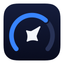

# AI Usage Tracker

**Claude Code, Codex, Antigravity ve OpenCode kullanımınızı, API eşdeğeri maliyetinizi ve plan limitlerinizi tek yerden izleyin.**

Windows, macOS ve Linux için, verilerinizi bilgisayarınızda tutan bir uygulama. Yapay zekâ araçlarınızın bilgisayarınıza zaten yazdığı kullanım kayıtlarını okur, kendi arşivini tutar ve token sayınızı, API eşdeğeri maliyetinizi ve canlı limit yüzdelerinizi gösterir. Hesap, bulut ya da telemetri yok.

[](../../releases/latest)

   [](LICENSE)

[Özellikler](#özellikler) · [Kurulum](#kurulum) · [Gizlilik](#gizlilik) · [Nasıl çalışır](#nasıl-çalışır) · [Kaynaktan derleme](#kaynaktan-derleme) · [English](README.md)

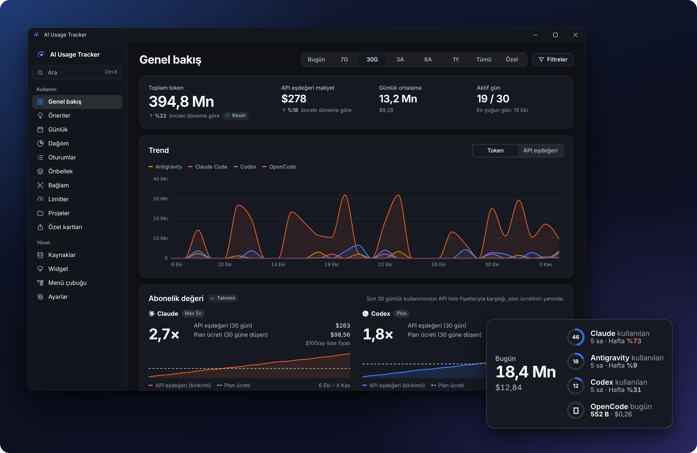

- **Verileriniz sizde kalır.** Prompt ve yanıtlarınız uygulamanın arşivine hiçbir zaman girmez. Uygulama yalnızca sayıları ve meta verileri bilgisayarınızdaki bir SQLite dosyasında tutar ve hiçbir yere göndermez.
- **Her sayının nereden geldiğini bilirsiniz.** Her değer bir etiket taşır: **Kesin** (aracın kendi kaydından), **Tahmini** (uygulamanın hesabı) ya da **Yakalanan** (canlı okunan). Hiçbir değer sessizce tahmin edilmez.
- **Limitinize takılmadan çalışın.** Claude, Codex ve Antigravity'nin 5 saatlik ve haftalık limitleri birkaç dakikada bir okunur. Her pencerenin ne zaman dolacağını önceden görür, dolmadan bildirim alırsınız.


## Özellikler

### Limitlerinizi anlık izleyin

5 saatlik ve haftalık limitleriniz Claude Code'un, Codex'in ve Antigravity CLI'ın resmi arayüzlerinden okunur, bu yüzden gördüğünüz sayılar araçların gösterdiğiyle aynıdır. Her pencere için, pencerenin başından bu yana ortalama hızınıza dayanan bir dolma tahmini görürsünüz. Kısa bir yoğunluk, bütün pencere öyle geçecekmiş gibi hesaplanmaz.

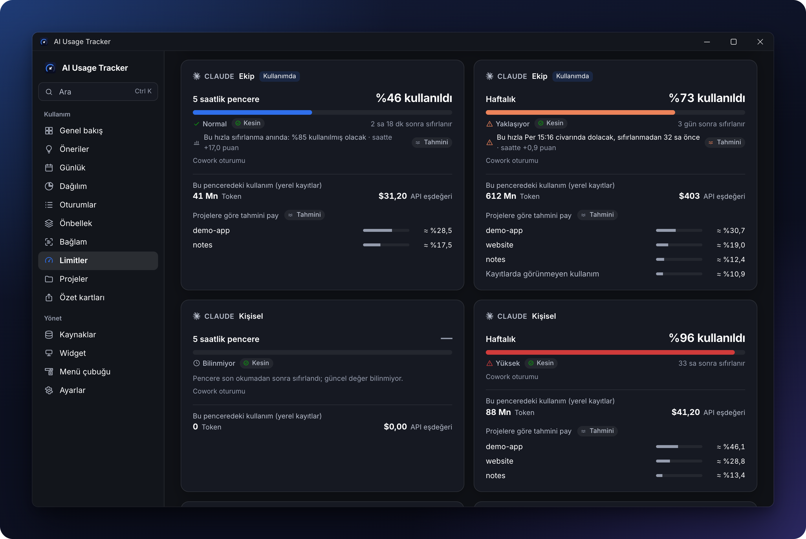

- Son okumadan sonra aracı kullandıysanız güncel değer bilinemez. Uygulama o zaman "?" ile son okumayı gösterir, panel ve menü çubuğu da bu okumayı "~" ile işaretler.
- Yüzdeleri **kullanılan** ya da **kalan** olarak görebilirsiniz. Uyarı renkleri **Widget stüdyosu**'ndaki **Dikkat** ve **Kritik** seviyelerine göre değişir (varsayılan %70 ve %90).
- Okuma yoksa her pencere için kendi bütçenizi belirleyebilirsiniz. Yüzde o zaman **Tahmini** olarak gösterilir.
- Her projenin limitten aldığı pay tahmin edilir. Web ya da telefon gibi başka yerlerdeki kullanımınız **Kayıtlarda görünmeyen kullanım** satırında ayrı görünür.

**Birden fazla hesap.** Her Claude ve Codex hesabının limiti, geçmişi ve dolma tahmini ayrı görünür. **Limitler** sayfasında her hesaba ad verip planını seçebilirsiniz. Bir istek, yalnızca kayıtlar bunu kesin gösteriyorsa bir hesaba yazılır. Gerisi **Tanımlanmamış hesap** altında kalır. Aynı Claude ayar klasöründe hesap değiştiriyorsanız [Canlı yakalama](#canlı-yakalama) altındaki yerel telemetri alıcısını açın. Kullandığınız hesap dolunca **Limitler** sayfası hangi hesapla devam edebileceğinizi söyler (**Ayarlar → Genel → Hesap önerisi**).

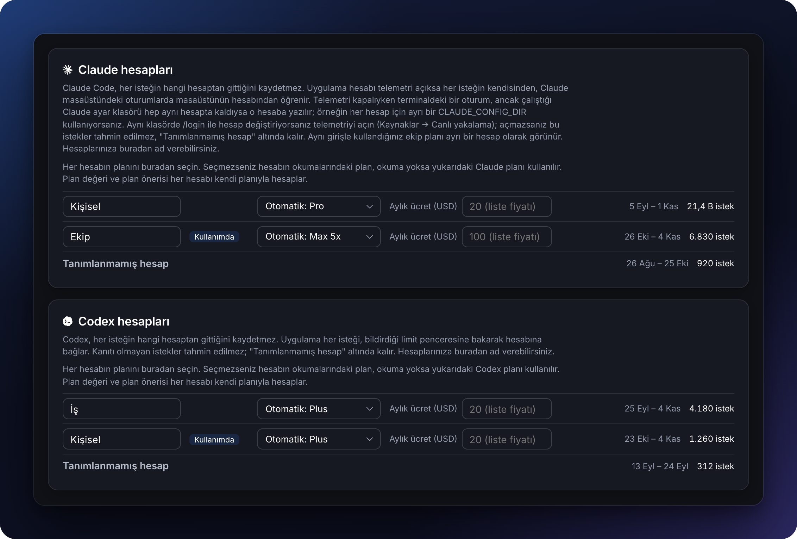

**Bildirimler.** Bir limit uyarı eşiğini geçince, dolunca ve yeniden başlayınca bildirim alırsınız. Haftalık limitinizin en az %30'u kullanılmadan sıfırlanmak üzereyse ya da bir aracın oturumu kapandığı için limitleri okunamıyorsa da haber alırsınız. Bildirimleri **Ayarlar → Bildirimler** bölümünden seçin. Windows'ta bildirimler uygulamanın Başlat menüsü kısayolu üzerinden gelir, bu yüzden kısayolu silmeyin.

**Limit sıfırlanınca devam et.** Kullanım limiti bir Claude Code konuşmasını işin ortasında keserse, uygulama limit sıfırlanınca konuşmayı devam ettirebilir. **Limitler** sayfasındaki **Limit sıfırlanınca devam et** anahtarını açın. Uygulama, Claude Code ayarlarınıza bir hook eklemeden önce size sorar (bkz. [Uygulamanın bilgisayarınızda değiştirdikleri](#uygulamanın-bilgisayarınızda-değiştirdikleri)). Limit sıfırlanınca konuşmaya, kaldığı yerden devam etmesini söyleyen tek bir mesaj gider. Konuşma açık, bilgisayar uyanık kalmalı. Yapılan iş de diğer kullanımlar gibi plan limitinizden düşer.

**Limit dolmadan devir notu.** Bir Claude Code ya da Codex konuşması 5 saatlik ya da haftalık limitinin %95'ine gelince uygulama, ondan bir kez ne yaptığını ve sırada ne olduğunu yazmasını ister. **Limitler** sayfasındaki **Limit dolmadan devir notu** anahtarını açın ve her aracı kartta ayrıca açıp kapatın. Uygulama bunun için gereken hook'ları eklemeden önce size sorar. Limit konuşmayı durdurunca gelen bildirimdeki **Codex'te devam et** (ya da **Claude'da devam et**) düğmesi, diğer aracı projenin klasöründe bu notla başlatır. Orada devam ederseniz durmuş konuşma, limit sıfırlanınca kendiliğinden devam etmez. Böylece iki ajan aynı dosyalar üzerinde çalışmaz. Notlar 14 gün sonra silinir.

**Pencere zamanlayıcı.** Claude'un 5 saatlik penceresi ilk isteğinizle başlar. **Limitler** sayfasındaki **Pencere zamanlayıcı** anahtarını açın ve bir saat seçin. Uygulama pencereyi o saatte sizin yerinize açar. 06:00'yı seçerseniz pencere 11:00'de sıfırlanır ve öğleden sonrayı ikinci bir pencereyle geçirirsiniz. Kart, çalışma saatlerinize göre bir saat de önerebilir. Her çalışma kendi Claude Code'unuzla çok küçük bir istek gönderir (Haiku, 1.000 ile 1.500 token arası) ve bu istek plan limitinizden düşer. O saatte uygulama açık, bilgisayar uyanık olmalı. Claude Code planınız yerine bir API anahtarı, Amazon Bedrock, Google Vertex AI ya da Microsoft Foundry kullanıyorsa istek gönderilmez.

### Geçmiş limit pencerelerinizi inceleyin

**Limitler** sayfasındaki **Geçmiş** sekmesi, okumalarınızın kapsadığı her 5 saatlik ve haftalık pencereyi listeler. Her pencerenin ne kadar dolduğunu, dolup dolmadığını, ne kadar sürede dolduğunu ve o sırada bu bilgisayarda ne kadar kullandığınızı görürsünüz. Uygulama, sonuna kadar izlediği pencerelerden bir pencerenin tamamının API eşdeğeri olarak kaça denk geldiğini tahmin eder.

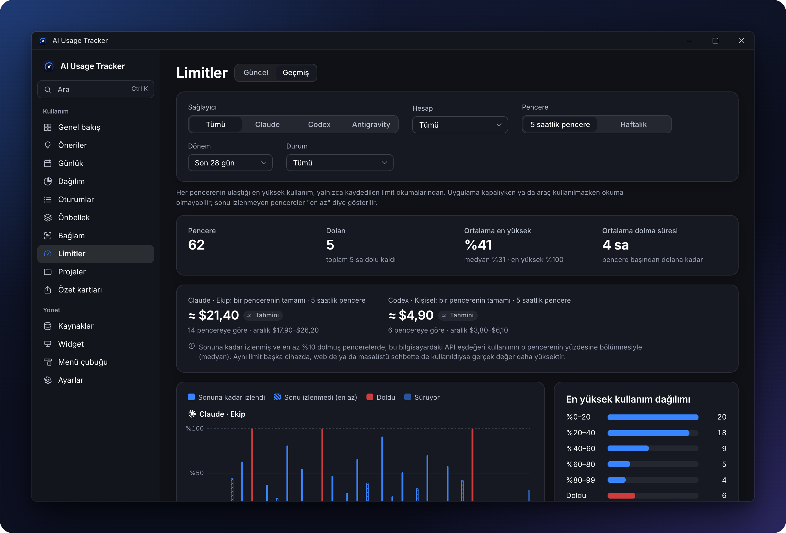

### Size uygun planı ve tasarruf fırsatlarını bulun

**Öneriler** sayfası kendi kayıtlarınızdan bulgular çıkarır: uzun bir aradan sonra baştan yazılan önbellek, uzun bağlam ek ücretleri ve sık hata veren araçlar gibi. Her bulgu dayandığı sayıları ve ne yapabileceğinizi gösterir. Tutarlar API eşdeğeridir. Abonelikle kullanıyorsanız bunları ödemezsiniz, ama kullanımınızın büyüklüğünü gösterirler.

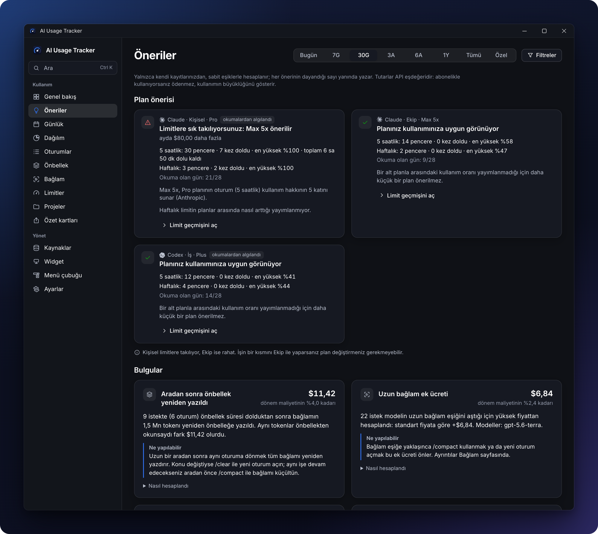

**Plan önerisi.** Uygulama son 28 güne bakar ve limitleriniz sık doluyorsa bir üst plan önerir. Daha küçük bir planı yalnızca sağlayıcı planlar arasındaki oranı yayımladıysa (Claude) ve kullanımınız alt plana sığacaksa önerir. Claude okumaları Max 5x ile Max 20x'i ayırmadığı için planınızı **Limitler** sayfasından seçin.

**Önce ve sonra.** MCP sunucusu eklemek ya da `CLAUDE.md` dosyasını kısaltmak gibi bir değişiklik yaptığınız günü işaretleyin. Uygulama o günden önceki ve sonraki günleri karşılaştırır: oturum başına maliyet, başlangıç yükü, araç hata oranı ve önbellek isabeti. Bu karşılaştırma o gün çevresinde neyin değiştiğini gösterir, değişikliğinizin buna yol açtığını göstermez.

**Abonelik değeri.** **Genel bakış**, son 30 günde her sağlayıcıdaki API eşdeğeri kullanımınızı plan ücretinizle karşılaştırır ("4,7×") ve planın kendini hangi gün amorti ettiğini gösterir. Liste fiyatları [`config/plans.json`](config/plans.json) dosyasındadır ve resmi [Claude](https://claude.com/pricing) ve [ChatGPT](https://learn.chatgpt.com/docs/pricing) sayfalarından doğrulanmıştır. Kendi fiyatınızı ya da yenilenme gününüzü **Limitler** sayfasından girin. Sohbet kullanımı yerel kayıtlarda olmadığı için gerçek değer daha yüksek olabilir.

**Aylık bütçe.** **Ayarlar → Aylık bütçe** bölümünden API eşdeğeri maliyet için aylık bir sınır belirleyin. **Genel bakış** bu ayki harcamanızı, kalan günleri ve bu hızla ay sonunda nereye varacağınızı gösterir. Bütçenin %80'ine ulaştığınızda ve bütçeyi aştığınızda bildirim alırsınız.

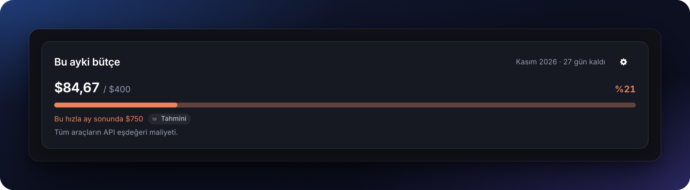

### Kullanımınızı gün gün görün

**Günlük** sayfası dönemi gün gün, sütun ya da takvim olarak gösterir. En yoğun gününüzü, aktif gün serilerinizi ve hafta sonu payınızı da burada görürsünüz. Bir gün seçtiğinizde o günün saat saat kullanımı, araçları, modelleri, projeleri ve en yüksek limit okumaları açılır.

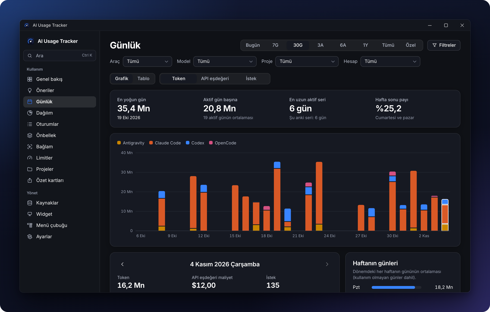

### Aynı işin başka bir modelle ne tutacağını görün

**Dağılım** sayfası dönemdeki isteklerinizi aynı token sayılarıyla fiyat listesindeki her modele göre yeniden hesaplar ve en ucuzdan başlayarak listeler. Model aileleri aynı metni farklı sayıda token'a böldüğü için aileler arasındaki karşılaştırma yaklaşıktır.

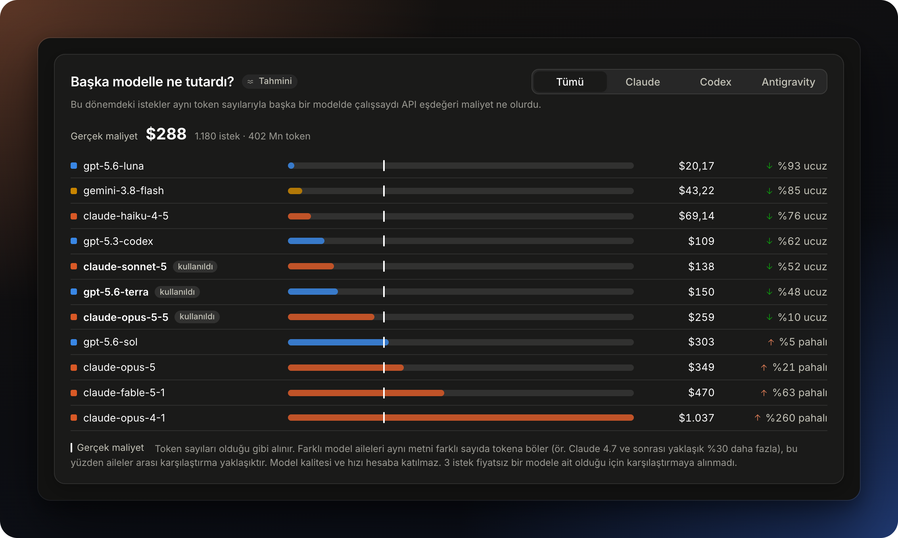

### Alt ajanların ve araçların payını görün

**Dağılım** sayfası alt ajanların ana konuşmanın yanında ne kadar tuttuğunu, her aracın kaç kez çağrıldığını ve çağrıların ne sıklıkla hata verdiğini de gösterir. Yalnızca aracın adı ve sonucu saklanır, girdisi ve çıktısı hiçbir zaman saklanmaz.

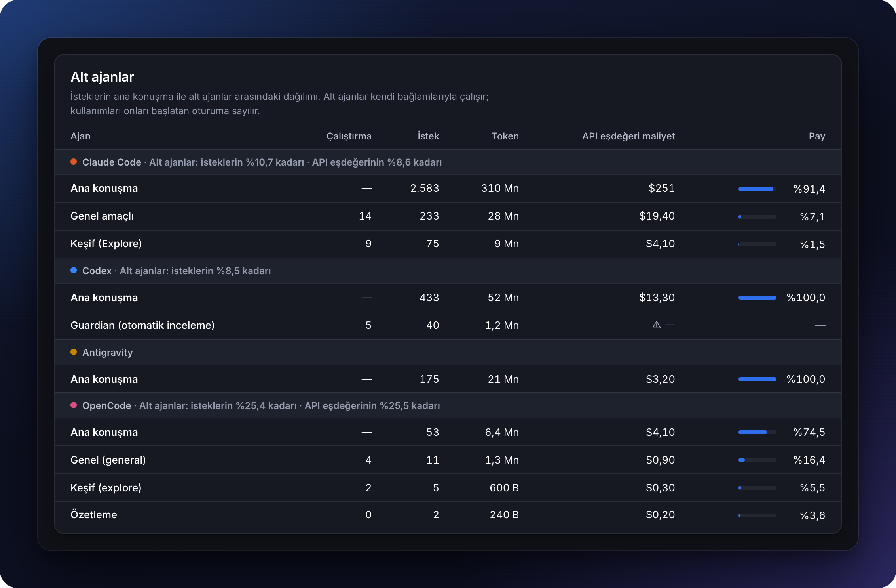

### Oturumlarınızı, önbelleği, bağlamı ve projelerinizi inceleyin

| 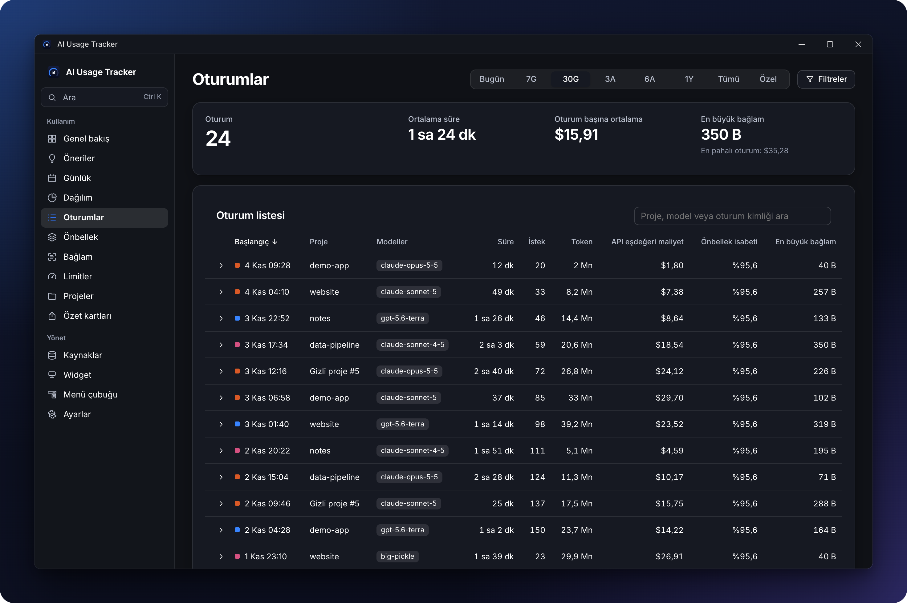 | 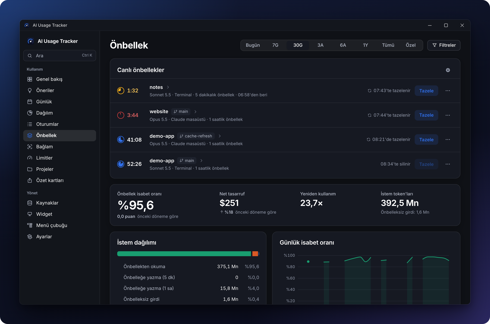 |
|---|---|
| **Oturumlar**: her oturumunuzun süresi, modelleri, maliyeti ve en büyük bağlamı | **Önbellek**: her konuşmanın önbelleğinin kalan süresi, isabet oranı, yeniden kullanım ve önbelleğin size gerçekte ne kazandırdığı |

**Oturumlar.** **Oturumlar** sayfasında bir oturumu açınca isteklerinin zaman çizelgesini görürsünüz. Önbelleğin yeniden yazıldığı yerler, alt ajanlar ve araç çağrıları da işaretlidir.

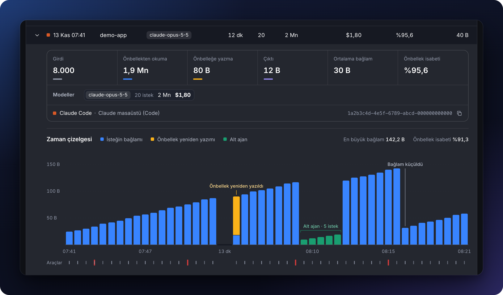

**Tur maliyeti.** Tur, tek bir istem ve onun tetiklediği her şeydir: istekler, alt ajanlar ve onların araç çağrıları. **Oturumlar** sayfası dönemdeki turları en pahalıdan başlayarak listeler. Böylece tek bir isteminizin neye mal olduğunu görürsünüz ("14:32'deki tur: 84 istek, 3 alt ajan, 11,40 $"). Turlar Claude Code ve Codex kayıtlarından gelir, istem metni hiçbir zaman okunmaz.

**Önbelleğin kalan süresi.** Claude, bir konuşmanın önbelleğini 5 dakika ya da 1 saat kullanılmazsa siler. **Önbellek** sayfası her Claude Code konuşmasının önbelleği için, konuşmanın Claude Code'daki ya da Claude uygulamasındaki adıyla geri sayım gösterir, widget ve menü çubuğu da önbelleği ilk dolacak konuşmayı gösterir. Durum satırı köprüsü açıksa Claude Code'un kendi durum satırı, o konuşmanın önbelleğinin ne zaman silineceğini gösterebilir. Süre dolmadan devam ederseniz sonraki istek önbelleği yeniden yazmak yerine ucuza okur. Nerede gösterileceğini ve süre dolmadan gelen uyarıyı **Ayarlar → Genel → Önbelleğin kalan süresi** bölümünden seçin.

**Önbellek tazeleme.** Bir konuşmanın yanındaki **Tazele**, Claude Code'a kısa bir turda önbelleği okutur ve önbelleğin süresi baştan başlar. **Otomatik tazele** bunu önbellek dolmadan kısa süre önce kendisi yapar. Tazelemelerin toplamı önbelleği yeniden yazmaktan pahalıya gelecekse durur. Her tazeleme plan limitinizden bir önbellek okuması kadar düşer ve bildirim sesi gibi kendi Stop hook'larınız da her tazelemede çalışır. Uygulama ilk seferde Claude Code ayarlarınıza bir hook eklemeden önce size sorar (bkz. [Uygulamanın bilgisayarınızda değiştirdikleri](#uygulamanın-bilgisayarınızda-değiştirdikleri)).

**Önbellek neden yeniden yazıldı.** Durum satırı köprüsü açıksa **Önbellek** sayfası, Claude Code'un önbelleği neden yeniden yazmak zorunda kaldığını toplar (örneğin değişen bir MCP sunucusu, sistem istemi ya da model) ve bu yeniden yazmaları projelere göre gruplar.

| 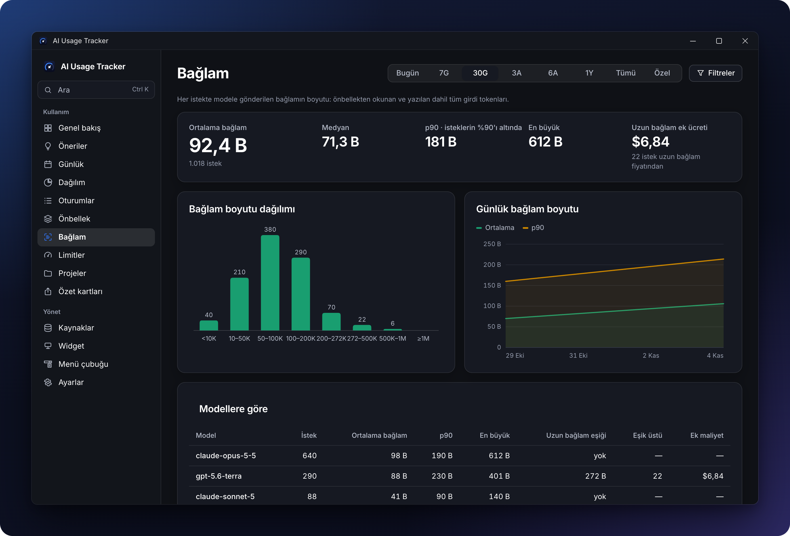 | 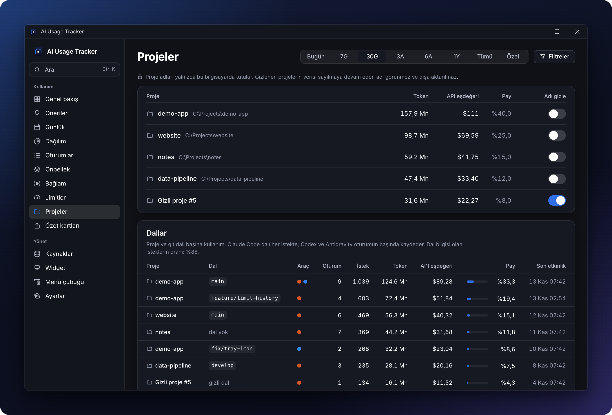 |
|---|---|
| **Bağlam**: istemlerinizin ne kadar büyüdüğü ve uzun bağlam ek ücreti | **Projeler**: proje ve git dalı bazında kullanım |

**Başlangıç yükü.** Her konuşma sizin yazmadığınız bir metinle başlar: sistem istemi, araç tanımları, `CLAUDE.md` gibi bellek dosyaları ve MCP sunucularınızın ekledikleri. **Bağlam** sayfası bu yükü her proje için, arttığı ya da azaldığı günle birlikte gösterir.

### Her şeyi tek kısayolla bulun

Mac'te **Cmd+K**, Windows ve Linux'ta **Ctrl+K** ile istediğiniz sayfaya, ayara, projeye, modele ya da oturuma geçin. Buradan temayı da değiştirebilir, widget'ı gösterip gizleyebilir ve güncellemeleri denetleyebilirsiniz.

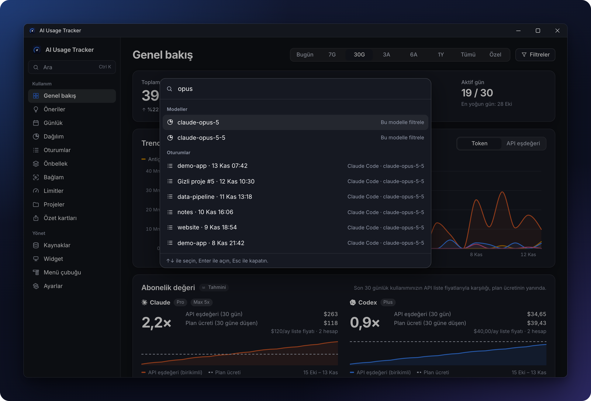

### Limitlerinizi masaüstünde görün

Widget, her zaman üstte duran küçük bir penceredir ve varsayılan olarak ekranın sağ alt köşesinde durur. Onu istediğiniz yere sürükleyin. Sağ tıklayarak uygulamayı açabilir, widget'ın saydamlığını, boyutunu ve konumunu değiştirebilirsiniz.

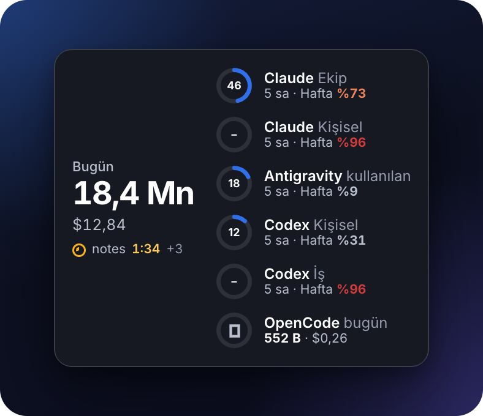

**Widget stüdyosu** sayfası, widget'ın neleri gösterdiğini, yerleşimini, limit gösterimini, görünümünü, yazı tipini ve uyarı eşiklerini canlı önizlemeyle değiştirmenizi sağlar.

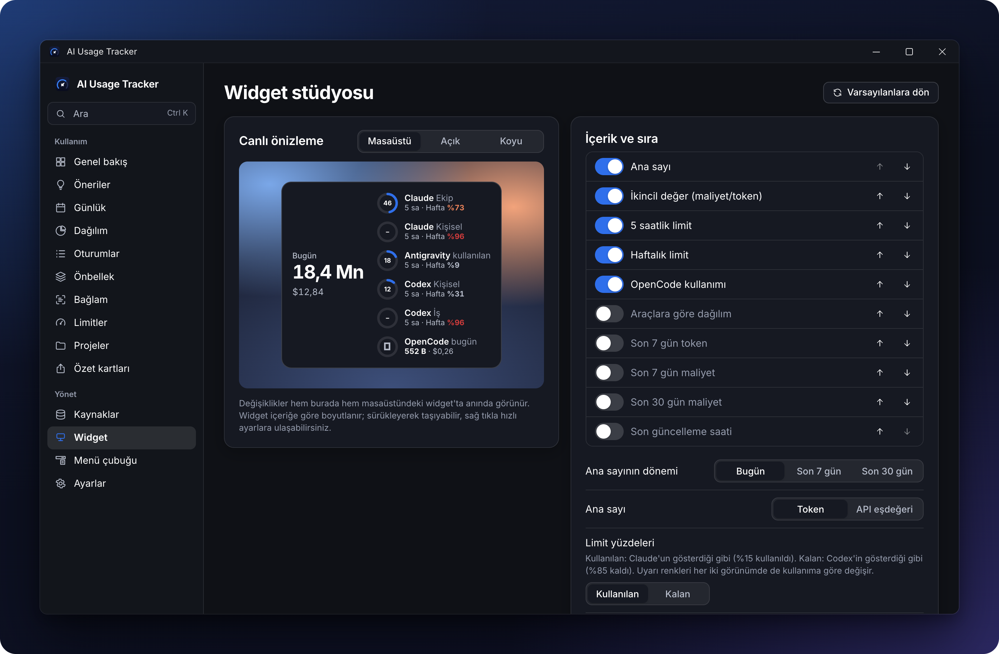

Sistem genelindeki bir kısayol widget'ı gösterir ya da gizler (**Ctrl+Alt+Shift+W**, macOS'te **⌃⌥⇧W**). Kısayolu **Ayarlar → Widget** bölümünden değiştirin.

### Limitlerinizi menü çubuğunda ve tepside görün

Uygulamanın simgesi Windows'ta saatin yanında, macOS'te menü çubuğunda, Linux'ta sistem tepsisinde durur. Simgeye tıklayınca kontrol paneli, sağ tıklayınca kısa bir menü açılır. Linux'ta tepsi tıklamaları bildirmediği için panel bu menüden açılır.


Panelde seçtiğiniz kutucuklar görünür: limitler, tahminler, kullanım, canlı önbellekler, son tarama ve düğmeler. Kutucukları **Menü çubuğu** sayfasında galeriden canlı önizlemeye sürükleyerek yerleştirin.


Simge, uygulama simgesini, bir limitin yüzdesini, bir aracın logosunu ya da limit kadar dolan bir göstergeyi gösterebilir. Yüzde, logo ve gösterge, limit dolmaya yaklaşınca uyarı rengini alır. macOS ve Linux'ta simgenin yanına, seçtiğiniz limitler, tahminler ve kullanımla `Cl 5s ▰▰▱▱▱ %46` gibi bir metin de koyabilirsiniz. Windows, tepsi simgelerinin yanında metin göstermez.


### Özet kartı paylaşın

**Özet kartları** sayfası bir gününüzü, haftanızı, ayınızı ya da yılınızı paylaşabileceğiniz bir görsele dönüştürür: özet, takvim, saatleriniz ya da yıl hikâyesi. Kartı dört boyutta PNG olarak kaydedin ya da kopyalayıp doğrudan bir gönderiye veya sohbete yapıştırın.

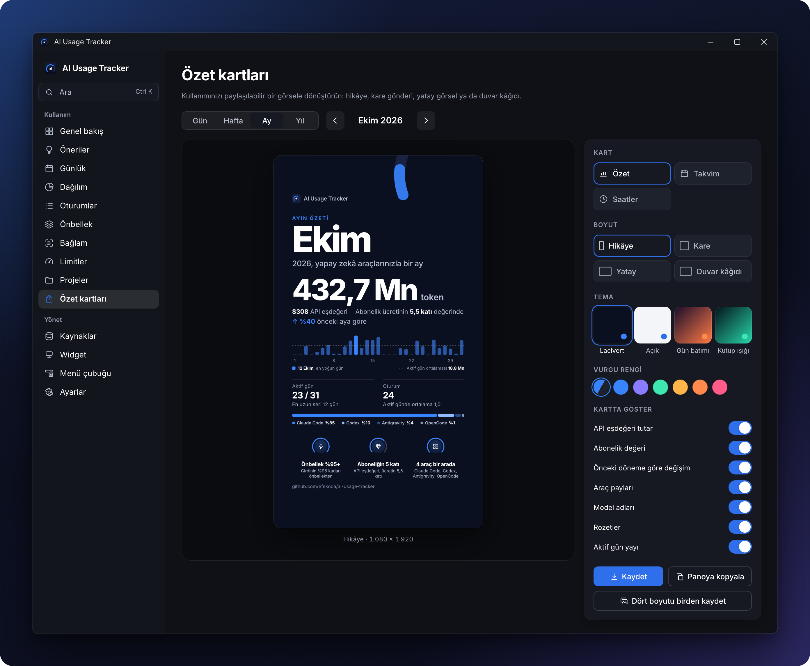

Kartta yalnızca toplamlar, araç adları ve model adları yer alır. Proje adları ya da yazdıklarınız asla yer almaz. **Kartta göster** ile tutarı, abonelik değerini, model adlarını ve daha fazlasını da kartın dışında bırakabilirsiniz.

### Haftalık rapor alın, verilerinizi yönetin

**Kullanım özeti (PDF).** **Ayarlar → Kullanım özeti (PDF)** bölümünden bir haftayı, ayı ya da yılı A4 PDF olarak kaydedin. Özette toplamlar, günlük grafik, limitler, modeller, projeler ve en maliyetli oturumlar yer alır. İsterseniz uygulama geçen haftanın özetini her hafta kendiliğinden kaydeder. Varsayılan yer, Belgeler klasörünüzdeki **AI Usage Tracker** klasörüdür.

**Kalıcı arşiv ve veriler.** Araçlar eski kayıtlarını siler (Claude Code varsayılan olarak 30 gün sonra), ama uygulamanın içe aldığı her şey kendi arşivinde kalır. **Ayarlar → Veriler** bölümünden CSV ya da JSON olarak dışa aktarabilir, veri tabanını yedekleyebilir, bir yedeği mevcut verilerle birleştirebilir ve **Tüm verilerimi sil** ile her şeyi silebilirsiniz.

**Fiyatlar.** API liste fiyatları uygulamayla birlikte [`config/pricing.json`](config/pricing.json) dosyasında gelir. Bu fiyatlar [Anthropic](https://platform.claude.com/docs/en/about-claude/pricing), [OpenAI](https://developers.openai.com/api/docs/pricing), [Google Gemini](https://ai.google.dev/gemini-api/docs/pricing) ve [Vertex AI](https://cloud.google.com/vertex-ai/generative-ai/pricing) resmi sayfalarından, OpenCode'un kullanabildiği modeller için de [DeepSeek](https://api-docs.deepseek.com/quick_start/pricing/), [Moonshot AI](https://platform.kimi.ai/docs/pricing/chat), [Z.ai](https://docs.z.ai/guides/overview/pricing), [Alibaba Cloud](https://www.alibabacloud.com/help/en/model-studio/model-pricing), [xAI](https://docs.x.ai/developers/pricing), [Mistral](https://docs.mistral.ai/inference/pricing) ve [MiniMax](https://platform.minimax.io/docs/guides/pricing-paygo) sayfalarından doğrulanmıştır. İlk kurulumu tamamladıktan sonra uygulama açılışta ve 12 saatte bir bu dosyanın daha yeni bir kopyasını GitHub'dan indirir. Böylece yeni modeller yeni sürümü beklemeden fiyatlanır. Bunu **Ayarlar → Fiyatlar → Fiyat listesini güncel tut** ile kapatabilirsiniz. Fiyatı bilinmeyen bir model hiçbir zaman tahmini bir fiyatla hesaplanmaz. **Ayarlar → Fiyatlar** bölümünden siz bir fiyat girene kadar maliyete eklenmez.

### Kullanımınızı komut satırından alın

`ai-usage-tracker --json`, uygulamanın gösterdiği kullanımı ve limitleri JSON olarak yazar. Bunu betiklerinize ya da Raycast, tmux, SketchyBar gibi araçlara bağlayabilirsiniz. Varsayılan dönem bugündür. Başka bir dönem için `--period` ile birlikte `7d`, `30d`, `3m`, `6m`, `1y` ya da `all` yazın. Komut uygulamanın verilerini yalnızca okur. Uygulamanın açık olması gerekmez, ama rakamlar son tarama kadar günceldir.

```sh
ai-usage-tracker --json | jq '.limits[] | select(.window == "five_hour") | .used_pct'
```

Kurulumunuza uygun komutu ve tmux, SketchyBar, Raycast ve PowerShell için hazır betikleri **Ayarlar → Veriler → Komut satırı** bölümünde bulursunuz.

## Desteklenen kaynaklar

| Kaynak | Okunan konum | Token | Limit | Not |
|---|---|---|---|---|
| **Claude Code** (CLI, VS Code, Claude masaüstü "Code") | `$CLAUDE_CONFIG_DIR` ya da `~/.claude/projects/**/*.jsonl` | **Kesin** | Yalnızca limit dolduğunda | Yardımcı arka plan çağrıları bu kayıtlarda yer almaz |
| **Cowork oturumları** (Claude masaüstü) | *Claude klasörü*`/local-agent-mode-sessions/**` | **Kesin** | **Kesin %** (5 sa / 7 gün) | Yalnızca bilgisayarınızda çalışan işler. Bulut işleri limitlerinize dahil edilir ama token sayıları bilgisayarınızda tutulmaz |
| **Claude masaüstü: plan kullanımı** | *Claude klasörü*`/plan-usage-history.json` | Yok | **Kesin %** | Sohbet token'ları yerelde tutulmaz |
| **Codex** (CLI ve masaüstü) | `$CODEX_HOME` ya da `~/.codex/{sessions,archived_sessions}` | **Kesin** | **Kesin %** (her istekte) | Sıkıştırılmış oturumlar (`.jsonl.zst`) da okunur |
| **Antigravity** (uygulama, IDE ve `agy` CLI) | `~/.gemini/{antigravity,antigravity-ide,antigravity-cli}/conversations/*.db` ya da `$ANTIGRAVITY_APP_DATA_DIR` | **Kesin** | **Yakalanan %** (`agy` ile) | Bir kopya okunur, Antigravity'nin dosyalarına dokunulmaz |
| **OpenCode** | `$XDG_DATA_HOME/opencode` ya da `~/.local/share/opencode` (Windows'ta da): `opencode.db`, ya da `$OPENCODE_DB` | **Kesin** | Yok | Modeli yapan şirketin API fiyatıyla hesaplanır ve hiçbir planın değerine eklenmez. 1.3.16'dan eski sürümlerle yapılan oturumlar sayılmaz |
| ChatGPT masaüstü | Hiçbir şey | Yok | Yok | Yalnızca algılanır |

`~` kullanıcı klasörünüzdür (Windows'ta `%USERPROFILE%`). *Claude klasörü* Windows'ta `%APPDATA%\Claude`, macOS'te `~/Library/Application Support/Claude` klasörüdür. Claude masaüstü uygulamasının Linux sürümü yoktur.

## Kurulum

[Son sürümden](../../releases/latest) sisteminize uygun dosyayı indirin. İlk açılışta bilgisayarınızda bulunan araçlar listelenir. İstediğiniz kaynakları seçip **Başla**'ya basın. Siz onay vermeden hiçbir kayıt okunmaz.

### Windows

Windows 10 ve 11. `AI-Usage-Tracker_x.y.z_x64-setup.exe` dosyasını çalıştırın. Kurulum yalnızca sizin kullanıcı hesabınıza yapılır (`%LOCALAPPDATA%\AI Usage Tracker`), yönetici yetkisi istemez ve Windows 10'da eksikse WebView2'yi de yükler.

> **SmartScreen uyarısı.** Kurulum dosyası kod imzası taşımadığı için Windows "Bilinmeyen yayımcı" uyarısı gösterebilir. Bu durumda **Ek bilgi → Yine de çalıştır**'ı seçin.

**Kaldırma.** Windows'ta **Ayarlar → Uygulamalar** bölümünü kullanın. Kaldırıcı, "Windows ile başlat" kaydı dahil [Uygulamanın bilgisayarınızda değiştirdikleri](#uygulamanın-bilgisayarınızda-değiştirdikleri) altındaki her değişikliği geri alır. "Uygulama verilerini sil" kutusunu işaretlerseniz `%LOCALAPPDATA%\AIUsageTracker` klasörü de silinir.

### macOS

macOS 11 ve sonrası, Apple Silicon ve Intel Mac'lerde. `AI-Usage-Tracker_x.y.z_universal.dmg` dosyasını açın ve **AI Usage Tracker**'ı **Uygulamalar** klasörüne sürükleyin. Uygulama Apple tarafından imzalanıp onaylandığı (notarize) için uyarı göstermeden açılır.

Uygulamayı disk görüntüsünden değil, Uygulamalar klasöründen çalıştırın. Disk görüntüsünden açılan kopya oturum açılışında başlayamaz, Claude Code durum satırını koruyamaz ve kendini güncelleyemez. Uygulamanın Dock'ta ve ⌘Tab listesinde görünmesini istemiyorsanız **Ayarlar → Dock'ta göster** seçeneğini kapatın.

**Kaldırma.** macOS'te kaldırıcı olmadığı için önce uygulamanın değişikliklerini geri alın:

1. **Kaynaklar → Canlı yakalama** bölümünde ve **Ayarlar → Oturum açınca başlat** seçeneğinde açtıklarınızı kapatın.
2. **Limitler** sayfasındaki **Limit sıfırlanınca devam et** ve **Limit dolmadan devir notu** anahtarlarını kapatın.
3. Önbellek tazeleme hook'unu eklediyseniz **Ayarlar → Genel → Önbelleğin kalan süresi → Kaldır** ile çıkarın.
4. Uygulamayı Çöp Sepeti'ne sürükleyin. Verileriniz siz silene kadar `~/Library/Application Support/AIUsageTracker` klasöründe kalır.

### Linux

Debian 12, Ubuntu 22.04 ve sonrası, Fedora, openSUSE ve WebKitGTK 4.1 bulunan diğer x86_64 dağıtımlarda çalışır.

- **Debian, Ubuntu, Mint:** `sudo apt install ./AI-Usage-Tracker_x.y.z_x86_64.deb`
- **Fedora:** `sudo dnf install ./AI-Usage-Tracker_x.y.z_x86_64.rpm`
- **openSUSE:** Paketler GPG imzası taşımadığı için `sudo zypper install --allow-unsigned-rpm ./AI-Usage-Tracker_x.y.z_x86_64.rpm` komutunu çalıştırın. Önce dosyayı `SHA256SUMS` ile doğrulayabilirsiniz (bkz. [Dosyanın doğruluğunu kontrol edin](#dosyanın-doğruluğunu-kontrol-edin)).
- **Her dağıtım:** `AI-Usage-Tracker_x.y.z_x86_64.AppImage` dosyasını çalıştırılabilir yapın (`chmod +x`) ve açın. Açılmazsa FUSE 3'ü kurun (Debian ve Ubuntu'da `sudo apt install fuse3`) ya da dosyayı `APPIMAGE_EXTRACT_AND_RUN=1 ./AI-Usage-Tracker_x.y.z_x86_64.AppImage` ile başlatın.

Uygulama üç biçimde de kendini günceller. `.deb` ve `.rpm` için sisteminiz parolanızı sorar.

**GNOME'da tepsi simgesi.** GNOME tepsi simgelerini yalnızca AppIndicator eklentisiyle gösterir. Ubuntu'da bu eklenti hazır gelir. Diğer GNOME sistemlerinde "AppIndicator and KStatusNotifierItem Support" eklentisini kurun.

**Widget kısayolu.** KDE Plasma ve GNOME'da, Wayland'de de, hangi programda olursanız olun çalışır. GNOME 47 ve öncesinde uygulama bunun için bir GNOME özel kısayolu ekler. Sway ya da Hyprland kullanıyorsanız `ai-usage-tracker --toggle-widget` komutuna kendiniz bir tuş atayın. Örneğin Sway'de `bindsym Ctrl+Alt+Shift+w exec ai-usage-tracker --toggle-widget`, Hyprland'de `bind = CTRL ALT SHIFT, W, exec, ai-usage-tracker --toggle-widget` kullanabilirsiniz.

**Kaldırma.** `sudo apt remove ai-usage-tracker` ya da `sudo dnf remove ai-usage-tracker` komutunu çalıştırın. Paket kaldırılınca, uygulamayı varsayılan klasörlerle (`~/.local/share` ve `~/.config`) kullanan her kullanıcı için Claude Code ve Codex ayarlarındaki değişiklikler ve oturum açılışında başlatma kaydı geri alınır. AppImage kullanıyorsanız macOS kaldırma adımlarının ilk üçünü uygulayın, sonra dosyayı silin. Verileriniz siz silene kadar `~/.local/share/AIUsageTracker` klasöründe kalır. GNOME'da widget kısayolunu da **Ayarlar → Widget kısayolu → Kaldır** ile ya da sonradan GNOME'un klavye ayarlarından kaldırın.

### Dosyanın doğruluğunu kontrol edin

Her sürümde, her dosyanın sağlama değerini içeren bir `SHA256SUMS` dosyası bulunur. Bu dosyayı indirdiğiniz dosyanın yanına koyup şu komutu çalıştırın:

- **Linux:** `sha256sum -c SHA256SUMS --ignore-missing`
- **macOS:** `shasum -a 256 -c SHA256SUMS --ignore-missing`
- **Windows (PowerShell):** `Get-FileHash .\AI-Usage-Tracker_x.y.z_x64-setup.exe` komutunun verdiği değeri `SHA256SUMS` içindeki ilgili satırla karşılaştırın.

## Gizlilik

> **Prompt ve yanıtlarınız arşive alınmaz.** Uygulama kayıtlardan yalnızca token sayısı, model ve zaman gibi bilgileri alır. Prompt ve yanıt metinleri arşive kaydedilmez, kullanım verileriniz bilgisayarınızdan çıkmaz ve uygulamada telemetri yoktur.

- **Okunanlar:** zaman damgası, model, proje klasörü, git dalı, oturum kimliği, alt ajan adı, her istemin gönderildiği an ve türü (metni asla), token sayıları, araç çağrılarının adı ve sonucu (girdisi ya da çıktısı asla) ve limit yüzdeleri. Önbellek listesi ile önbellek ve limit bildirimleri ayrıca konuşmanın Claude Code'daki ya da Claude uygulamasındaki adını gösterir. Bu ad konuşmanın kaydının sonundan okunur ve hiç saklanmaz. Proje adlarını gizlerseniz bu ad da gizlenir.
- **Saklananlar:** yalnızca bu değerler, uygulamanın veri klasöründeki `tracker.db` (SQLite) dosyasında: Windows'ta `%LOCALAPPDATA%\AIUsageTracker`, macOS'te `~/Library/Application Support/AIUsageTracker`, Linux'ta `~/.local/share/AIUsageTracker`. Proje adlarını gizleyebilirsiniz, gizlenen adlar dışa aktarımlarda da maskelenir.
- **Hiçbir zaman tutulmayanlar:** prompt ve yanıtlar, dosya içerikleri, kimlik bilgileri ve erişim token'ları. Uygulama, araçların kimlik bilgisi dosyalarını okumaz.
- **Hesaplar:** Uygulama hesapları ayırt etmek için Codex hesap kimliğinin ve Claude planının bağlı olduğu kuruluş kimliğinin yalnızca geri çözülemeyen bir özetini saklar. Claude'da yalnızca bu kimliği okur: `~/.claude.json` dosyasından, telemetri kayıtlarından ve Claude masaüstünün Code sekmesindeki oturum listesinden. Hesap adları sizin verdiğiniz adlardır ve e-posta adresi hiç okunmaz.
- **Antigravity ve OpenCode:** İkisi de sohbet metnini bir veri tabanında tutar. Uygulama Antigravity'ninkini yalnızca sizin açabildiğiniz geçici bir kopyadan okur ve kopyayı hemen siler. OpenCode'unkini salt okunur açar. İkisinden de yalnızca sayıları ve meta verileri alır.
- **İnternet bağlantısı:** Uygulamanın kendisi internete yalnızca güncelleme ve yeni fiyat listesi denetimi için bağlanır. Her denetim tek bir dosya indirir ve hiçbir veri göndermez. Limit okumaları kendi Claude Code, Codex ve Antigravity CLI kurulumunuzu çalıştırır ve bu araçlar limitlerinizi kendi servislerinden sorar. Uygulama bu okumalarda Claude Code'un telemetrisini ve Codex'in analitiğini kapatır. Uygulamadan kurduğunuz bir araç, üreticisinin sitesinden gelir.
- **Pencere zamanlayıcı:** Açıksa seçtiğiniz her gün kendi Claude Code'unuzu bir kez çalıştırıp tek küçük bir istek gönderir. Bu çalıştırmada Claude Code'un telemetrisi, hata bildirimi, MCP sunucuları ve hook'ları kapalıdır.

### Uygulamanın bilgisayarınızda değiştirdikleri

Uygulama, Claude Code ve Codex dosyalarını yalnızca siz bir özelliği açınca değiştirir ve bir hook eklemeden önce size sorar. `~/.claude/settings.json` dosyasının her değişiklikten önce yedeğini alır. Bir özelliği kapattığınızda yalnızca uygulamanın yazdıkları çıkarılır, sizin değişiklikleriniz korunur.

| Özellik | Ne ekler | Nasıl kaldırılır |
|---|---|---|
| **Önbellek tazeleme** | `~/.claude/settings.json` dosyasına bir hook | **Ayarlar → Genel → Önbelleğin kalan süresi → Kaldır** |
| **Limit sıfırlanınca devam et** | `~/.claude/settings.json` dosyasına bir hook | **Limitler** sayfasındaki anahtarı kapatın |
| **Limit dolmadan devir notu** (Claude Code) | `~/.claude/settings.json` dosyasına bir hook ve yalnızca uygulamanın not klasörü için bir yazma izni. Hook her konuşmanın başına kısa bir cümle ekler | **Limitler** sayfasındaki anahtarı kapatın |
| **Limit dolmadan devir notu** (Codex) | `~/.codex/hooks.json` dosyasına bir hook. Codex bu hook'u bir kez onaylamanızı ister. Codex'in `config.toml` dosyasına dokunulmaz | Kartta Codex'i ya da anahtarın tamamını kapatın |
| **Claude Code durum satırı köprüsü** | `~/.claude/settings.json` dosyasındaki `statusLine` alanı. Mevcut durum satırınız çalışmaya devam eder | **Kaynaklar → Canlı yakalama** bölümünden kapatın |
| **Yerel telemetri alıcısı** | `~/.claude/settings.json` dosyasındaki `env` bloğuna log dışa aktarma değişkenleri | **Kaynaklar → Canlı yakalama** bölümünden kapatın |
| **Oturum açınca başlat** | Uygulama için bir oturum açılışı kaydı | **Ayarlar → Oturum açınca başlat** seçeneğini kapatın |
| **Widget kısayolu** (GNOME 47 ve öncesi, Wayland'de) | Widget tuşu için kendiliğinden eklenen bir GNOME özel kısayolu | **Ayarlar → Widget kısayolu → Kaldır** |

Bir hook dosyada birkaç olayın altında görünebilir, her seferinde uygulamanın kendi komutuyla. Önbellek tazeleme ve limit hook'ları konuşmayı hiç okumaz. Limit ve devir notu hook'larının konuşmaya eklediği mesajlar uygulamanın içinde sabittir. Codex hook'u konuşmanın kendi Codex kaydının sonunu okur ve yalnızca limit satırlarını alır. Codex notunu geçici klasörde yalnızca sizin açabileceğiniz bir klasöre yazar, uygulama da onu kendi veri klasörüne taşır. Uygulama devir notlarını okumaz, yalnızca açar ya da yolunu diğer araca verir.

Windows kaldırıcısı ve Linux paketinin kaldırılması, GNOME kısayolu dışında bu değişiklikleri geri alır. Güncellemeler bunlara dokunmaz. macOS'te ve AppImage'da uygulamayı silmeden önce bunları kapatın.

### Canlı yakalama

**Kaynaklar → Canlı yakalama** bölümünde beş anahtar bulunur. Üç limit okuması varsayılan olarak açıktır. Bunlar hiçbir dosyayı değiştirmez, modele istek göndermez ve yalnızca kendi oturumunuzu kullanır. Claude Code'un ayarlarını değiştiren iki yöntem varsayılan olarak kapalıdır.

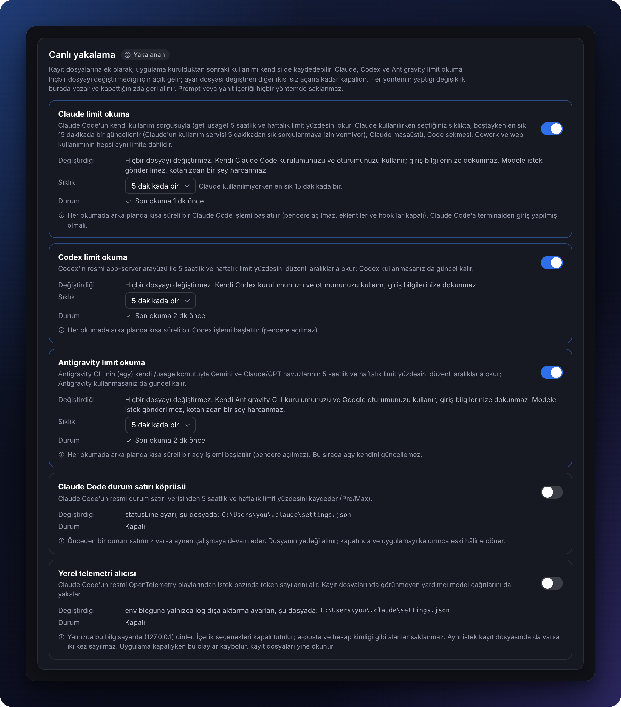

| Yöntem | Ne yapar | Ne gerekir |
|---|---|---|
| **Claude limit okuma** | Claude'u kullanırken limitlerinizi 5 dakikada bir Claude Code'un kendi kullanım sorgusuyla okur. Claude masaüstü, Cowork ve web kullanımı da yansır | Claude Code'da Pro ya da Max hesabıyla oturum (`claude` → `/login`) |
| **Codex limit okuma** | Limitlerinizi Codex'in resmi arayüzüyle 5 dakikada bir ya da **Sıklık** alanında seçtiğiniz aralıkla okur | Oturum açılmış Codex |
| **Antigravity limit okuma** | Gemini ve Claude/GPT limitlerini `agy` aracının `/usage` komutuyla 5 dakikada bir ya da seçtiğiniz aralıkla okur | Antigravity CLI (`agy`). Antigravity uygulaması ve IDE bu okumayı yapamaz |
| **Claude Code durum satırı köprüsü** | Claude Code'un resmi `statusLine` verisinden limitleri ve önbellek yeniden yazmalarını kaydeder. İsterseniz durum satırınıza önbelleğin süresini ve konuşmanın maliyetini de ekler | Terminalde Pro ya da Max hesaplı Claude Code. Claude masaüstündeki Code sekmesi durum satırı çalıştırmaz |
| **Yerel telemetri alıcısı** | Claude Code'un resmi telemetrisinden istek bazında token sayılarını ve Claude hesabını alır. Kayıtlarda olmayan yardımcı çağrıları da yakalar. Yalnızca `127.0.0.1` adresini dinler, bu kuruluma özel bir anahtar kullanır ve prompt kaydını hiçbir zaman açmaz | Claude Code |

Limit okuma için gereken araç kurulu değilse kartında **Kur** düğmesi çıkar. Bu düğme üreticinin kendi kurulum betiğini kullanır (`claude.ai/install`, `chatgpt.com/codex/install` ya da `antigravity.google/cli/install`). Araçta oturum kapalıysa kart nasıl giriş yapacağınızı gösterir. Kendi telemetri kurulumunuz varsa uygulama ona dokunmaz ve sizi uyarır.

## Nasıl çalışır

Her şey sizin bilgisayarınızda olur:

1. Yapay zekâ araçlarınız kullanım kayıtlarını zaten diske yazar.
2. Uygulama her kaydı kaldığı yerden okur ve yerel bir SQLite arşivinde yalnızca sayıları ve meta verileri tutar. Akış sırasındaki ara kayıtlar ile devam ettirilen ya da çatallanan oturumlardaki tekrarlar bir kez sayılır.
3. Limit okumaları açıksa limit yüzdeleri bilgisayarınızdaki `claude`, `codex` ve `agy` üzerinden alınır.
4. Panel, widget, tepsi simgesi ve PDF özet bu arşivi kullanır.

## Güncellemeler

İlk kurulumu tamamladıktan sonra uygulama açılışta ve 6 saatte bir yeni sürüm olup olmadığına bakar. Bunun için yalnızca küçük bir sürüm dosyası indirir ve hiçbir veri göndermez. Güncelleme yalnızca siz onayladıktan sonra ve imzası uygulamaya gömülü anahtarla eşleşirse kurulur. Denetimi **Ayarlar → Güncellemeler** bölümünden kapatabilirsiniz.

## Bilinen sınırlamalar

- **Claude Code toplamları** biraz düşük kalabilir, çünkü ana model dışındaki yardımcı çağrılar kayıtlarda yer almaz.
- **Masaüstü sohbetlerinin** (Claude ve ChatGPT) token sayıları yerelde bulunmaz.
- **Codex'in hızlı katmanı** istek bazında kaydedilmediği için standart fiyat uygulanır.
- **Eski Antigravity konuşmaları** okunmaz. Antigravity'nin eski sürümleri bunları şifreli `.pb` dosyaları olarak saklıyordu.
- **Google AI plan fiyatları** ülkeye ve kampanyaya göre değiştiği için Antigravity planınızın ücretini kendiniz girersiniz.
- **OpenCode** maliyeti, modeli yapan şirketin API fiyatıdır. OpenRouter, GitHub Copilot ya da OpenCode Zen'in aldığı ücret değildir. Üretici fiyatı olmayan model maliyete girmez.
- **Kayıt biçimleri** resmi olarak belgelenmiş değildir ve değişebilir. Uygulama bilmediği alanları atlar ve tanıyamadığı dosyaları **Kaynaklar** ekranında listeler.

## Kaynaktan derleme

Rust 1.99+ ve Node 22.12+ gerekir. Bunlara ek olarak Windows'ta Visual Studio Build Tools (C++), macOS'te Xcode Command Line Tools, Linux'ta WebKitGTK 4.1 ve geliştirme dosyaları gerekir (Debian ve Ubuntu'da `sudo apt install libwebkit2gtk-4.1-dev libayatana-appindicator3-dev librsvg2-dev libxdo-dev libssl-dev`).

```bash
npm --prefix ui install
cargo test -p tracker-core
npx --prefix ui tauri dev
npm --prefix ui run release
```

Yalnızca `npm --prefix ui run dev` komutunu çalıştırırsanız panel tarayıcıda örnek verilerle açılır. Hata bildirimlerinizi ve pull request'lerinizi bekliyorum.

## Kod imzalama politikası

Bkz. [CODE_SIGNING.md](CODE_SIGNING.md).

## Lisans

[MIT](LICENSE)
